# 吴恩达《构建生产级AI语音助手｜Building AI Voice Agents for Production》中英字幕（deepseek） - P3：2.end-to-end-architecture---part-1.zh_en - GPT中英字幕课程资源 - BV1A25LzMEkQ

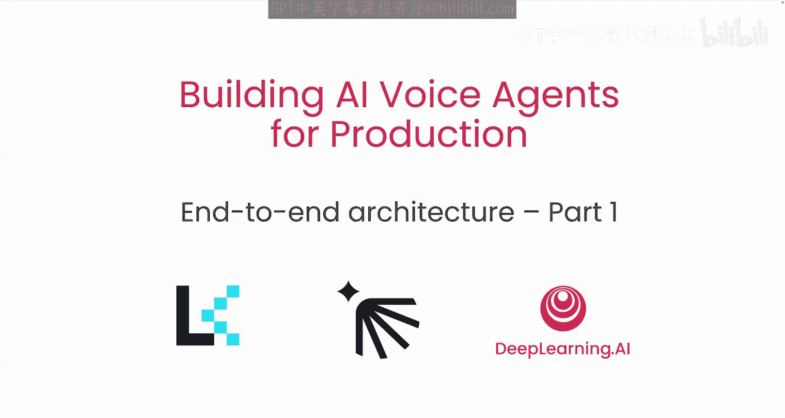

Like most computer programs you write or applications you build。

 there's a balance to strike between the quality of the output and how quickly that output arrives for a voice agent specifically。

 the tradeoff is between two things。 One how quickly can the agent understand your thoughts and respond back to you。

 and two， how well the agent understood your thoughts and how helpful was its response In the next lesson will talk in detail about optimizing everything behind the agent right now。

 though， let's zoom in on the relationship between the user's device and the agent running on a server at the highest level。

 what we need to do here is transfer speech In other words， audio data between two computer programs。

 One computer program is running on a user's device。 It's the application。

 and the other one is the voice agent running on a server What's the ideal way for us to do this。

 Let's spend a bit of time learning about networking protocols。 The Internet。

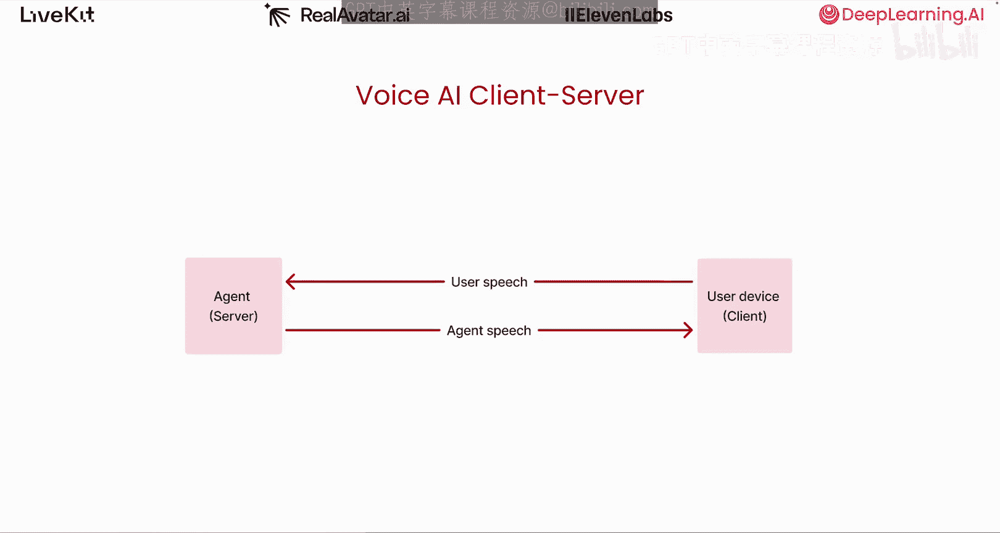

buuilt on IP， the Internet protocol， it's responsible for giving every device and address just like a house。

 if one device wants to send information to another device。

 kind of like sending physical mail between two houses。

 there are a couple of protocols built on top of IP for doing this。TCP and UDP。

 and they each offer different methods of doing so。 TCP prioritizes reliability over latency。

 We can see our user is sending some speech packets using TCP to the agent。

 The Internet is kind of like the world's road system and every packet that is sent out might take a different route through the network。

 In this example， packets 1 and three arrive at the agent first。 While packet2 is still in transit。

 TCP will not provide your application。 In this case， the agent access to packets 1 and3。

 until packet2 arrives。 If packet 2 is lost in transmission， which can happen。

 the TCP protocol on the receiver side will ask the sender to resend packet 2。 Meanwhile。

 your agent program must continue to wait until packet2 successfully arrives。 Now， in your mind。

 imagine a realworld voice agent example。

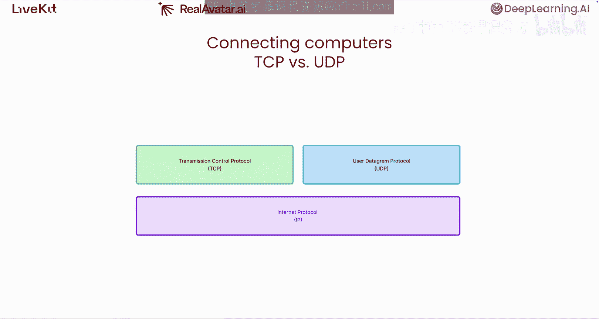

Where tens of thousands of audio packets are being sent every second。

 if even a small subset of those packets are lost or slow to reach the agent。

 it can cause the queue to get backed up or stalled you may see this problem in other places referred to as head of line blocking TCP's design is problematic for voice agent applications as it ultimately leads to stuttering or freezing in audio playback。

 which is a poor user experience。 UDP， on the other hand， prioritizes latency over reliability。

 unlike TCP with UDP， the protocol will hand your agent any and all packets。

 the second they received concretely， as you can see in the diagram your agent has access to packets one and three immediately。

 even though packet2 is still in transit That means your agent can actually make a choice about what to do。

This situation， it can wait for packet2， ignore packet2。

 even interpolate between packets one and three， or maybe just skip packets one and2 and start straight from packet3 for realtime streaming applications like AI voice agents UDP is a better fit where we have full control over what to do in poor networking situations now that we know UDP is the ideal choice for our use case。

 How can we use it It's a lowlel protocol so we'd have to write a lot of code to use it directly Fortunatelyly。

 there are higher level web protocols that are a bit easier to work with there are three that are widely support across every browser。

 desktop and mobile and that's HttP web socket and webrRTC HttP builds on top of TCP which we now know isn't the ideal choice for what we're building It's a stateless protocol meaning it wasn't designed for。

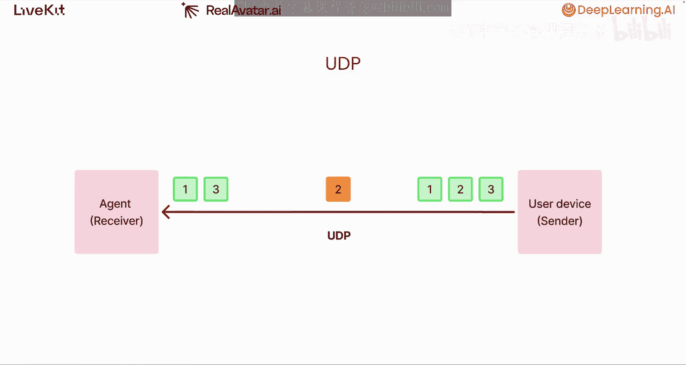

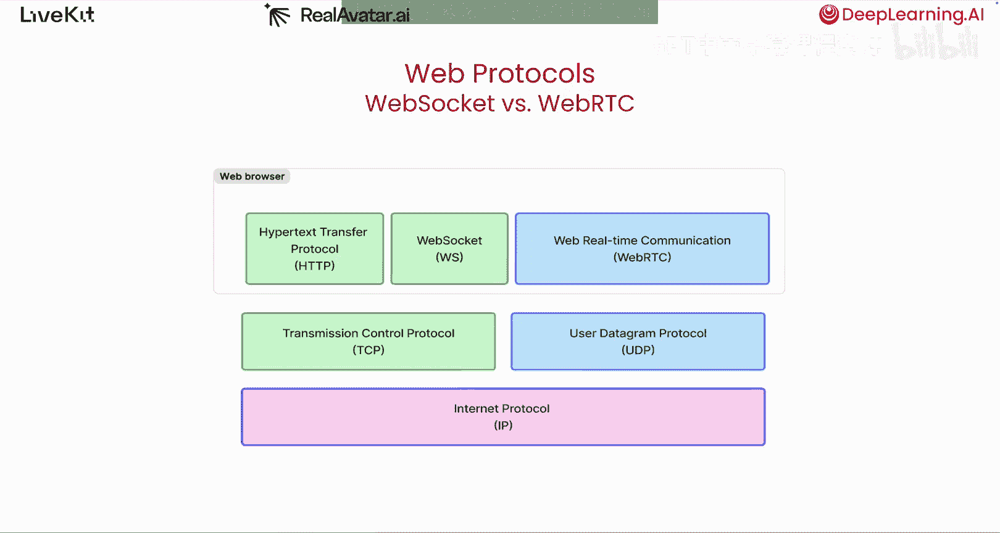

longonglived connections where you're constantly streaming data back and forth with HTTP。

 the sender connects to the receiver， sends some data and then disconnects。

 ignoring the disadvantages of TCP underneath if we still want to use HTTP to exchange voice data between our user and agent we would have to figure out how long to buffer the audio on the sender side establish a connection to the receiver send that buffer along and then disconnect once it's sent not only is this tricky to do well but every time we have to connect and disconnect。

 it takes additional time which adds overall latency and makes handling things like the user interrupting the agent midpech difficult Lastly HTTP stands for hypertext transfer protocol not hyper audio or hyper voiceice or hyper speechch which means it doesn't have higher level abstractions for sending audio data back and forth。

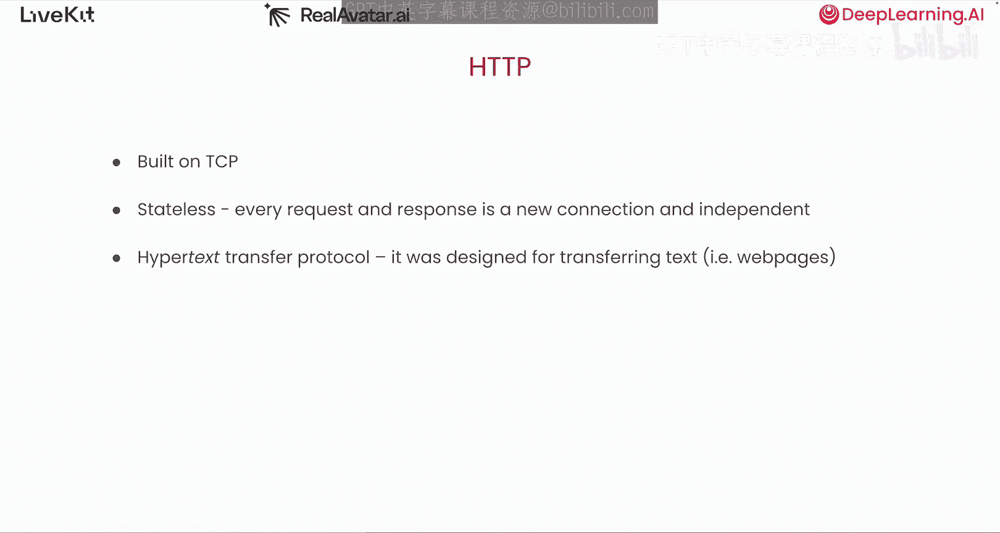

For our use case， exchanging audio data is the primary thing we're doing between client and server。

 So it would be nice to have robust tools for doing that。 Here's a fun fact。 over a decade ago。

 applications like Siri or Alexa actually used HtTP for their voice agents When a user had a question their client application like the Alexa device would record their speech to a local file Once the user finished speaking。

 their client made an Http request to a server endpoint。

 uploading the audio file containing the user's query to Amazon servers。

 the server application processed their query， generated an audio file response and sent that file back in an HttP response Once the audio file was downloaded by the client application it played out through the device speakers now that you know more about how HttP works under the hood you can see why those early voice agents didn't feel that fast or conversational。

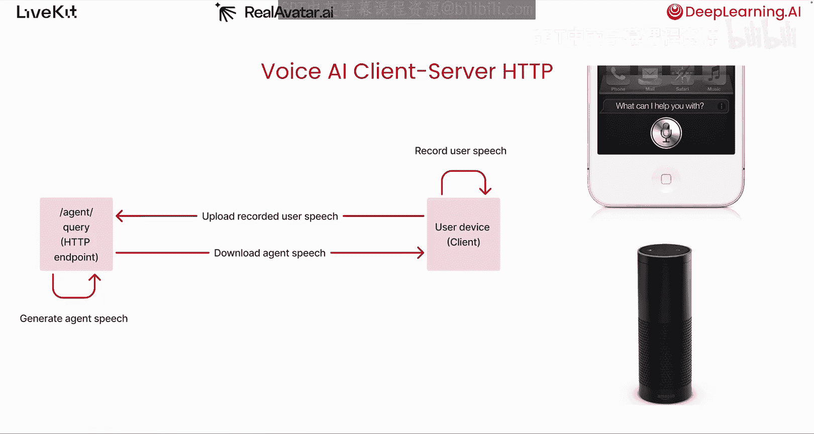

we need is a stateful architecture， one where we can establish a persistent connection between the user and agent and constantly stream audio back and forth either side can process speech on the fly just like a human does with their ears and stream speech back as it's generated by the agent or spoken by the user with a stateful system the agent can build up conversational history and detect when the user is done speaking or interrupting it in real time is there a protocol which can help us accomplish this web socket does support persistent connections and allows us to stream arbitrary data back and forth。

 but like HGTP it's built on TCP so it fundamentally suffers from the same problems It also doesn't have any special facilities for sending audio data back and forth WebRTC is the other widely supported protocol that supports longli connection。

And bidirectional data streaming It's built on UDP and was specifically designed for transferring audio or video data between two computers at a protocol level。

 WebrRTC measures a network in real time and paces the sending of audio packets so that they arrive as smoothly and consistently as possible on the receiver side。

 it also automatically compresses audio data before it's sent over the wire。

 which helps with latency。 the more data one side needs to send the longer it takes For example。

5 seconds worth of speech data that's sent uncompressed over an HGTP request or streamed with a web socket becomes just3% of the data size when it's compressed by the WebrRTC protocol Lastly。

 webRTC automatically timestamps every packet sent over the wire。

 making handling things like interruptions and knowing exactly when that interruption occurred trivial。

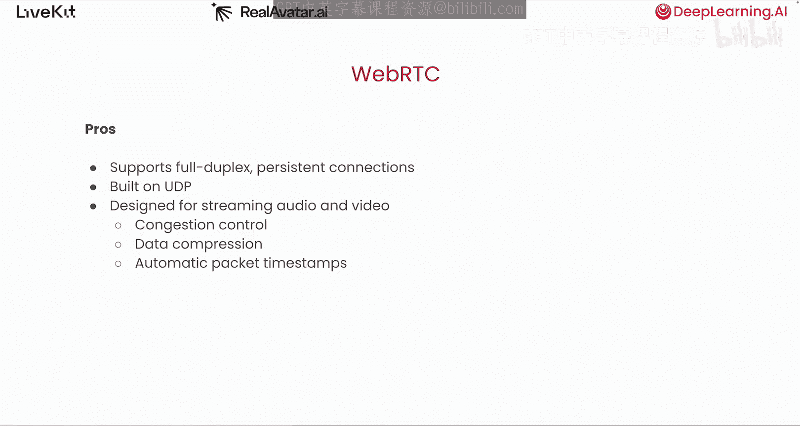

WebrRTC is used at scale by some of the most widely adopted applications in the world。 Discord。

 Google Meet， Zoom and Tiktok all use it for realtime audio and video streaming。

 WebrRTC does come with some challenges though The first one is complexity。

 It's just really hard to work with。 This is the full call stack just to establish a oneon one call between a sender and receiver。

 Another challenge of WebrRTC is scale。 The standard webrRTC protocol is a peer topeer protocol。

 That implies that if we use standard webrRTC for our voice agent application。

 Your user and agent would be directly connected。 Sp would stream directly from source to destination over the public internet。

 as we learned earlier， the public internet is kind of like the world road system with the equivalent of freeways。

 residential streets， one lane roads， potholes， and yeah。

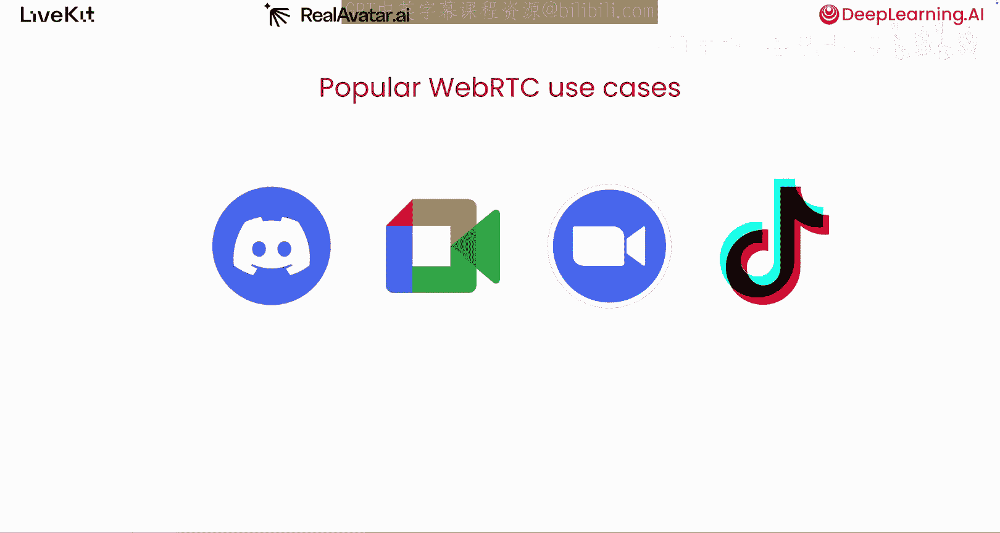

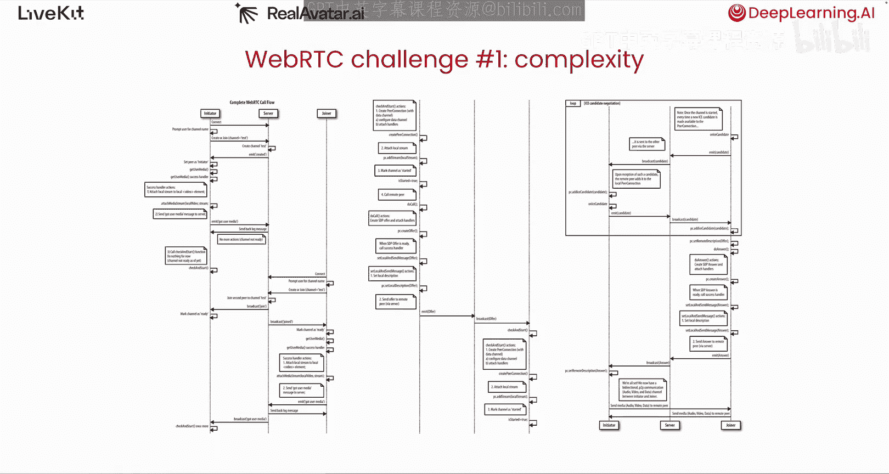

Even rush hour， everyone else's data packets are traveling along the same roads as yours。

 the longer your packets have to travel， the more of these road hazards they'll end up encountering and the longer it will take for those packets to arrive at their destination One way to solve this problem is to deploy your agent all around the world so all of your users regardless of where they are have a relatively short path to exchange audio between them and the agent。

 This is a pretty serious undertaking though， and it comes with a lot of operational complexity。

 Fortunatelyly， there's infrastructure which solves both of the challenges that come with using standard webrRTC。

 Live kitt is an open source project that makes building and scaling a voice agent using WebrRTC easier than using HttP or web socket on the client' side Live kitt has open source Sks across every platform you can drop into your application It streamlines establishing a persistent connection between your user and agent。

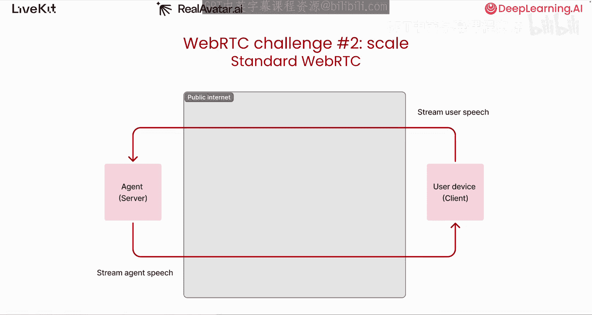

And streaming speech back and forth on the server side。

 Livekit has an open source framework that makes building an AI voice agent simple。

 We'll talk more about the agent side in the next lesson。 Remember that road system we learned about。

 It turns out that there's another way to avoid traffic。 Instead of taking the public streets。

 What if we could drive along private tunnels through the Internet。

 Livefi cloud is a set of WebrRTC servers distributed all around the world that form a global network of tunnels。

 When your user wants to stream speech data to your agent They can send their data over the public internet to the nearest livekit cloud server。

 That hop from user' device to the nearest station is short。 So there's not much added latency。

 Once packets reach the Li cloud server， they travel through this tunnel network on an optimized path with little to no congestion。

 The packets will exit Liveki's network at the server closest to where the agent is running。😊。

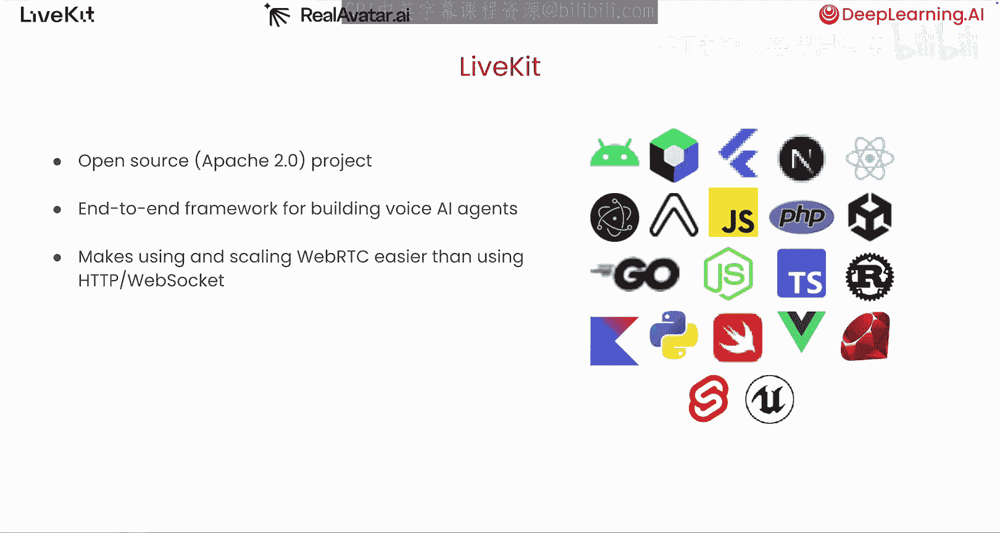

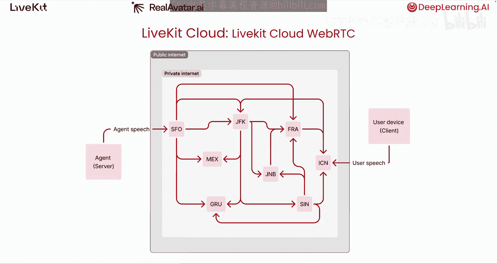

And make a short final trip to the agent itself In practice。

 this strategy reduces network latency between the user and your agent by about 20 to 50%。

 If you're interested in seeing live kitt in action。

 the openaiI team used Live kit to build ChattptT advanced voice mode when you talk to their voice agent。

 all of that voice data is going back and forth through LiveKt's cloud network now that you have a good understanding of what's happening under the hood between the user's device and your agent。

 let's talk more about the voice agent and what's going on behind the scenes once your user's speech reaches the server。

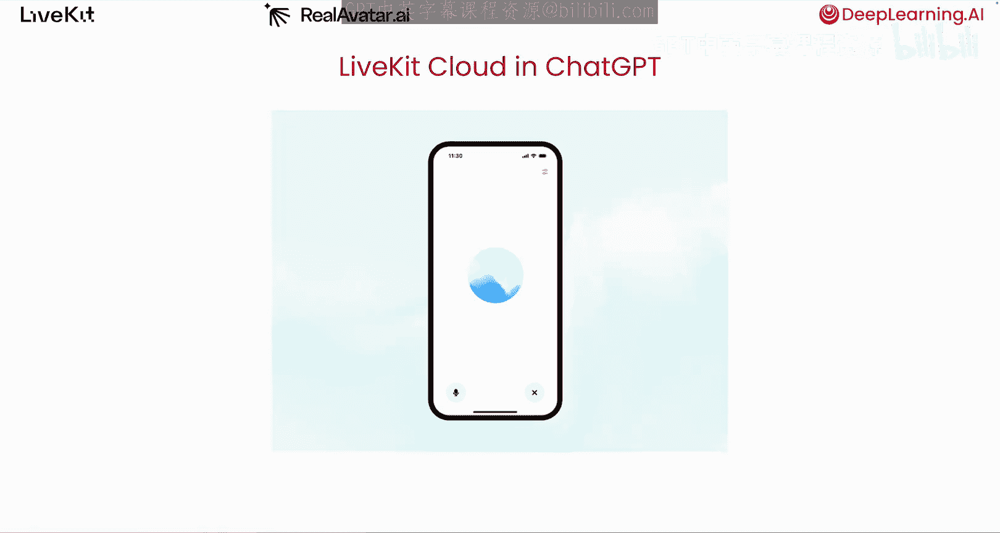