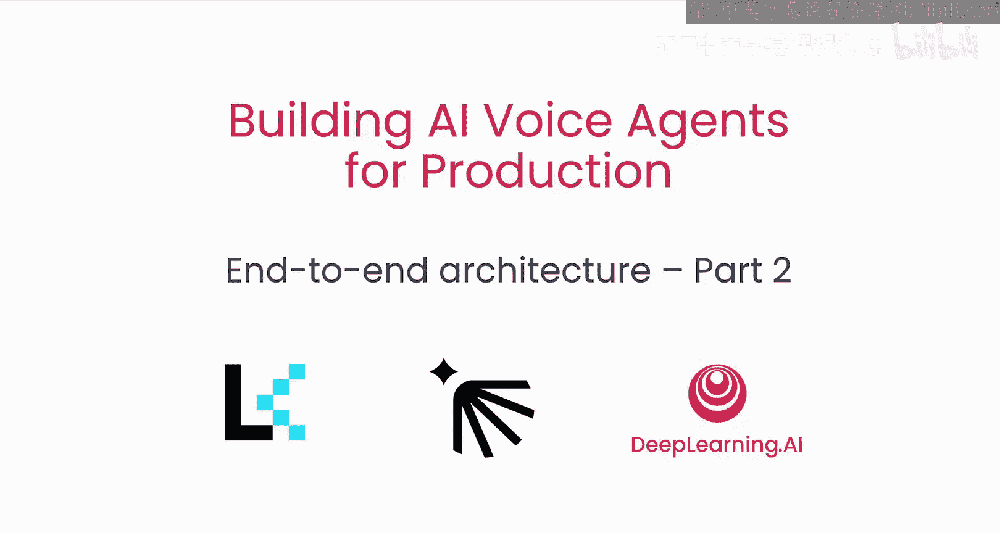
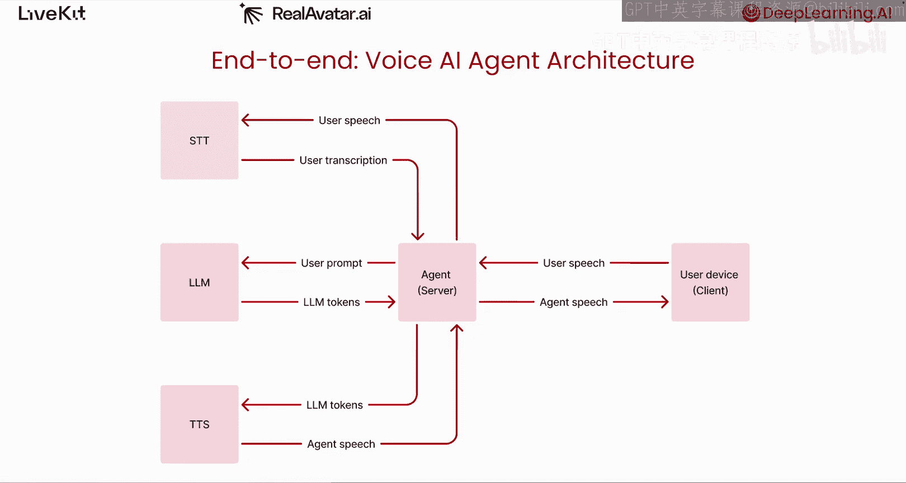
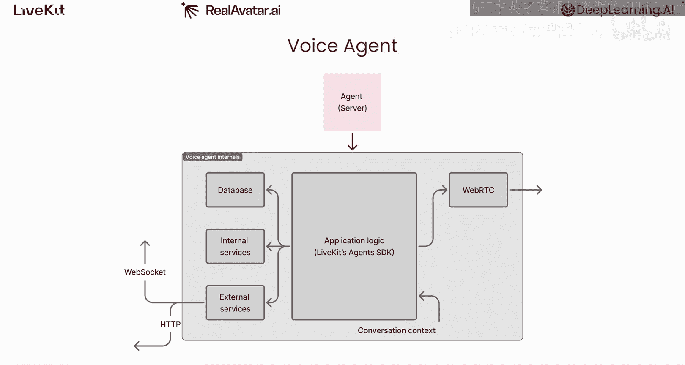
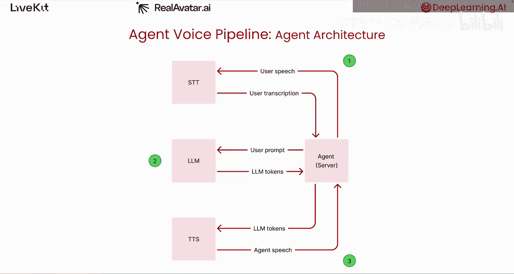
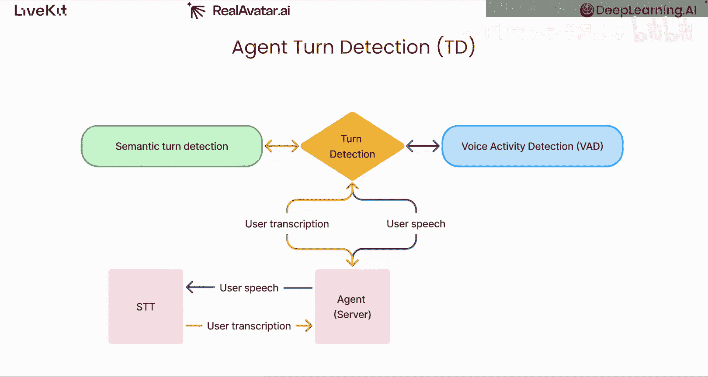
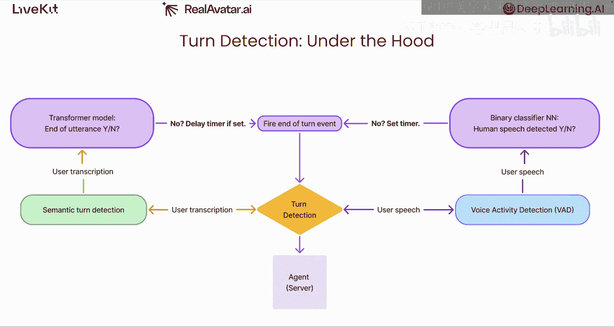
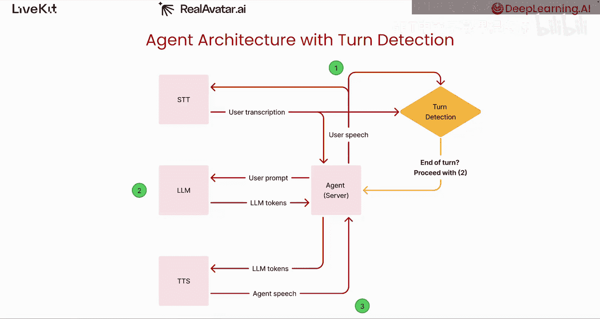
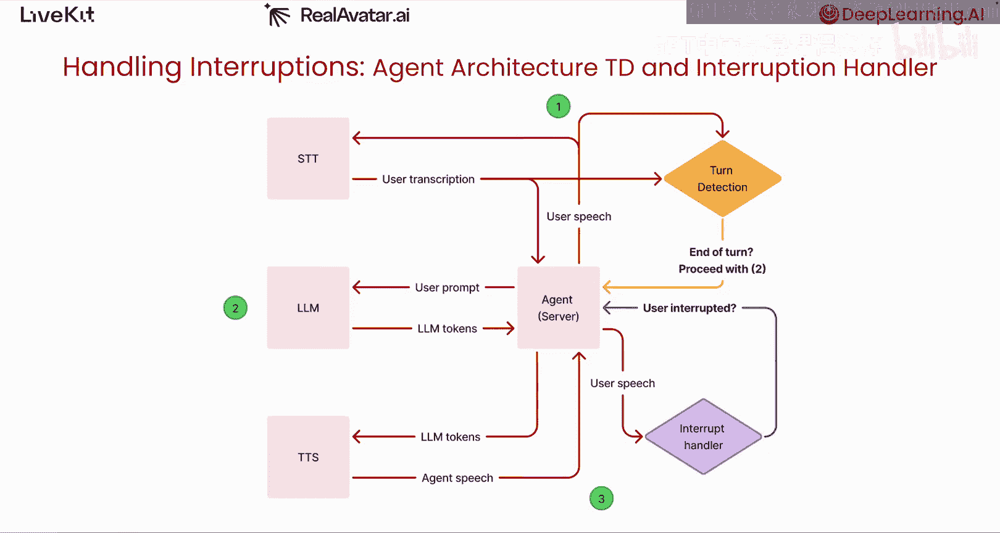
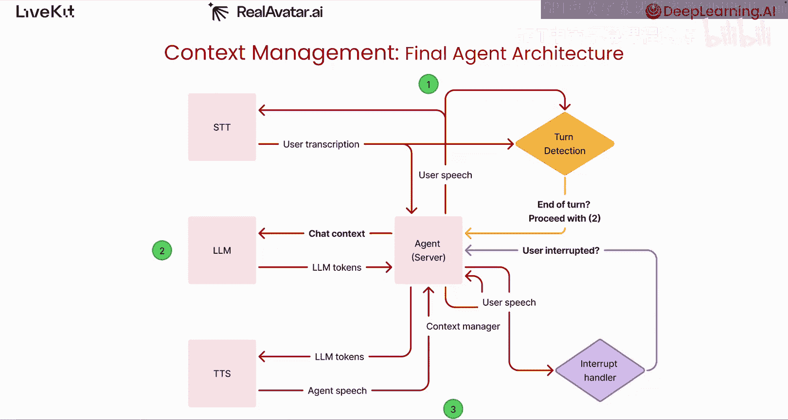
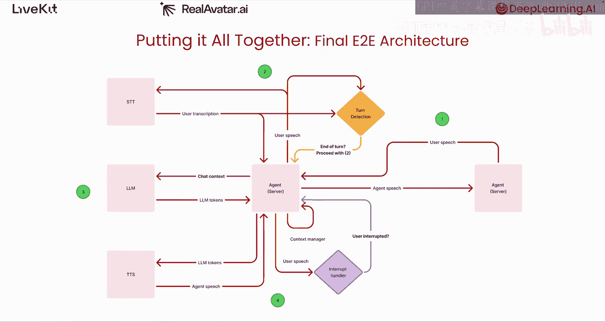

# 吴恩达《构建生产级AI语音助手｜Building AI Voice Agents for Production》中英字幕（deepseek） - P4：3.end-to-end-architecture---part-2.zh_en - GPT中英字幕课程资源 - BV1A25LzMEkQ

In the previous lesson， we discussed how we'll connect our client device to the voice agent via WebrRTC。

That's great。 your user can now speak to your agent with less than 30 to 50 milliseconds of latency。

 but what is a voice agent anyway， a voice agent is simply a stateful computer program that can consume and process voice data streaming into it like from a user speaking into their phone and it can generate a spoken response to send back to that user most of the application logic of your agent program will be specific to your use case but voice agents built using Live kit's agent SDK have a persistent webTC connection linking it to one or more client devices LiveKs agent SDK also takes care of things like managing the conversation context and spinning up an instance of your agent for every user that wants to speak to it every agent instance may keep a database connection for performing actions like Rag interact with libraries or services running on the same machine or make HtTP requests or establish website。

Connections to external services for things like speech to textex or LLM inference In the lessons that follow。

 you'll use LiveKs agents SDK for building your voice agent。

 you'll build your agent in Python but you can also use no JS as well How do we give the agent the ability to listen think and speak back to the user Let's zoom in on that part。

 This is what's known as a pipeline or cascaded or component model voice architecture as voice input data from user streams into the agent It passes through an ordered series of steps before a voice response from the agent is sent back to the user First the agent relays the user's speech to a smaller speech to textex AI model often abbreviated STT the STT model converts the speech to text in real time and passes it back to the agent Once the user is。

speakingking and the agent has the full transcription of what the user said it relays that full transcription to an LLM as the user's prompt。

 the LLM takes that prompt and runs inference against it as output tokens are generated they stream back out to the agent from the LLM The agent collects and organizes these tokens for every sentence that it collects the agent will relay that sentence to another smaller text to speech model often abbreviated TtS。

 The TtS model will convert those sentences sent by the agent back into speech and stream them to the agent the agent takes those and will relay the bytes of voice data as it receives them from TtS back to the client device over the persistent webTC connection we talked about in the previous lesson and so that's the full endto end pipeline that your agent is running through where it takes user speech converts。

Into text， puts that text through an LLM。Takes the tokens coming out of the LLM pipes that through TtS and then from TtS streams the audio back to the user I want to turn our attention now。

 though， to one of the hardest problems in building convincingly human voice agents and that's turn detection in a human conversation this concept of alternating between speaking and listening is known as turntaking a human is quite good at sort of automatically knowing when they should speak or listen Turn detection is a heuristic of voice agent uses to know when the user is done speaking and it can respond Con turn detection systems combined two signals The first is signal processing I the user actually speaking or not and the second is semantic processing what did the user actually say Here's how this is done typically as user audio streams into the。

It's not just sent to STT， but in parallel， it's also streamed into something called voice activity detection or VAD for short VD analyzes the audio signal It's a small binary classifier neural network that simply outputs whether human speech was detected in the input sample or not when the bit flips from human speech detected to not detected。

 VD starts a timer for a developer configurable number of milliseconds before firing an event marking the end of the user's turn If VaD detects human speech again before the timer has fired everything is reset as the user's speech is converted into text by STT and send back to the agent。

 the agent also forwards the transcriptions from STT to another part of the turn detection system a semantic turn detector model Live kit has an open source。

Moel that we've trained in house it takes in a user's transcribed speech and the transcriptions from the last three or four previous turns in the conversation and outputs a prediction whether it thinks the user is done speaking or not based on what they've said a VaD detected silence and set a timer to fire the end of turn event but the semantic model believes the user isn't done speaking yet。

 for example， if they're just pausing between thoughts。

 the turn detector will delay the timer from firing for a configurable amount of time and now that we have an understanding of turn detection。

 this is what our overall voice agent architecture looks like with it incorporated。

 only when the turn detection system has fired an end of turn event can the agent proceed to forwarding the users transcribed speech to the LLM for inference VD isn't just used for turn detection either。

It's also used for interruption handling to mimic the dynamics of two humans having a conversation。

 We need to be able to handle the case when a user interrupts the voice agent midpech。

 This could happen for a variety of reasons， including the LLM may be speaking more than necessary or the user changed their mind about something the user may want to correct themselves even under the hood since the user's speech is already being passed into VD via turn detection we're using the presence of human speech as opposed to the absence of human speech and turn detection to signal an interruption when an interruption occurs。

 every part of the voice pipeline downstream is flushed if the LLM was performing inference at that time that stopped if there was any agent's speech being generated by TTS that's also stopped one final update to our overall architecture here is context management when it's the agent's。

To think and speak not only is the most recent transcription of what the user said sent to the LLM。

 but the full history of everything that's been said thus far by either party during that session is also sent along。

 This includes things like function calls and their results。

 which is part of most production grade voice agents。

 Live kits agents SDK also automatically synchronizes the LLM context when the user interrupts the agent。

 It uses timestamps to determine the last thing the user heard played back from the agent and aligns the conversation on the agent side to this point。

 And now we put it all together。 That's it。 In the next lesson。

 we're going to take all of these concepts in theory we've discussed here。

 and we're going to put them into practice by building a voice agent that you can speak to。

