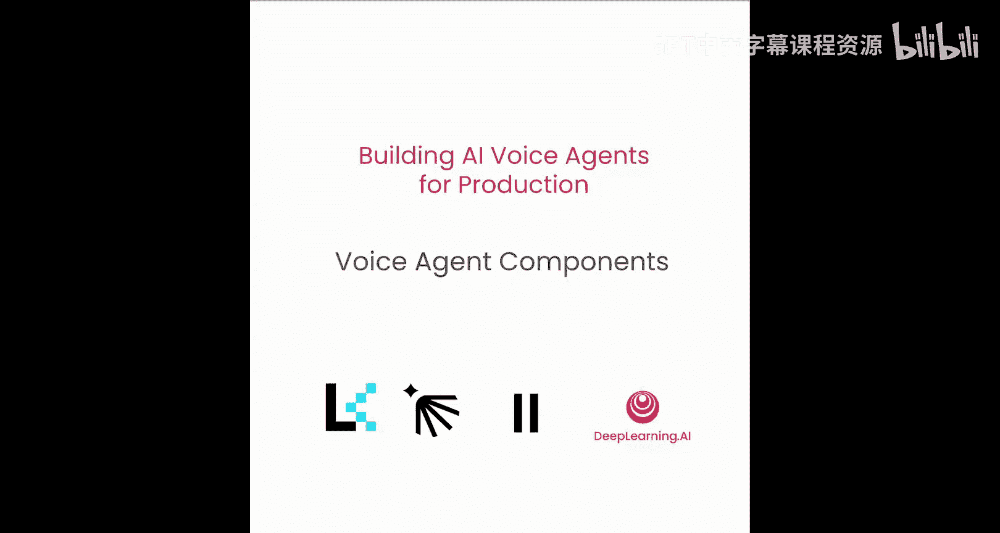
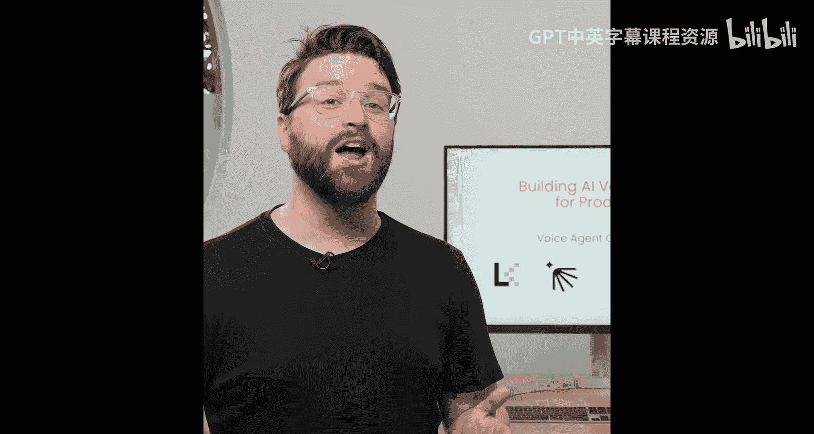
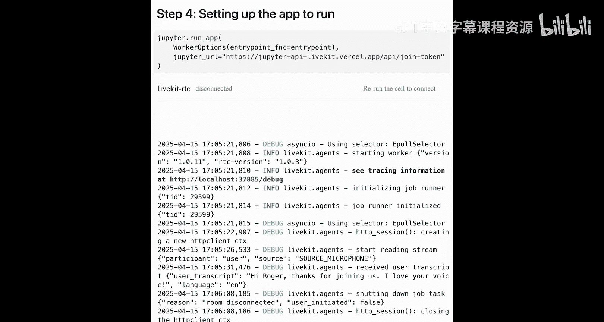

# 吴恩达《构建生产级AI语音助手｜Building AI Voice Agents for Production》中英字幕（deepseek） - P5：4.voice-agent-components.zh_en - GPT中英字幕课程资源 - BV1A25LzMEkQ

In this lesson， we're going to walk through the different building blocks of a voice agent from the moment someone starts speaking all the way to when the agent responds。

 We'll break down each stage in the pipeline。 Talk about tradeoffs and look at where you can make decisions that really shape the user experience。

 whether you're optimizing for speed， quality or control。

 understanding how each layerwork will help you build smarter， more effective voice agents。

 There are two main types of voice agents first， there's the pipeline approach。

 which rest walk through in detail earlier。 And then there's speech to speech or realtime agents。

 which Naalina introduce back in the first lesson。 speech to speech agents are usually simpler to implement。

 and they can sound really natural。 But in exchange， you give up control。

 Since the model takes in speech and output speech。

 It's harder to see or tweak what's happening in the middle。 Pi agents on the other hand。

 have more moving parts， and yes， more complexity， but you get fine grain control over each stage。

 you can see and manage exactly what's coming in and going out at each step， which can be a big deal。

😊。

For real world applications。 Every system has tradeoffs at some point。

 you'll probably have to choose between latency， quality and cost。

 One of the big advantages of using a pipeline approach is that you don't have to make that tradeoff globally。

 you can change out different parts of your system based on what matters most for your use case。

 In the example， Nealina gave earlier， if you're doing something like restaurant bookings。

 you might want to optimize for LM reasoning。 getting the best possible response from the model。

 but if you're handling something like medical triage where accurate transcription is critical that it might make more sense to spend some more of your latency budget on the speech to text layer instead。

 All， Let's talk about what really matters when the rubber meets the road。

 Some of the key things to keep in mind as you're designing each of these sections。

 starting with voice activity detection。 This component only sends audio when it detects someone is actually speaking。

 That's a big deal。 It reduces hallucinations from your speech to text model and it cuts down on costs since you're not sending silence for transcription。

There's no voice to tran。 Then we've got the speech to text layer。

 This is where we need to make some key decisions like which languages we want to support。

 whether we're doing direct speech translation， and whether we want to use a specially trained model for recognizing voice in narrower use cases like telephony The final two steps in your voice agent are the LLM layer and text to speech。

 Now the LLM layer is the one that people are already most familiar with。

 This is where we run text to text inference to get a response from the large language model。

 If you want to add things like content filtering。 this is the layer where you do it。

 It's where you'll see the biggest latency hits depending on which model you're using。 And finally。

 you have text to speech or TtS。 This layer takes the text from the LLM and turns it back into speech。

 the TtS layer is where you'll choose things like which voice or accent to use and whether you want to apply any pronunciation overrides for specific words or phrases that you want spoken in a certain way。

 Now let's put everything we learned into action and get coding first will import the necessary。

Live kit agent classes and plugins， including Open AI for speech to text， and as the inference layer。

 11 Las for TTS and Clero for voice activity detection will also import dotN so we can get our environment variables into memory and loggings that we can see what's going on with her agent。

We define our assistant class that inherits from live kit agent class。

 This assistant is given basic instructions about its role and will keep track of what's being said so far in the conversation。

 By default， request that are sent to an LM for response or stateless。

 but we want to maintain a conversation with history。

 The assistant will keep all of the messages that we've sent back and forth in context so that it can hold a conversation that's aware of the things we've already said。

 It also keeps track of whose turn it is to talk。 If it can be interrupted and which if any tools that it has at its disposal to answer questions for the user。

 Today， we're just going to set the instructions parameter and inherit all of the other defaults from the base agent。

 Next， we'll define an asynchronous entry point function。

 which will run when live kit tells our agent that it's needed。 By default。

 every new room will request an agent Room are the primitive that connect agent sessions to users when an agent and a user are having a conversation。

 that's happening inside a room。 step by step， this entry point function connects to a。

Liveroom we define a agent session with all necessary plugins that will need to listen and speak to the user and we assign our assistant to the session。

Finally， we use the Live kitt agent Jupiter CLI command to register the application with Live kitt。

 This will allow our agent to be dispatched to rooms When we run this next cell。

 we'll be able to have a conversation with our agent。Hello there。 It's wonderful to have you here。

 How can I assist you today。😊，Hi there。 What kind of things can you help with， Hi。

 I'm here to help with a wide range of topics。 whether you need information。

 help solving a problem or just one to chat。 feel free to ask about anything。 Great。

 so our agent works。 Now that our agent is running， let's change the voice out for something else。😊。

So we're going to scroll back up here to where we define our custom agent。

And we're going to add a voice ID。Now when we run our agent。Hello there。

 It's wonderful to have you here。 How can I assist you today， Hi， Roger， thanks for joining us。

 I love your voice。😊，Thank you so much。 It's great to be here with you。

 How can I make your day better。 So to recap from this lesson。

 we were able to get our agent running and we were able to change some of the settings so that we could have a different voice In the next lesson。

 we'll learn a little bit about metrics and how we can optimize our agents。😊。

