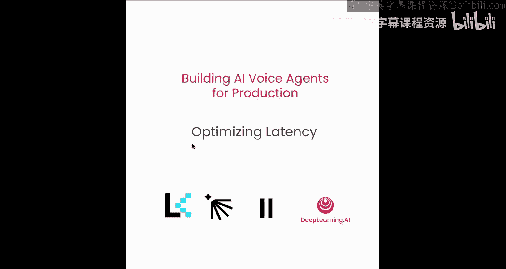
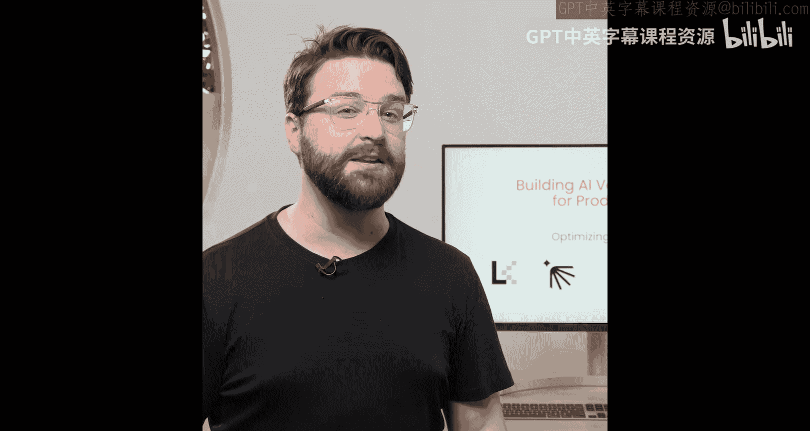
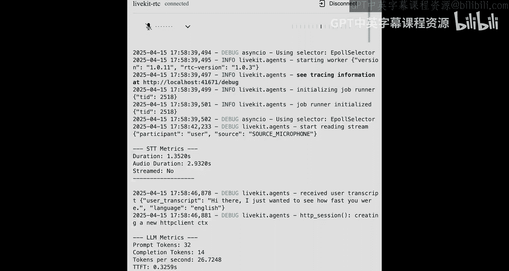

# 吴恩达《构建生产级AI语音助手｜Building AI Voice Agents for Production》中英字幕（deepseek） - P6：5.optimizing-latency.zh_en - GPT中英字幕课程资源 - BV1A25LzMEkQ

Voice agents live or die by latency In this lesson。

 will walk through each stage of the voice pipeline and look at where delays happen and how to reduce them from speech detection to text generation and back to voice will cover the key levers that you can pull to make your agent feel fast and responsive。

 A critical part of keeping things fast， comes from the client。 Let's talk a bit more about Web RRTC。

 Web RRTC is an open source project that enables realtime communication directly in web browsers and mobile apps。

 The key thing here is it lets you share audio， video and data without needing any plugins or extra software。

 It uses the get user media API to access your device's camera and microphone and also support screen sharing through the get display media methods。

 And if you want to go beyond just audio and video。

 You can use RTC data channels for direct data exchange。 All right。

 let's talk about optimizing the speech pipeline。 You probably remember the main components here。

 We've got voice activity detection， which identifies when someone is speaking。 Turn detection。😊。

Helps manage speaker transitions and speech to text which converts audio into text Now by default。

 Vad and turn detection are blocking， and that's intentional。

 we don't want to send audio frames unless we're confident it's actually voice with VD we usually lose about 15 to 20 milliseconds at the start of each utterance just to confirm that speech is happening。

 Turn detection is a bit different It's not blocking for transcription。

 It listens for the end of a user's turn and fires an event when that turn is done but it doesn't stop transcription from happening while someone is still speaking。

 So here's how it works in practice。 If someone is speaking a paragraph。

 say five sentences speech to text transcribes continuously in segments as the person talks Those first few segments go off to the transcribeber in real time。

 once turn detection signals that the speaker is done。

 that's when we send the full transcript to the LLM。 So it's not all waiting on one big blob。

 It's a stream and turn detection just helps us know when to move forward。

 Next up is the LLM stage LLMs generate responses token by token。

Even the model itself doesn't know exactly how long the full response will be until it's finished So it wouldn't make sense for us to wait until the whole response is ready。

 Instead， we stream the output from the LLM to the text to speech engine as it's being generated。

 The most important metric to track here is time to first token。

 That's how long it takes for the model to produce the very first part of its response。

 it usually defines how long users are waiting before anything starts happening。

 everything after that happens asynchronously as the LLM keeps generating tokens we're already passing that text off to the TtS engine to start synthesizing speech So if you want to cut down your overall response time。

 time to first token is where you want focus your latency optimizations。 Finally。

 we have text to speech streaming in this stage we're streaming directly from the LLm to the TtS engine。

 which gives us the best latency Now unlike the LLM stage where time tofi token is the key metric here the most important thing to watch is time to first by That's when we actually start hearing audio come out of the TTS engine。

 The total time it takes to render the full response。

Is less critical as long as rendering happens faster than the engine can speak it since it takes time to physically speak the utterance。

 the model has a buffer。 So again， for TtS performance。

 the thing to optimize is that time to first byte。 that's what determines how quickly the voice actually starts responding。

 Let's see how fast agent really is and tracks some metrics。

 So the first step here is going to be the same as in the last module。

 We're going to import our agent plugins and modules。 We are going have to add a few extras。

 though we're going import the metric classes that define the structure of the data collected from each part of the voice pipeline。

 these classes help us access performance information like response time token counts。

 audio durations， things like that。 We're also going to import asynch ios。

 so we can run asynchronous tasks。 This lets us handle metrics collection and other background work without blocking the main flow of the agent。

 Next， we're going to define our agent exactly as we did in the last one。

 But this time we're going to call it the metrics agent。 Next。

 we're going to add our metrics collection hooks。These handlers let us collect performance data from each part of the pipeline and trigger callback functions when metrics are available。

 The first thing that we're adding is our LLM metrics。

 So if that's for time to first token and tokens per second。 Next。

 we're going to add our STT metrics wrapper。And this is going to tell us the duration of input and whether streaming was used。

 Next， we'll add our end of utterance metrics wrapper。

 And this one here is going to tell us how long it took us to detect that someone was speaking with Vad and also how long transcription took。

Lastly， our text to speech metrics wrapper。 This one is going to be time to first bite total render time。

 This is the one that says how fast the agent is starting to speak back to us。

 Now that we have our wrappers defined， we are going to actually define the callback functions that are going to collect the metrics and print them to the console。

First are LLM metrics。The things that we're tracking here are the prompt tokens， completion tokens。

 tokens per second。 And that time to first token。 that's so critical。 Next。

 we'll add our speech to text metrics。 So the total duration of audio。

 and whether or not the response was streamed。 Next is our end of utterance metrics This is the one that tells us how long the speech to text took to run and how long vad took。

 Lastly， is our text to speech metrics。 This is the time to first bytes。

 So how long it takes until we can actually hear our agent speaking， as well as the duration。

 audio duration and whether or not the response was streamed。 Next。

 we're going to define our entry point， just like we did in the last agent。Then we can run our agent。

Hi， I wanted to see how fast you were。Hello， I'm designed to respond quickly to your questions and requests。

 how can I assist you today？Now， as we scroll down through our logging。

 we can see all of our speech to text metrics。 We can see our LLM metrics。

 including tokens per second in time to first token。

 and then we can see how long it took for those critical first bys to come through。 Okay。

 so let's make a change right now， our time to first token through our LLM was 0。84 seconds。

 but I think we can make that a little bit better。 We're going to change our LLM model from G 40 to G 40 mini。

 This is a slightly less capable model than 40。 but it responds a lot more quickly。😊。

Let's try talking to our agent again using 40 minii。Hi there， I just wanted to see how fast you are。

I'm ready to help。 What do you need assistance with？Now if we scroll down to look at our LLM metrics。

 we can see our time to first token was almost twice as fast as when we used40。

 so just to recap in this lesson， we rebuilt our agent。

 added all the ability for us to track metrics。And then reduced the response time of our LLM by almost half。

