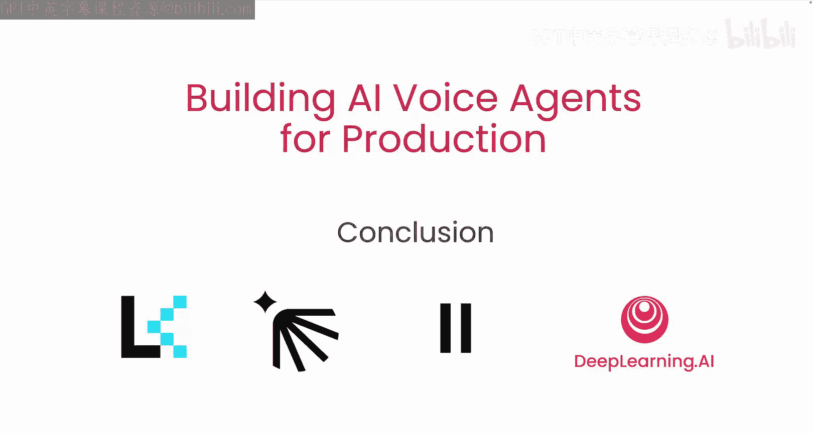

# 吴恩达《构建生产级AI语音助手｜Building AI Voice Agents for Production》中英字幕（deepseek） - P7：6.conclusion.zh_en - GPT中英字幕课程资源 - BV1A25LzMEkQ

In this course， you learned about the components of an AI voice agent pipeline and how to combine them into a system with low latency communications and agent hosting to build a conversational AI agent。

 We hope this was helpful， and we look forward to talking with the agency build。😊。

