# 吴恩达《检索增强生成｜Retrieval Augmented Generation (RAG)》中英字幕（Claude-3.7-s） - P12：11_关键词搜索：TF-IDF算法.zh_en - GPT中英字幕课程资源 - BV1qsgLzmEg6

Let's start our exploration of search techniques with keyword search。

This technique has powered retrieval in databases and search engines for decades。

 and yet its simplicity and effectiveness make it a key component of retrieval in modern ragg systems。

 Let's have a look at how it works and what strengths it brings to your retriever pipeline。

Keyword search is a technique that retrieves documents based on whether they share words in common with the prompt。

The idea is basically that documents that contain a lot of words from the prompt。

Are more likely to be relevant。

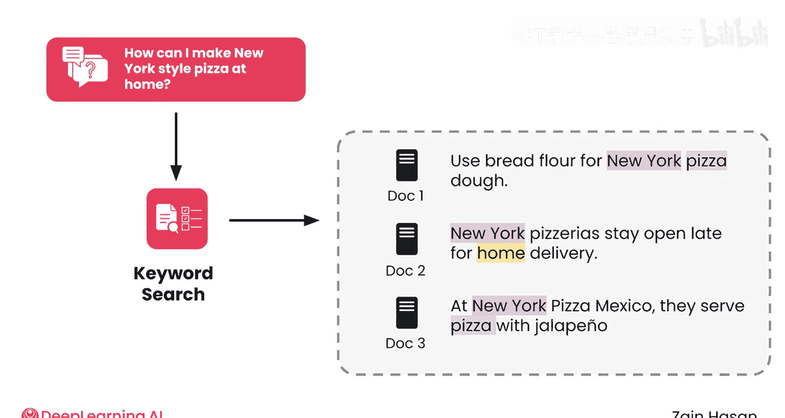

Here's how it works。 Both the prompt and each document are treated as a bag of words。

 This means the order of the words is totally ignored。

 and all that matters is which words are in the text。 and how often， For example， the text。

 making pizza without a pizza oven contains the word pizza twice。

 and the words making without a and oven once。

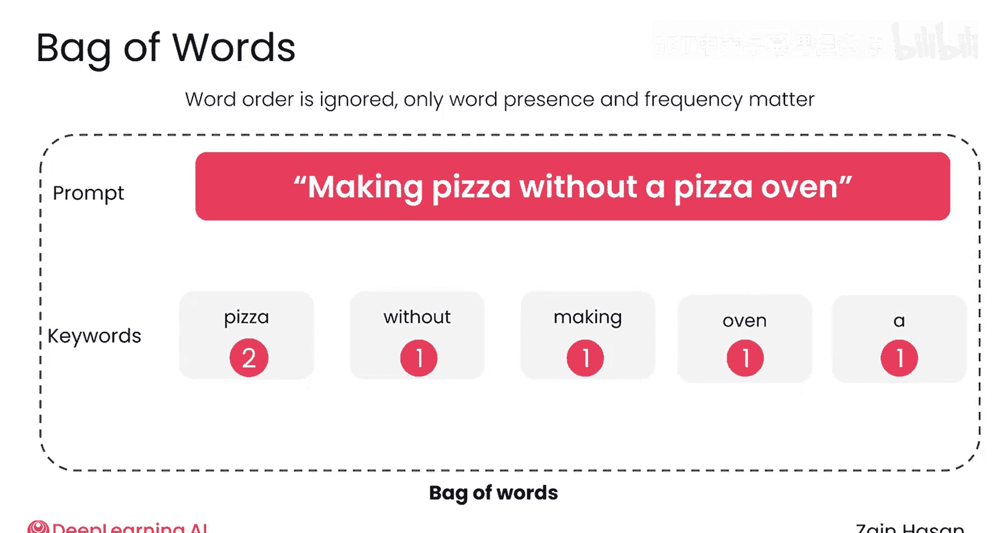

These word counts are stored inside of a vector。

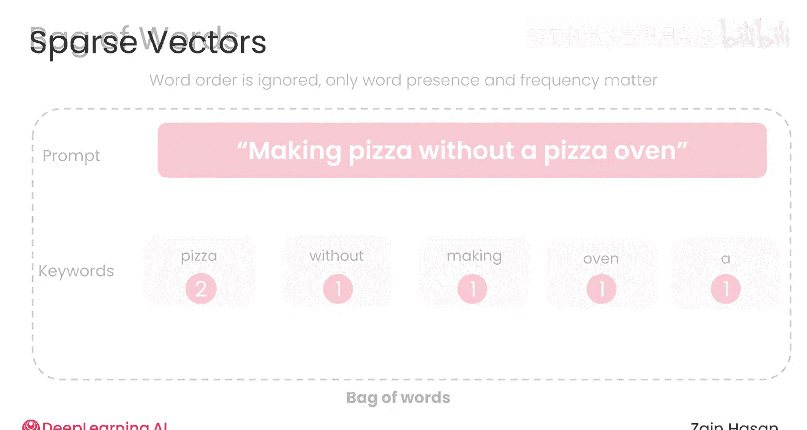

The vector has one spot for each word in the system's vocabulary。

 so there could easily be tens of thousands of spots。

 Each number in the vector counts how often that word appears in the text。

 Since most of the locations hold zeros， these are also called sparse vectors。

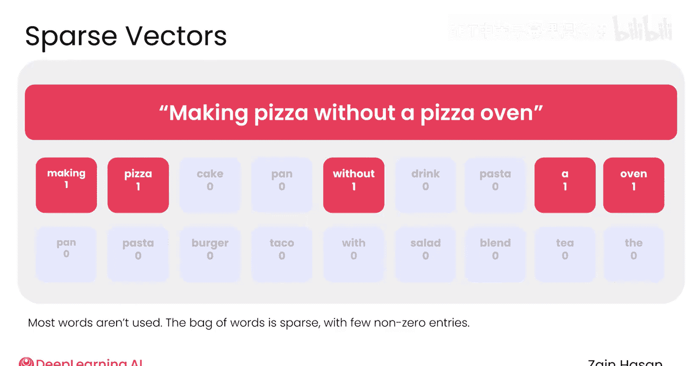

To prepare the knowledge base for retrieval， a sparse vector is generated for each document。

All of these vectors can be arranged in a grid， which is referred to as a term document matrix。

Each column is a different document and each row is a different word。

This is also sometimes called an inverted index。Since it makes it easy to start from a word and find every document that contains it。

It's inverted because usually you start from a document and think of which words it contains。

 But here you're starting from a word。And finding which documents include that word。

This inverted index can be created once prior to processing any search。

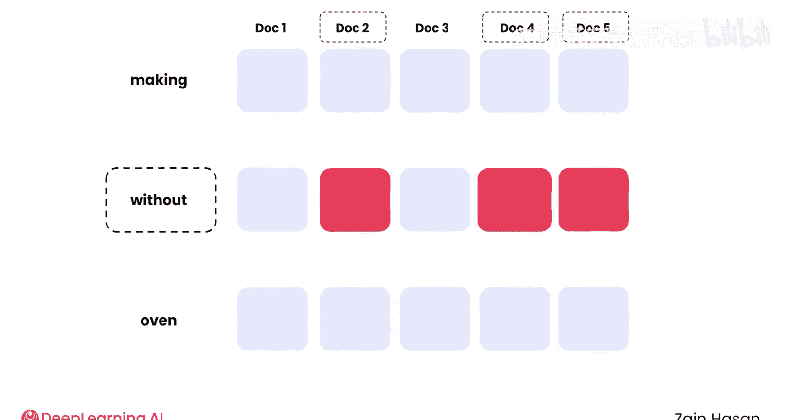

When a prompt is sent to the retriever， a sparse vector is quickly generated for the prompt。

Now that each document and the prompt have a sparse vector。

 you're ready to start scoring and ranking documents。

The simplest approach is to just award documents， points when they contain words in the prompt。

 Each word in the prompt is called a keyword。In the example prompt from before。

 you'd start with the first keyword making。And find its row in the index。

 Then youll go across that row and award one point to every document that contains at least one copy of the keyword。

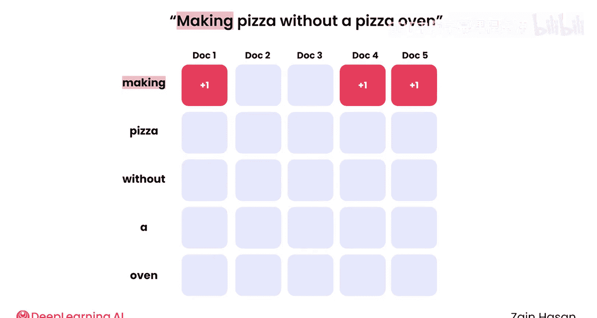

You then complete the same process for every other keyword in the prompt。

 If a document contains the keyword， it scores a point。 This prompt contains five keywords。

 Me the highest possible score is 5。Once you're done， the total scores can be used to rank documents。

 and the documents with the highest scores are retrieved。

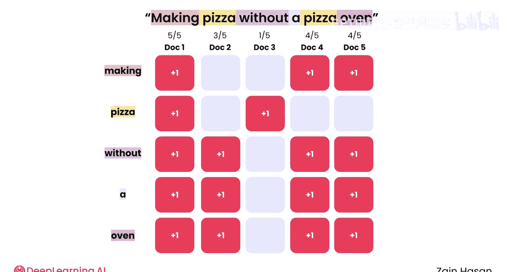

One shortcoming of the simple scoring approach is that it doesn't capture whether a document contains keywords multiple times。

Which likely indicates greater relevance。A simple fix is to increase a document score every time it contains a keyword。

 not just the first。Now you can find the row of each keyword in the matrix and just award each document the number of points in its column。

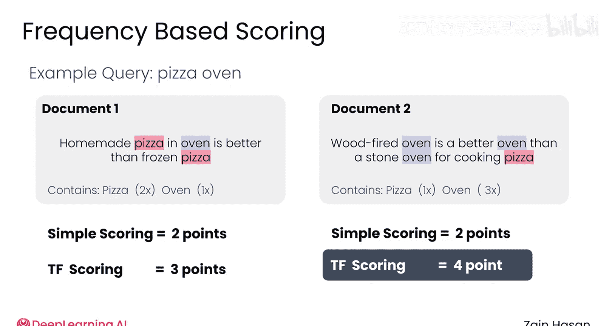

This introduces a new problem， however， which is that longer documents may contain the keywords many times simply because they're longer。

To correct for this， you can divide each document score by the number of words in that document。

This normalized score levels the playing field。 It rewards documents in which keywords make up a greater share of the total text and de emphasizes long documents that might contain keywords many times simply because they're so long。

This approach is pretty good。But it awards points for all keywords equally。

 whether they are filler words like the or less common words like pizza。

 whose presence is a much better indication of relevance。To correct for this。

 you can again weight terms。But this time， using a measure called inverse document frequency or IDF。

To use this approach， you need to calculate an IDF value for each word in the system's vocabulary。

For each word， you'll count how many documents it appears in and then divide by the total number of documents。

 If your knowledge base has 100 documents and the word pizza appears in five of them。

It would have a document frequency of5 over 100 or a 0。05。

A common word like the might appear in all 100 documents。

 So this document frequency would be 100 over 100 or just one。Since you want to reward rare words。

 you now flip the fraction upside down or invert it。Pizza's IDF would now be 20。

While there has an IF of just one。At this point， rare words have a significantly higher IDF than common ones。

Which can overly reward rare words。For this reason， the log of the IF is what's normally used。

 Rare words still have a greater weight， but it's less exaggerated than before。

The result is an IDF value for each word that captures how rare it is across the knowledge base。

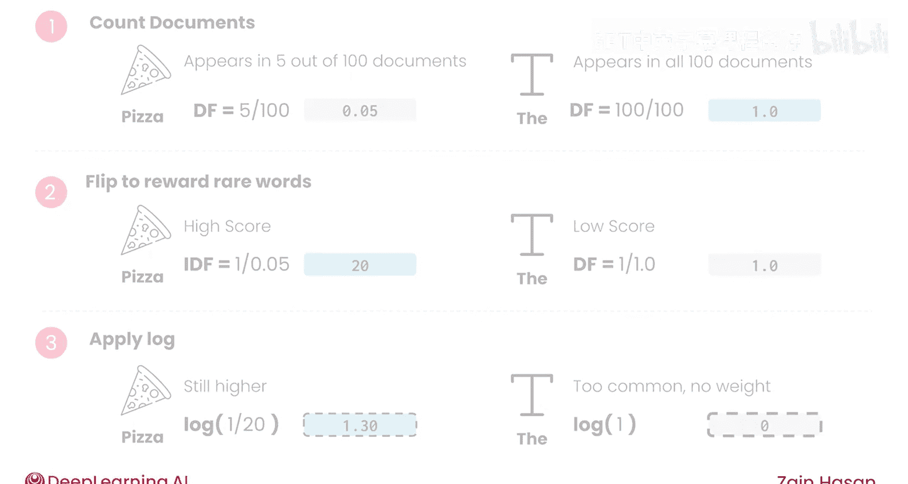

To use these values in scoring first， the values in the inverted index are updated。

 multiplying the numbers in each row by that words IDF score。

 The resultant matrix is a term frequency， inverse document frequency matrix， or TF IF matrix。

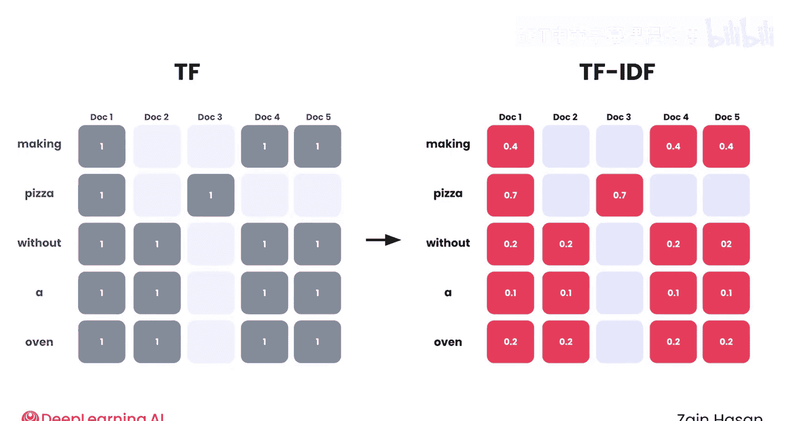

To score the documents in the knowledge base， you just use the same approach as before for each keyword in the prompt。

 go across its row and award each document the TFIDF score it has in that row。

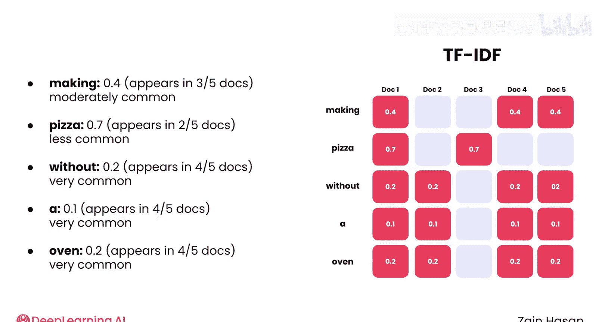

The TF IDF scores produced by this approach are a standard baseline for the performance of keyword retrieval。

The highest scoring documents will frequently use keywords。

 and in particular will feature many keywords that are rare across the entire knowledge base。

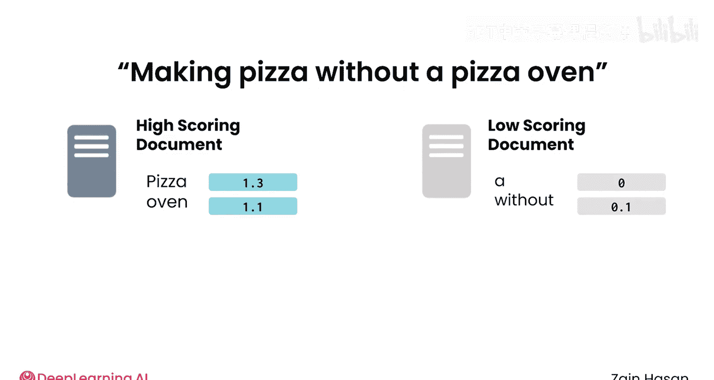

Looking at the earlier prompt， documents containing rare words like pizza or oven would likely score much better than documents that contain common words like a or without While TF IDF is a foundational approach to keyword search。

 modern systems tend to use a slightly refined version of this approach called BM25。

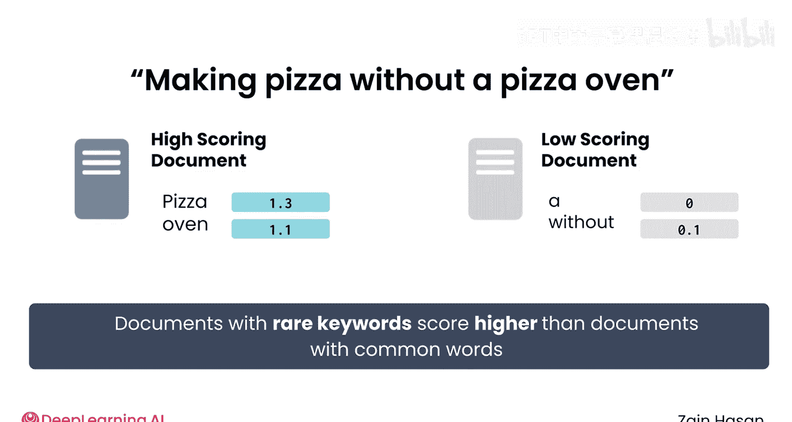

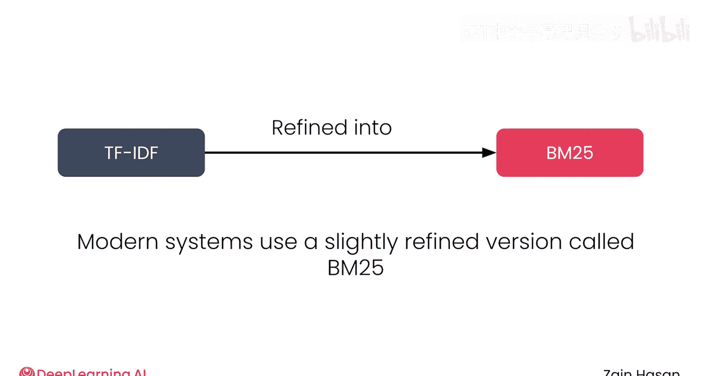

Join me in the next video to learn how that works and then reflect on the strengths of keyword search and how it fits inside your RA system。

