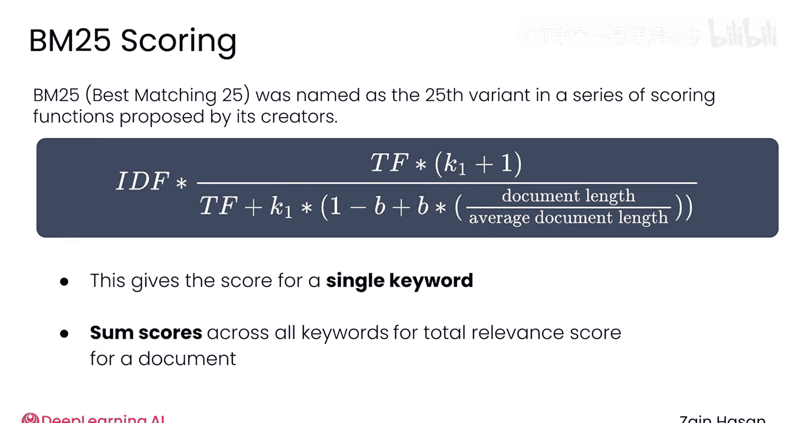
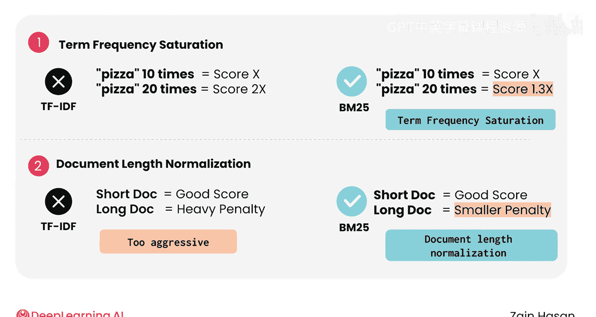
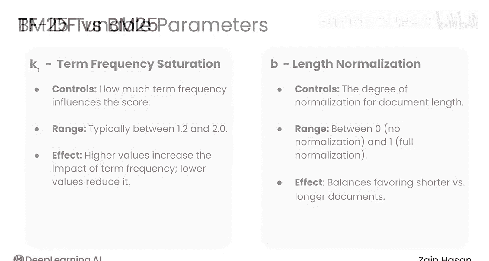
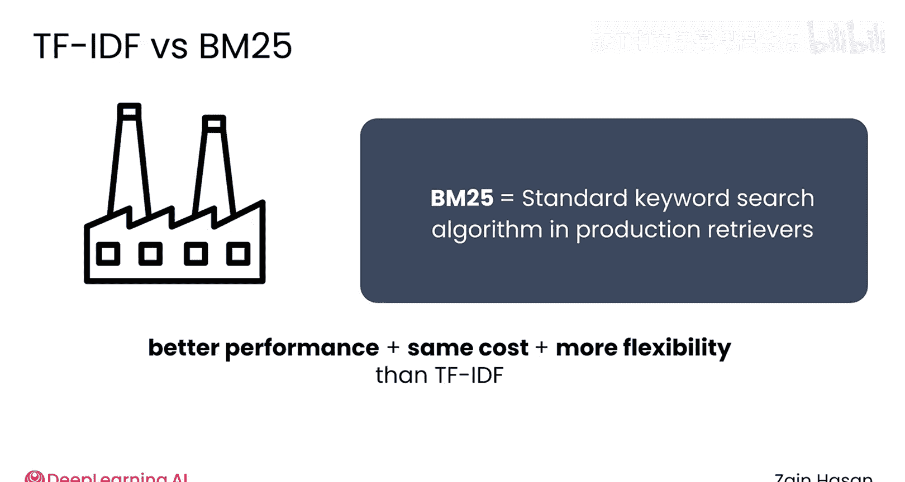
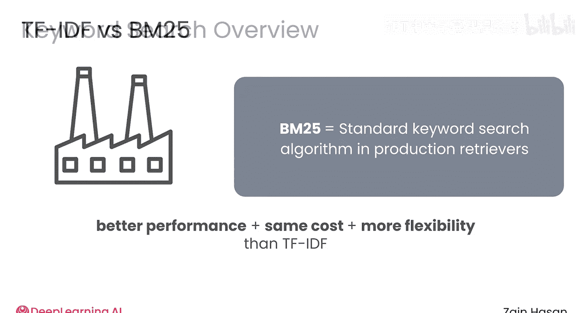
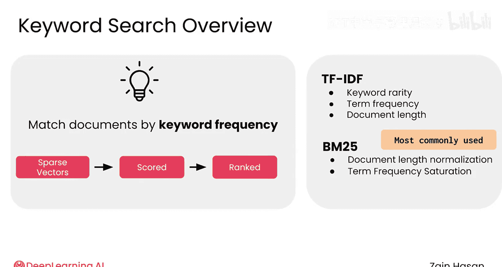
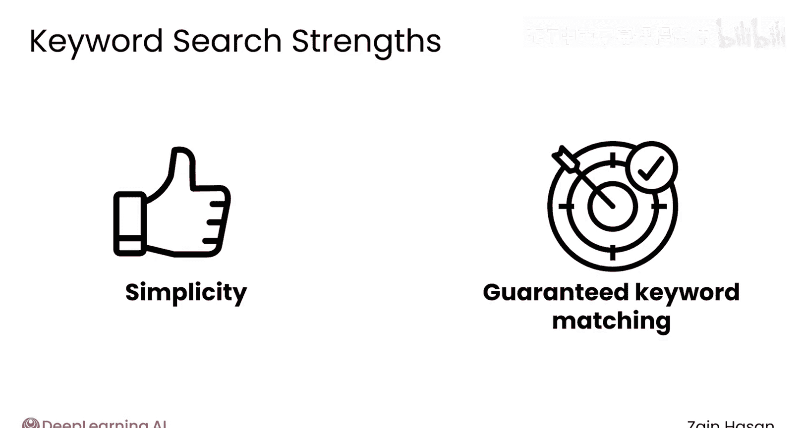

# 吴恩达《检索增强生成｜Retrieval Augmented Generation (RAG)》中英字幕（Claude-3.7-s） - P13：12_关键词搜索：BM25算法.zh_en - GPT中英字幕课程资源 - BV1qsgLzmEg6

While TFIDF remains a classic keyword search algorithm。

 the algorithm used in most retrievers is called Best matching 25， or more simply BM25。

It's called this because it was the 25th variant in a series of scoring functions proposed by its creators。

It makes a few improvements upon TFIDF， so let's explore how those work。Heres the formula for BM25。

It actually works very similarly to TFIDF with a few key additions you'll see momentarily。

This formula generates a relevant score for a single keyword for a particular document。

Summing these scores up across all keywords generates a total relevant score for a single document。

 which can then be used for ranking。

Let's now see how BM25 improves on TFIDS First， documents score diminishing returns as they include more instances of a keyword。

The idea here is that a document that includes the keyword pizza 20 times。

Isn't actually twice as relevant as one that includes pizza 10 times？

This behavior of discounting additional instances of a keyword is referred to as term frequency saturation。

Second， longer documents are still penalized as they are in TFIDF。But in BM25。

 these penalties are also diminishing。While penalizing long documents is important。

 TFIDF can do so too aggressively in a way that overly discounts longer documents。

BM25 applies diminishing additional penalties as documents grow in length。

The result is that long documents still score highly as long as they have a fairly high frequency of the keywords。

 this process of adjusting scores based on document length is called document length normalization。

BM25 also differs from TFIDF in that it includes two tunable hyperparameters。

These allow you to control the degree of term frequency saturation and document length normalization。

 or in other words， how rapidly documents stop being rewarded for repeated keywords and penalize for increased length in a production retriever。

 you attune these hyperparameters in order to land on an overall scoring system that best fits the data in your knowledge base。

In a production retriever， the standard keyword search algorithm is BM25。

It tends to perform significantly better than TF IF at finding relevant documents is roughly equivalent in terms of the computational resources it requires。

 and the ability to tune its hyper parametersa to your dataset set makes it much more flexible。

 Let's briefly review keyword search and talk about how its strengths are used inside of a typical retriever pipeline。

The core idea of keyword search is that you match documents to prompt based on how frequently keywords from the prompt appear in each document as a part of this process。

 both prompt and documents are converted to sparse vectors that count how often each word in the systems vocabulary appears in that piece of text。

 PF I DF or BM 25 are just different approaches for processing these sparse vectors in order to score and then rank documents。

These methods also account for important factors like the rarity of a keyword。

 how often a document contains a keyword and document length。

B M 25 is the most commonly used keyword search algorithm that has withstood the test of time for decades since its invention。

 it strikes a good balance between complexity and performance in real world applications。

The primary strength of keyword search is its simplicity。

 It's a relatively straightforward approach that works well in practice。

 often capable of performing quite well on its own and frequently setting a competitive benchmark that more advanced techniques may struggle to surpass。

 It also ensures that retrieved documents will contain the keywords from your users's prompt。

 especially in situations when you expect users to use technical terminology or exact product names。

 This kind of exact keyword matching is particularly important。

Despite all its strengths， keyword search does have weaknesses。

 it ultimately depends on the query containing keywords that exactly match the words in the document。

If a user sends a prompt that has a similar meaning to a document。

 but just doesn't include the right words， keyword search won't be able to find that match。

So let's have a look at semantic search and how it addresses this problem。

