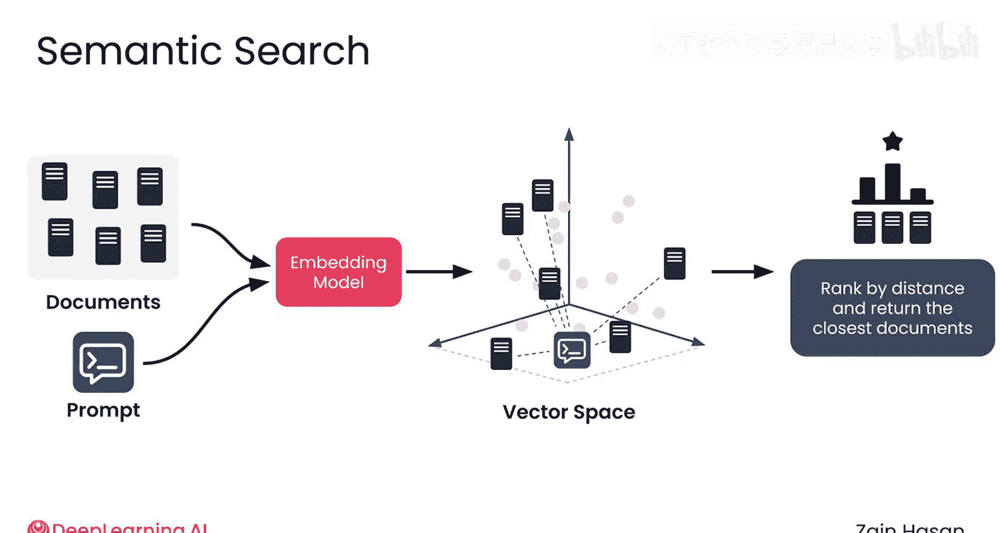

# 吴恩达《检索增强生成｜Retrieval Augmented Generation (RAG)》中英字幕（Claude-3.7-s） - P14：13_语义搜索技术入门.zh_en - GPT中英字幕课程资源 - BV1qsgLzmEg6

Now， let's turn our attention to semantic search。 semantic search is able to match documents to prompts based on shared meaning and can capture nuances that keyword search misses。

For example， a keyword search is enabled to match the words happy and glad。

Even though they're synonyms。And would incorrectly match Python， the programming language and Python。

 the snake。 The technology underlying semantic search is quite remarkable。

 So let's dive in to see how it works。😊，On a very high level。

 semantic search works just like keyword search。 Every document is mapped to a vector。

 and so is a prompt。 Then the prompt vectors and document vectors are compared to generate scores and find the documents that most closely match the prompt。

The primary difference is the way vectors are assigned to each document and prompt。In keyword search。

 you just count how often each word appears in the piece of text In semantic search， however。

 you generate vectors by running the document or prompt through a special mathematical model called an embedding model。

 embedding models map words to a location in space。This location is represented by a vector。

 for example。The embedding model might map the word pizza to the vector 3，1。

And the word bare to the vector 5，2 in two dimensions， you can represent these as points on the X。

 Y axis。 Now， here comes the part that almost feels like magic。😊。

The embedding model will map semantically similar words to nearby locations in space。 For example。

 the word food and cuisine would get embedded closer to one another。

 and the words trombone and cat would be embedded further apart。

Similar meanings lead to similar positions。The X and Y aes here don't have any simple interpretation。

 there's no food access and animal access here， or at least not one that's easy to see。Instead。

 you should just think about points floating around on the 2D plane with similar meeting words clustered together。

Words have many complex relationships， and creating sensible clusters and two dimensions probably won't work。

 If the vectors each had three components， you can imagine embedding them into three dimensional space。

 Now， there is more room where clusters of related concepts can form and to capture nuanced relationships between them。

In most embedding models， however， these vectors have hundreds or even thousands of components。

 giving an incredible amount of flexibility on where to embed each point。

 It's impossible to graph or maybe even imagine this high dimensional space， but mathematically。

 all the same principles hold。The vectors give the coordinates of locations in that space。

 similar concepts are embedded close together， and dissimilar concepts are embedded farther apart。

Even though this example is focused on individual words。

 embedding models exist for many kinds of input data。There are embedding models for individual words。

 sentences， and even entire documents。These models take different kinds of inputs， but in each case。

 output a single vector that specifies a point in space。Just as with single words。

If the vectors are closer together， the pieces of text have similar meaning。Consider three sentences。

He spoke softly in class。He whispered quietly during class。 Her daughter brightened the gloomy day。

When projected in de vector space， the vectors for the first two sentences will be closer together。

 while the third sentence would be far away from the other two。

In order to quantify the similarity of different pieces of text。

 you can measure the distance between their vectors。Theres a few ways to do this。 For example。

 the Euclidean distance， you might remember from geometry class just measures how far apart two vectors are by drawing a straight line from one vector to the other。

 The shortest possible distance between them。 The formula to calculate this is essentially the pythagorean theorem。

 but scaled up across more dimensions。In very high dimensional space， however。

 every point tends to be pretty far away from every other point。

A much more commonly used measure of distance is cosine similarity。

 which measures the similarity in the direction of two vectors。

 regardless of whether they're that close to one another in space。 The vector 1010 and  hundred00。

Aren't that close to one another， but they face in the same direction。

Cosine similarities range from one when the vectors face exactly the same direction to negative  one。

 when they face exactly the opposite from one another。You will also occasionally see the dot product。

 which measures the length of the projection of one vector onto another。

 If two vectors are similar in length and direction， the projection will be larger。

If they're at a 90 degree angle， the projection length will be0。

If they're facing opposite directions， the dot product will be negative。If math's not your forte。

 don't worry。You'll likely never need to implement these distance measures。

 but knowing how they work is helpful。 For example， for both the dot product and cosine similarity。

 higher values reflect closer vectors， which ultimately reflects more similar concepts。

Cosine similarity ranges from negative1 to 1， and the dot product can take any value between negative and positive infinity。

Let's see how this distance measure is used to power semantic search first。

All the documents are projected into vector space by the embedding model。

Thanks to how the embedding model is designed， documents with similar meaning will be closer together。

 and documents with dissimilar meaning will be farther apart。Next。

 you embed the prompt to get a vector of its own。 Now。

 you can measure the distance between the prompt vector and the vector of each document。

Thanks to the way the embedding model is designed， whichever documents are closest will also have the most similar meaning。

At this point， ranking documents is easy。 You just sort documents by their distance from the promptm and return the documents。

 which have the shortest distance。 Thanks to the way the embedding model works。

 You've just found the documents with the most similar meaning to your prompt。

Semantic search is fairly straightforward if you take for granted that the embedding model works properly。

 Similar concepts end up mapped to nearby locations。

And so you can quantify relevance by the distance between vectors。

Diging a little deeper into how embedding models are trained and how they almost magically know how to play similar concepts closer together can help deepen your understanding of semantic search in general。

 So join me in the next video to dive a little deeper on this key component to semantic search。😊。

