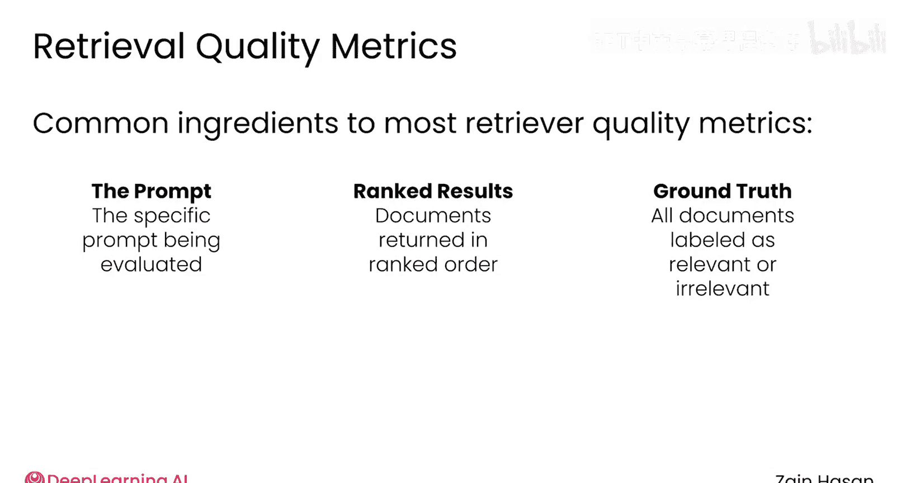
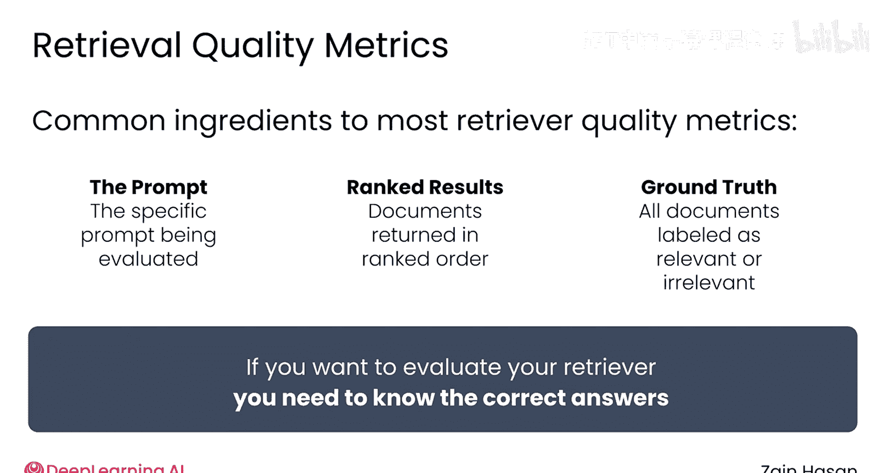
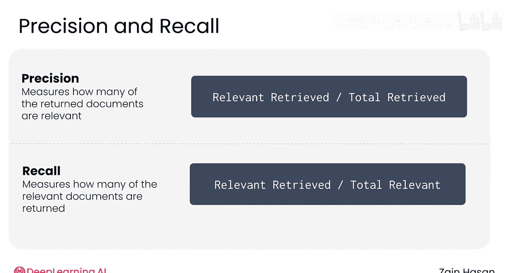
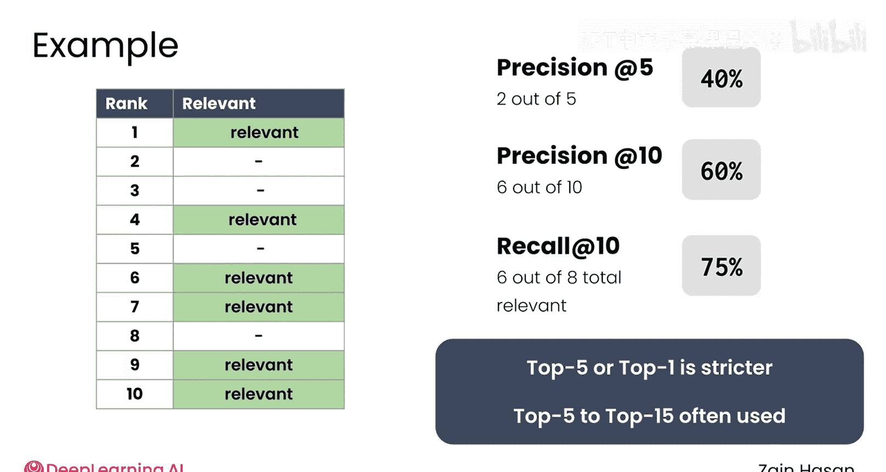
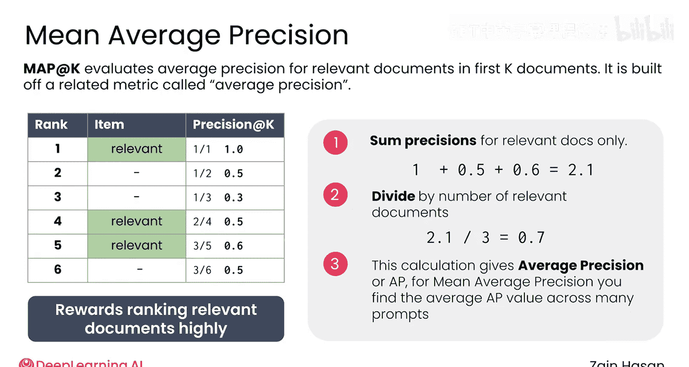
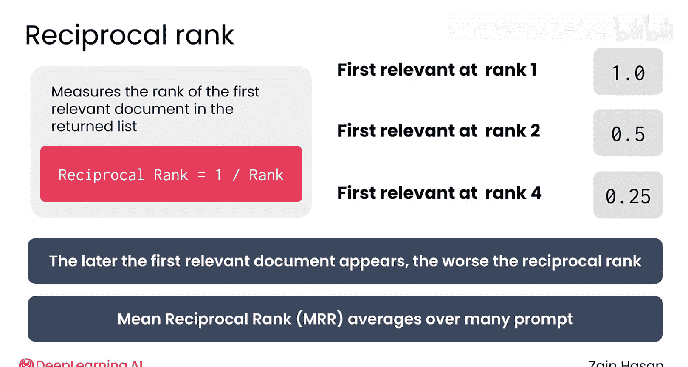
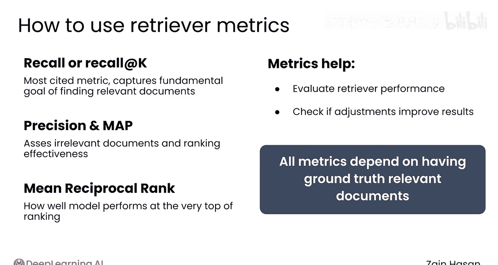

# 吴恩达《检索增强生成｜Retrieval Augmented Generation (RAG)》中英字幕（Claude-3.7-s） - P17：16_检索质量评估.zh_en - GPT中英字幕课程资源 - BV1qsgLzmEg6

Just like any piece of software， once your retriever is up and running。

 you'll want to know if it's actually working。While you can evaluate a retriever in terms of latency。

 throughput， resource usage， and so forth， what ultimately matters is search quality。In other words。

 is it finding relevant documents。 Let's look at a few ways you can answer that question。

 There is a few ingredients common to most retriever quality metrics。 First。

 you'll need the prompt itself， as retrievers may perform well on one prompt and poorly on another。

Second。You need the ranked list of documents。 The retriever returns from that prompt。 And finally。

 you need a ground truth list of all the relevant documents in your knowledge base that the retriever should return。

In other words， if you want to grade your retriever。

You need to know the correct answers。

Two of the most common retriever quality metrics are precision and recall。

 Preion is calculated by dividing the number of relevant retrieved documents by the total number of documents retrieved。

 recall， on the other hand， is calculated by dividing the number of relevant documents retrieved by the total number of relevant documents in the knowledge base。

Here is an example to help you understand the difference。

Suppose you know that your knowledge base has 10 documents relevant to a prompt because you handmark them。

 You run your retriever on the prom， and it returns 12 documents，8 of which are relevant。

 The precision is 66%。 since 8 of the 12 are relevant， and the recall is 80%。

 Since 8 of the 10 relevant documents were retrieved。 Now。

 you adjust your retriever settings and run the prompt through it again。On this second run。

 it returns 15 documents， nine of which are relevant。

Your retriever returned three more documents than last time， but only one more relevant document。

 Precision drops to 60% or 9 out of 15。 recall， however， increases to 90%。

 as you found 9 of the 10 relevant documents this time。In other words。

 you've traded a little bit of precisionally to get a bit more recall。

 Precision penalizes a retriever for returning irrelevant documents and can be thought of as capturing how trustworthy the results are。

 recallca， penalizes a retriever for leaving out any relevant documents。😊。

And measures how comprehensive the retriever is。 The only way to have perfect recall and precision is to rank the relevant documents most highly and only return those documents。

 Otherwise， you're often trading off between the two Retrieval metrics are influenced by how many documents。

 the retriever returns。 So to standardize through usually talked about in terms of the top K documents。

 meaningan， the K documents that the retriever ranked most highly。 For example。

 consider this ranked list of documents are turned by a retriever。

The precision at5 in this example is 40%， since only two of the top five documents are relevant。

The precision at 10， meanwhile， rises to 60% as six of the top 10 documents are relevant。

 Suppose there are 8 relevant documents in the knowledge base。

 The recall at 10 here would be 6 out of 8 or 75%。Depending on which value of top K you choose。

 you can quickly produce new precision and recall values。Top 5。

 top 2 or top 1 metrics can be used when stricter standards are important， Often， though。

 a slightly more generous range between top 5 and top 15 is used。

To give a more holistic view of retriever performance。

 mean average precision or map at K evaluates the average precision for relevant documents in the first K documents retrieved。

 First， let's calculate a related metric called average precision at 6 for this example。

You list out the six documents the retriever ranked most highly and calculate precision at K for every row。

 Next， you add up the precisions only for rows that contain relevant documents。 Here。

 those rows are 1，4， and 5， So you add 1，0。5 and 0。6。Finally。

 you divide by the number of relevant documents retrieved in the top K， which in this case is 3。

 That gives us an average precision of 0。7。To calculate mean average precision。

 you just calculate average precision across many prompts and sets of documents retrieved and average those values。

 This just tells you what the average precision would be for a typical prompt your retriever receives。

Map rewards ranking relevant documents highly。 If an irrelevant document sneaks into a spot high up in the rankings。

 it'll decrease the precision at the rank of every relevant document below it。

 B down the overall average。 A high map value is therefore a good indication that a retriever is placing the relevant documents it finds high up in the ranking。

A final common metric is reciprocal rank， which measures the rank of the first relevant object in a returned list。

 For example， if the first relevant object appears at rank 2。

 the reciprocal rank would be 1 over 2 or 0。5。If it were at rank 4， the reciprocal rank would be 0。

25。The further down the list， the first relevant document appears the worse the reciprocal rank。

 This is typically performed over multiple prompts to get the mean reciprocal rank or MR R。

 MR R reflects how soon on average， you can find a relevant item in the retriever's ranking。

 and emphasizes the importance of including at least one relevant document as high in the ranking as possible。

 For example。

If you complete four searches using a retriever and the first relevant document in each ranking appeared in the first third。

6 and second spot in the ranking， you'd calculate the mean reciprocal rank by dividing one by each of those numbers。

 You then average those values here。 that gives you。1， one third，1，6， and one half。

Adding those values and dividing by 4 gives you the mean reciprocal rank of 0。5。

 with many metrics available。 It's important to know how best to use them together。

 recall or recall at K is the most foundational and most cited metric for retrievers because it captures the most fundamental goal of the retriever。

 Find relevant documents。 Precision and map build upon this by assessing whether the retriever is including many irrelevant documents or how effectively the retriever is ranking them。

Mean reciprocal rank is a bit more specialized， but helps identify how well your model performs at the very top end of its ranking。

 These metrics can both help evaluate the performance of your retriever and help you decide if adjustments you make to a system are working。

 For example， you could adjust how heavily you weight semantic or keyword search in your hybrid retrieval system and then see what effect that has on your retriever's recall or precision for a collection of sample prompts。

If there's a downside to these metrics， it's just that they all depend on having ground truth。

 relevant documents for a collection of sample prompts。

This can be a time consuming and manual process to compile The end result， however。

 is a system you can monitor during both development and once it's in production。

Okay， you've covered all the most important concepts underlying a retriever in a typical rag system。

 Join me in the next video and let's summarize the main takeaways from this module。

