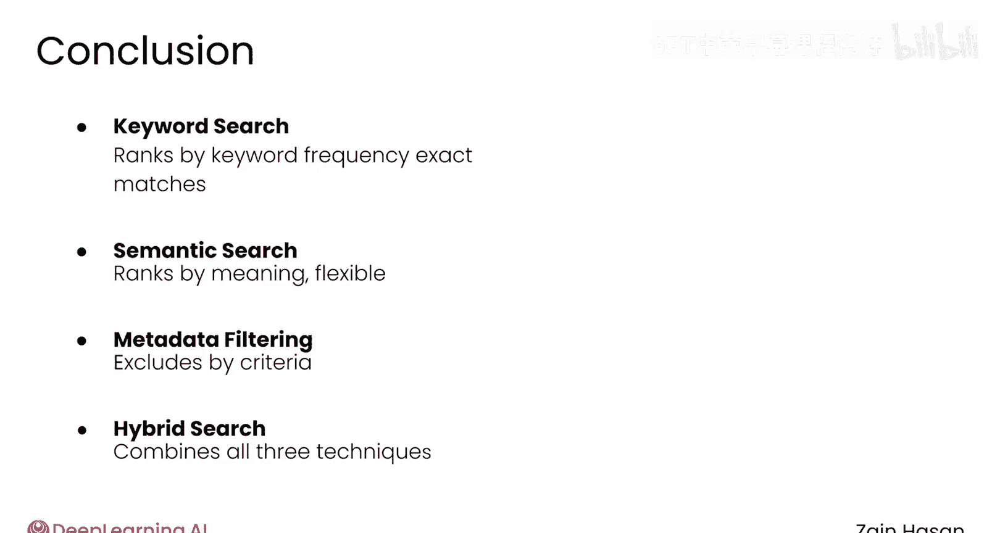
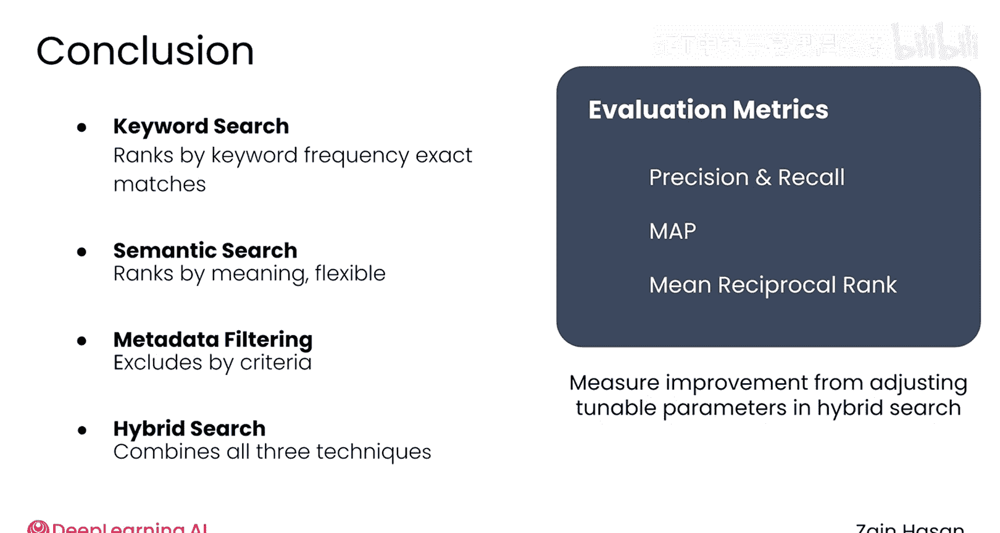

# 吴恩达《检索增强生成｜Retrieval Augmented Generation (RAG)》中英字幕（Claude-3.7-s） - P18：17_模块2 总结.zh_en - GPT中英字幕课程资源 - BV1qsgLzmEg6

That brings us to the end of our journey through information retrieval principles and how they're combined in a retriever。

 Let's quickly review the main concepts we explored in this module。To begin。

 you are introduced to the fact that retrievers actually usually search for documents using a hybrid of three search techniques。

 keyword search， semantic search， and metadata filtering。

You then look closely at how each search technique works and the benefits they provide。

 Keyword search ranks documents based on the frequency with which they contain keywords from the prompt。

 It's a mature approach and useful because it ensures documents contain the exact keywords found in the prompt。

 semantic search ranks documents based on having similar meaning to the prompt。

 This is enabled thanks to an embedding model， which can embed pieces of text to mathematical vectors with the special property that pieces of text with similar meaning will be embedded to vectors close to one another in vector space。

Semantic search provides flexibility that keyword search doesn't。

Metadata filtering excludes documents based on strict criteria captured in a document's metadata。

 usually to ensure results are relevant to a user。 Hybri search combines these techniques by performing a keyword。

And semantic search across the knowledge base， filtering the results using a metadata filter and then combining the documents from both lists to form a single ranked list of documents from which the top matches can be returned to the user。

 Finally， you saw a few common metrics used to assess retrieval quality and evaluate whether it increases or decreases in response to adjusting various tunable hyperpara in the hybrid search pipeline。

Nice， at this point， you have a solid background in all the information refrieval concepts used inside a typical rack system。

 so join me in the next module to see how they're applied inside a production scale retriever。

