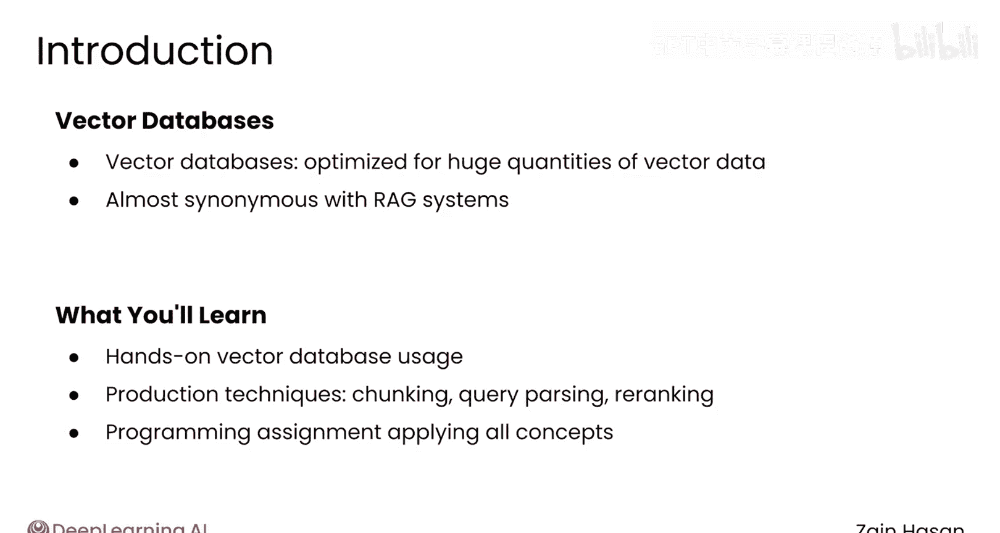

# 吴恩达《检索增强生成｜Retrieval Augmented Generation (RAG)》中英字幕（Claude-3.7-s） - P19：18_模块3 简介.zh_en - GPT中英字幕课程资源 - BV1qsgLzmEg6

Now that you have a strong foundation and information retrieval。

 it's time to move all of that theory into production。

 you could use a traditional relational database to implement most of the retrieval techniques you just saw。

 but once you need to search millions or even billions of documents。

 some of those operations in particular， the vector operations underlying semantic search will flow down significantly。

At this point， you'll probably want to switch over to a vector database。

 vector databases are databases optimized to store and search through huge quantities of vector data。

 and as a result， they've become almost synonymous with RaG systems。In this module。

 you'll learn why vector databases are so optimized for vector retrieval and can hands on using one to execute a variety of different searches。

 You'll also see a collection of techniques used in production rag systems like document chunking。

 query parsing and reranking， which are used in production settings to further improve the performance of a retriever。

 As always， there will be a programming assignment to apply all these concepts at the end of the module。

I hope you enjoyed this module where you'll get to apply all of your information retrieval knowledge。

 Join me in the next video and let's get started。