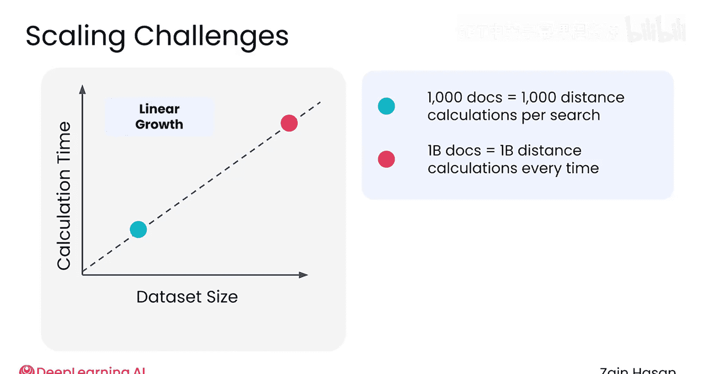
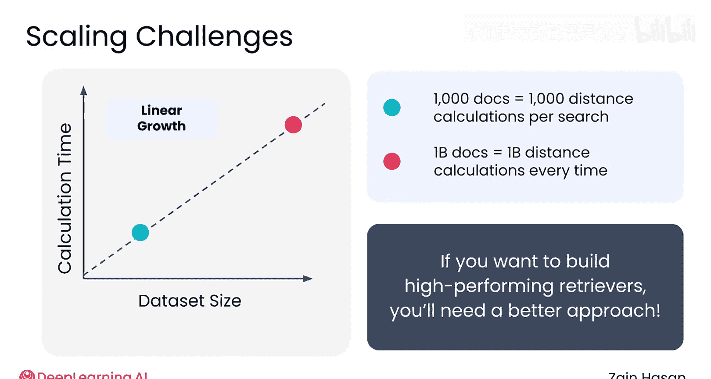
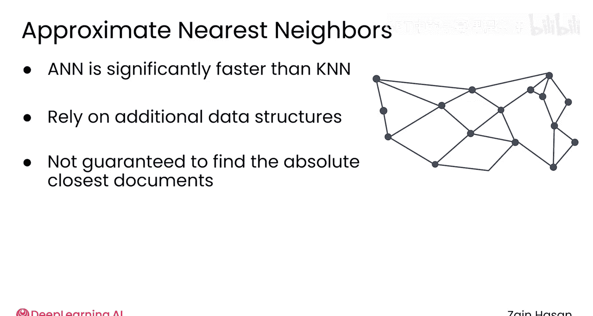
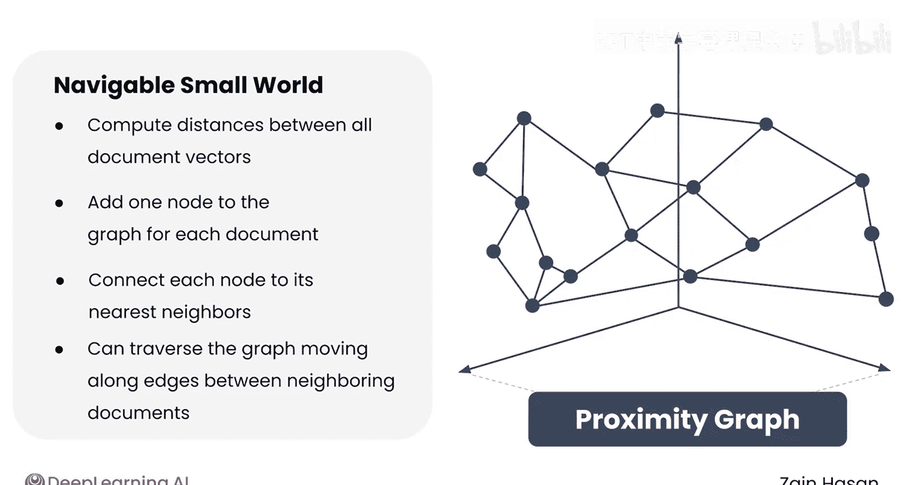
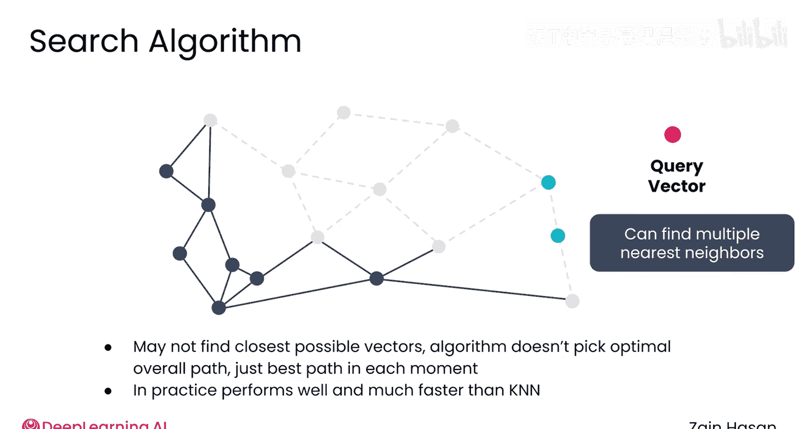
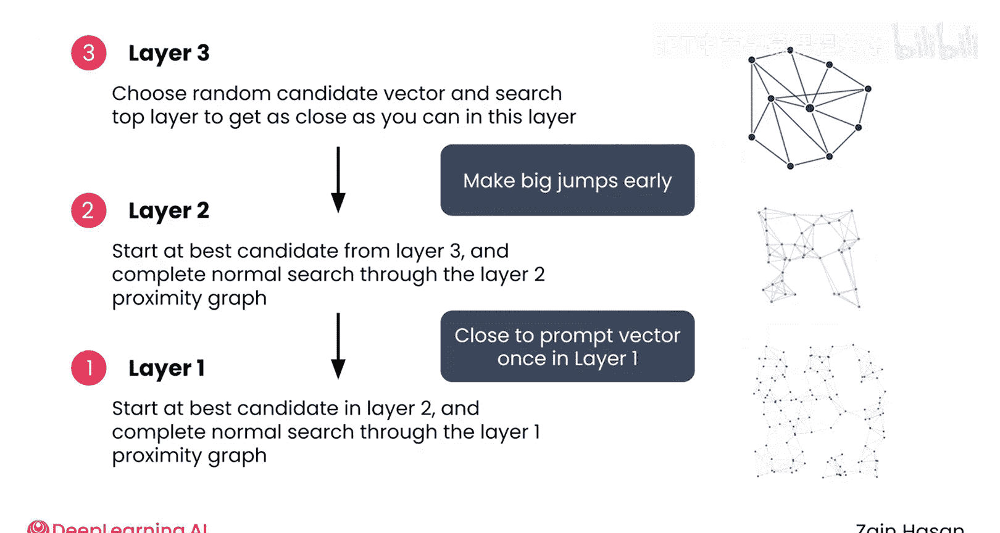
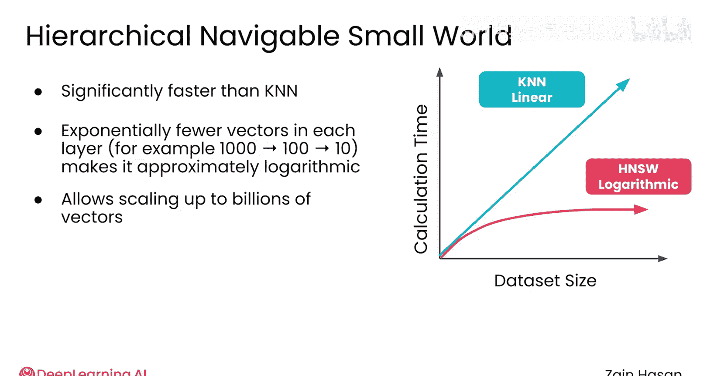
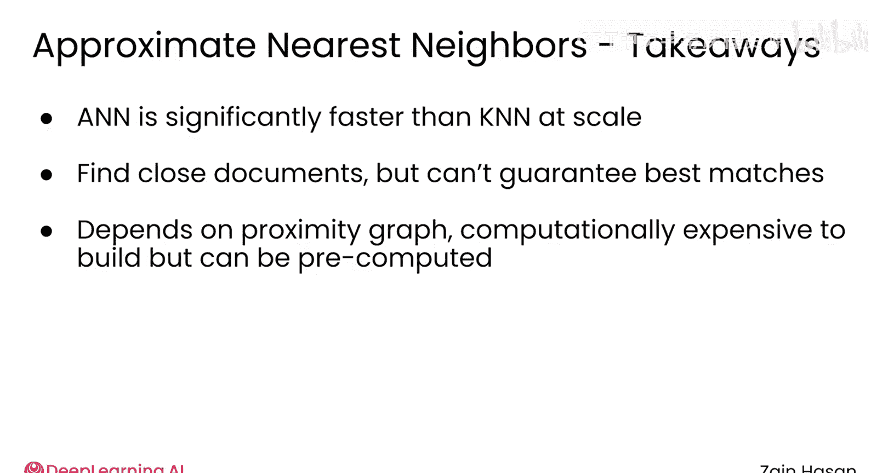

# 吴恩达《检索增强生成｜Retrieval Augmented Generation (RAG)》中英字幕（Claude-3.7-s） - P20：19_近似最近邻(ANN)算法.zh_en - GPT中英字幕课程资源 - BV1qsgLzmEg6

While keyword and semantic search form the foundation of a production retriever as you scale up these techniques。

 new issues arise。If implemented naively， vector search in particular skills poorly。

 requiring significant computational resources and adding latency to your system。

Let's look at the algorithm underlying vector search to understand the source of the problem and then explore how we can improve it。

The simplest form of vector retrieval is called Ca nearest's Neighbs search。

And it's one you've seen throughout the course so far。First。

 you create an embedding vector for every document in your knowledge base as well as your prompt。

 then you calculate the distance between the prompt vector and every document vector。

You then sort documents based on their distance from the prompt vector。

The user can then choose a number K， which is just how many of these nearest neighbor documents to return。

Kay nearest neighbors is easy to understand and easy to implement。

 The problem is that it scales terribly。The number of calculations each search requires grows linearly with the number of documents in the knowledge base if you have1 thousand documents for each search。

 you have to calculate 1000 vector distances。If you have a billion documents though。

 you have to calculate 1 billion vector distances。That second search will be a million times slower than the first。

If you want your retriever to perform well at scale， you'll need a better approach。

To improve upon can nearest neighbors， retrieveeverrs use a family of algorithms called approximate nearest neighbors or A N N。

 These algorithms use clever data structures to enable significantly faster searches。

In order to do this， they make a small sacrifice in the quality of results。

 meaning they aren't guaranteed to find the absolute closest documents in the knowledge base。

 though they'll still find ones that are very close by。

Let's look at one typical A an algorithm called Navigable small World。Before any searching is done。

 the algorithm creates a data structure called a proximity graph。To do this， first。

 it calculates the distance between each vector and every other vector。

Then inside this proximity graph， you add one node for every document。 Finally。

 you make an edge between each document and a few of the other documents it is closest to。

 This results in a web like structure， you can imagine traversing the proximity graph by hopping from one document to its closest neighbors along the edges that connect them。

 Now， let's see how this proximity graph speeds up search。 When a prompt is received。

 it's vectorized to create a query vector。 The goal is to find the documents located closest to that query vector。

 To do that。 The algorithm randomly chooses an entry point called a candidate vector to start with。😊。

Which is just one of the nodes in the proximity graph。

This is a truly random choice with no assumption that it's even close to the prompt vector。Now。

 the algorithm starts traversing the graph。 It looks at each neighbor of the current candidate vector and calculates which of them is closest to the prompt vector。

Since theres only a few neighbors to consider， this is a very fast process。

Whichever is closest becomes the new candidate。Now， the process repeats at each candidate vector。

 the algorithm looks to see which of the connected neighboring vectors is closest to the query vector。

 and that becomes the new candidate。 The process continues until none of the neighbors are closer than the current candidate。

 and the candidate vector is returned。 with small modifications。

 This approach can be made to return multiple documents， but the core idea is still the same。

You're just moving across the proximity graph each time choosing whichever neighbor gets you closest to the pro。

This approach doesn't necessarily find the best possible vector in the knowledge graph。

There might be one out there that's closer to the prong vector。

 but just wouldn't be reached by the algorithm because it can't pick the optimal overall path through the proximity graph。

 Just the best path in each moment。In practice， though。

 this algorithm finds very close vectors and much more rapidly than Can' neighbors。

 While this navigable small world algorithm is already more efficient than can N。

 a slight variation called hierarchical navigable small world or HN S W adds further improvement by significantly speeding up early parts of the search。

😊。

HNSW depends on having a hierarchical proximity graph with many layers。

Here's what that hierarchical proximity graph might look like for a knowledge base with 1 thousand documents。

Layier 1 contains all thousand vectors。And you calculate the proximity graph as normal。In layer 2。

 you randomly drop out all but 100 vectors。And you make a new proximity graph for just those 100 vectors。

 Finally， in layer 3， you randomly drop out all but 10 vectors and again make a proximity graph for the remaining 10 in order to search this proximity graph。

 searches begin in layer 3， the top layer。The algorithm chooses a random entry point in this layer and then searches as normal to find the best candidate in layer 3。

 Then it drops down to layer 2， starting from the best candidate found in layer 3。

Since there are more vectors here， there might potentially be one that is closer to the prompt vector。

The algorithm moves through layer 2 as normal until it finds the best candidate in layer 2。

 At that point， it drops down to layer 1， the lowest level。

 which has every vector in the knowledge base。 The algorithm moves through this lowest layer as normal。

 And this time， the best candidate found is the one the algorithm actually returns。

This hierarchical approach is very efficient because at the highest layers。

 the algorithm makes big jumps to get into the approximate neighborhood of the prompt vector。

 By the time any possible vectors are considered in layer 1。

 The candidate vector should already be very close to the prompt vector。

 This HN SW algorithm is significantly faster than a K nearest neighbor search。

 as you go up in layers， there are exponentially fewer vectors to navigate。

 And so the runtime of HNSW is approximately logarithmic。 While K N is linear。

This is what allows vector surge to scale up to billions of vectors and still require only a few hundred milliseconds of latency。

You won't need to implement A and algorithms like this one。

 but understanding a few of their key features is still important。 First。

 they're significantly faster than canous neighbors。

 allowing vector search to still be possible at scale。Second。

 while they tendten to find documents that are close to the prompt vectors。

 they can't guarantee they'll find the absolute best matches。 And finally。

 the entire process depends on building a good proximity graph。

A fairly computationally intensive process that luckily can be pre computeutd before receiving any prompts。

 That's a good summary of how A an algorithms make vector search possible at scale。

So let's now look at the tools you'll use to actually implement these algorithms。

