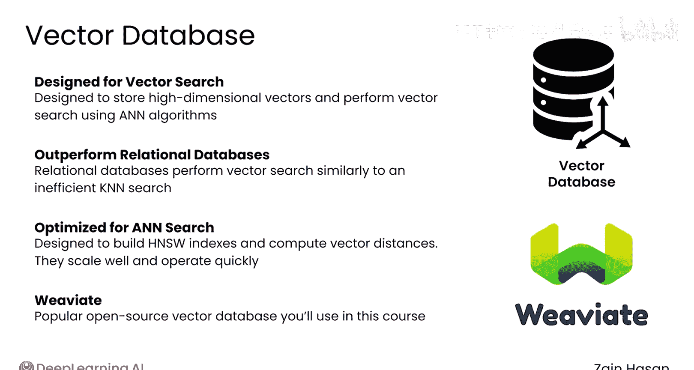
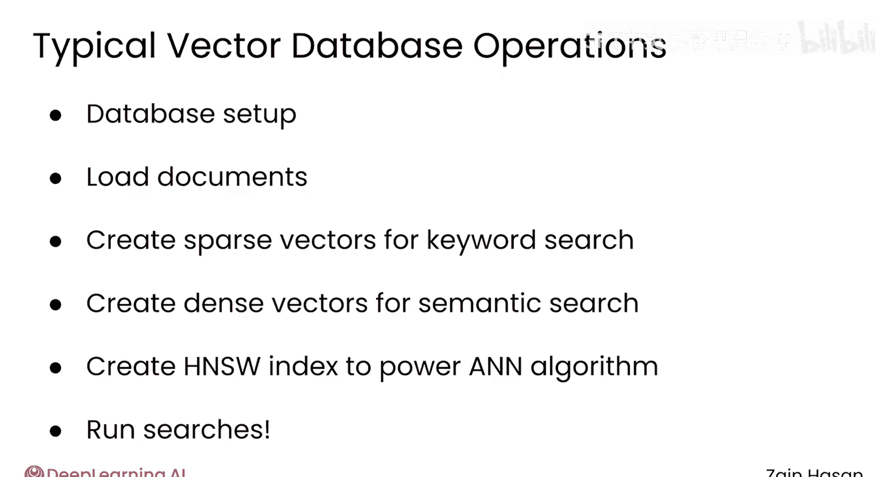
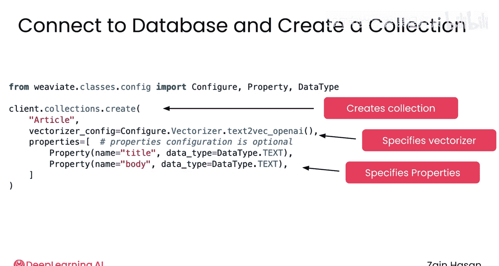
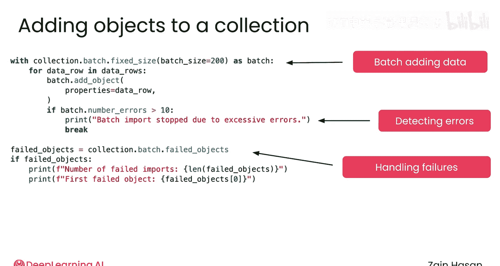
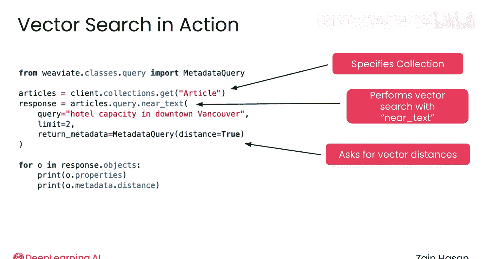
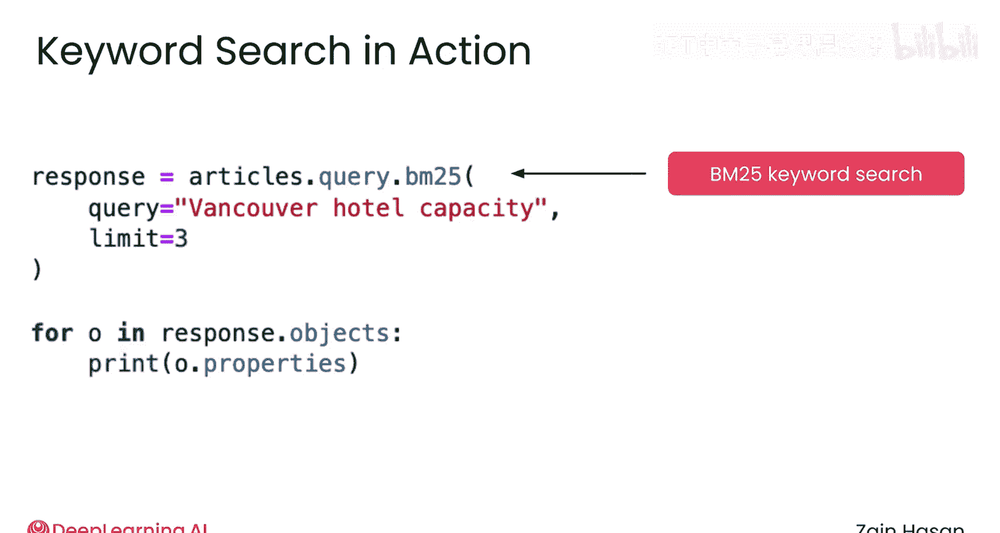
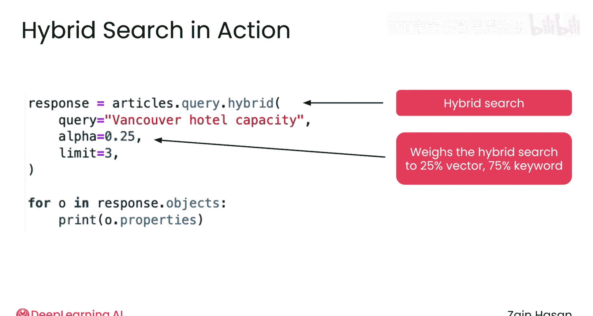
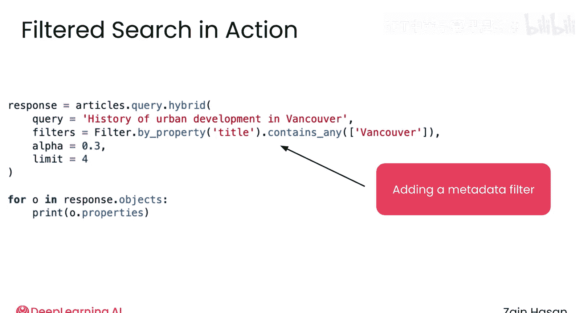
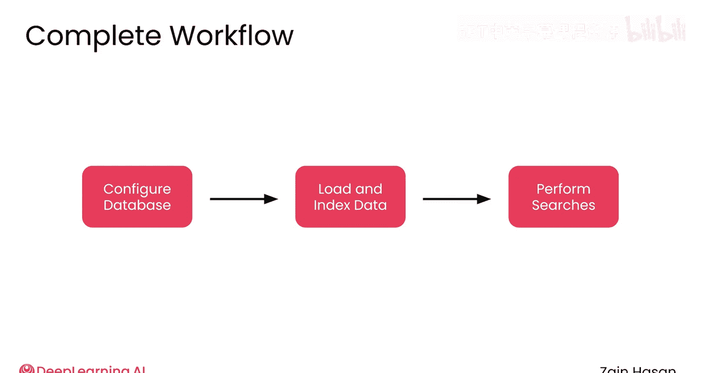

# 吴恩达《检索增强生成｜Retrieval Augmented Generation (RAG)》中英字幕（Claude-3.7-s） - P21：20_向量数据库技术.zh_en - GPT中英字幕课程资源 - BV1qsgLzmEg6

In a production ragg system， you'll typically store and retrieve vectors from a specialized database called a vector database。

 Let's explore some common operations with a vector database and how they lay the foundation for performing retrieval inside a ragg application。

 A vector database is a database that has been designed from the ground up to store high dimensional vector data and implement vector oriented algorithms like the approximate nearest neighbors algorithm you just saw。

 They grew in popularity in the early 2020s in response to the widespread availability of large language models and the explosion of vector embedding based techniques like semantic search。

Standard relational databases performed poorly at semantic search。

 where their performance was much closer to the highly inefficient， canous neighbor's algorithm。

Vectctor databases are optimized for tasks like building the proximity graph that powers HNSW search or computing vector distances。

 and so scale well and operate significantly faster in most vector based applications， in particular。

 building a RA system。The vector database you'll be using in this course is called Weviiate。

 It's a popular open To vector database that you can run both locally or in the cloud。

There are a wide variety of other vector databases available on the market as well。

 If you choose a different vector database for future projects。

 theyll almost certainly provide very similar functionality to what I'll be showcasing with alleviate。

The goal here is to get hands on with some workflows that are common to any ragg project。

 There's a few steps involved in getting a vector database ready to process searches。

 some of which are handled automatically for you。

You'll need to set up the database， load your documents。

 create the sparse vectors that will power keyword search。

 create dense embedding vectors that power semantic search。

 and finally create the index that will power your A&N search algorithm like the HNSW index you just saw。

At that point， you're ready to run actual searches。In the following ungraded lab。

 you'll get to see all these steps in detail， but let's go through a couple of examples to see how these steps are handled and weviiate。

The first step to working with Weviiate is either creating a database instance or connecting to an existing one。

 You'll see examples of how this is done in the ungraded lab。Next。

 you'll need to create a collection to hold your data。

 The collection I've made here is called article and will hold the title and body of news articles。

 This code also specifies that each data type will be text。 More importantly。

 this call indicates which embedding model or vectorizer should be used to create semantic vectors for each article added。

Now that you've configured your collection， it's ready for you to add data into it。

This code is adding data into the collection using the batch method of the collection。

Bch not add object actually adds the object into the collection。

 but it also counts and tracks errors， making it possible to correct them afterwards。

 or break the loop If too many errors are encountered。 Once the data is inserted。

 you're ready to perform vector search in this first query。

 I'm specifying the collection I just created。 and then you can pass in a text query。

 Also passed in here is a particular metadata request， which gives you back the distance。

That'll be the distance between the query vector and the object vector for each object。

You can also perform keyword searches Wevi automatically creates an inverted index for you。

 which allows you to map which words are used and how frequently in every document here you can perform a simple BM25 query that you learned about in the last module。

And we asked for the top three ranking documents based on this query。

 you can also go ahead and combine vector search with keyword search in the form of hybrid search with hybrid search。

 what happens is both keyword and vector search will be performed in the background in parallel and then using this alpha parameter。

 which is set to 0。25 right now， you weigh the scores from vector search and keyword search accordingly。

So with Al at 0。25， vector search gets a weighting of 25% and the other 75% goes to keyword search。

Those get reraned accordingly， and then we get the top three back out。In production and practice。

 this is what the majority of companies use because it allows you to balance the semantic similarity of vector search and the strict matching similarity of keyword search。

You can also then go ahead and apply filters on top of this， for example。

 here you can have a filter that is applied to a particular property and that checks for the value at that property。

If it matches， the object passes our filter and can be returned。 If it doesn't match。

 it's not returned。

So the entire loop from beginning to end looks something like this， you configure the database。

 then load and index your data， and finally you write a particular query which includes hybrid search filters。

That's a good overview of how to use a vector database。

 Check out the ungraded lab to get hands on with all of these steps。

