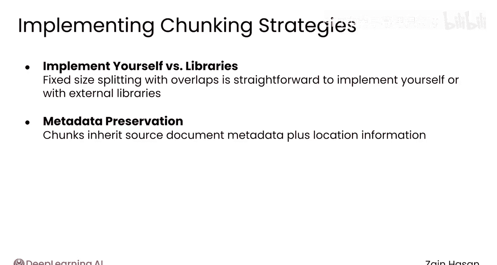

# 吴恩达《检索增强生成｜Retrieval Augmented Generation (RAG)》中英字幕（Claude-3.7-s） - P22：21_文本分块技术.zh_en - GPT中英字幕课程资源 - BV1qsgLzmEg6

As you just saw， vector databases have architectures and APIs optimized for vector retrieval。

It's straightforward to set up a database that scales rapidly and performs the variety of search types you've seen throughout this course。

In most production rack systems， you'll want to add a few additional adaptations to vector retrieval to optimize your overall system performance In the next few videos。

 I'll walk you through a few of those strategies beginning with chunking。

Simply put chunking is the practice of breaking longer text documents from your knowledge base into smaller text chunks。

 The reason you do it is threefold。 Firstly， many embedding models have limits for the amount of text they can embed into vectors。

 Secondly， chunking can improve the search relevancy metrics for your retriever。And thirdly。

 it ensures you're only sending the most relevant text from a document to the LLM。

To understand the value of chunking， imagine you have a knowledge base of a thousand books。

If you were to index this knowledge base， each book would be vectorized by an embedding model。

 and the result would be 1000 vectors that each represent the context of one book。

 The problem here is you're compressing the meaning of an entire book down to a single vector。

 These vectors can't give a sharp representation of any specific topic discussed in a particular chapter or page。

 and instead， kind of averages across all of them。As a result。

 you'd expect search relevance to be pretty poor。Even if you use this system for retrieval。

 you'd be retrieving an entire book at a time， which would quickly fill up your LLM's context window。

For this reason， you typically want to take your books and chunk them up into smaller pieces like the page。

 paragraph or sentence level。Suddenly， your knowledge base might contain 1 million paragraphs instead of 1000 books。

 but vector databases easily scale up to store and search through all those vectors。

The first consideration when chunking is what chunk size to use。If you make the chunks too big。

 say at the chapter level， you run into the same problem you did when trying to vectorize the entire book。

 The chunks are still too big to capture nuanced meaning with a single vector。

 and they'll rapidly fill an LLm's context window。Alternatively。

 it's also possible to make chunks too small。 Consider the extreme case where you chunk at the word level。

 Your vectors will lose all the context of the surrounding sentences and paragraphs。Which again。

 diminishes search relevance。Even chunking at the sentence level could be too fine grained。

There's no one size fits all approach to chunk size。

 but usually you'll find a balance between vectors trying to capture too much or too little context all at once。

The simplest way to do this is to use a fixed size chunk and strategy where at the outset。

 you determine that every chunk will be the same size。 For example， 250 characters。

Character1 to 250 are chunk 1。251 to 500 are chunk 2。

501 to 750 are chunk 3 and so on and so forth all the way to the end of the document。Of course。

 there's no guarantee the splits between chunks happen at sensible places。

The split will often fall in the middle of a word or separate two pieces of a cohesive thought in a paragraph。

This is usually addressed by allowing overlaps in chunks。 For example。

 chunks might be 250 characters long， but overlap by 25 characters with the chunks that come before and after。

 So chunk 1 is characters 1 to 250。 chunk 2 is 226 to 4，75。 Ch 3 is 4，51 to 700。And so forth。

Typically， this overlap is expressed as a percentage of the overall chunk。 So here。

 this would be a 10% cent overlap。 Overping chunks minimizes instances where words are cut off from their context。

 Words in the middle of a chunk have context to either side of them。

 Words at the edge of chunks will appear in two chunks。

 Inc the odds that they appear alongside relevant context。

Allowing for more overlap usually positively impact search relevancy。

 but at the cost of adding more vectors to your database with redundant information。

 a more dynamic chunking strategy is called recursive character text splitting。

The idea is you choose one particular character to split on。 For example。

 you could split on the new line character， which often appears between paragraphs。

 This gives you a variable chunk size。 So there is an increased chance that you have very large or very small chunks。

 depending on new line character locations。On the plus side， however。

Yourre accounting for the document structure and increasing the chances that related concepts are kept together within a single chunk。

 If your knowledge base has a variety of document types， you can， of course。

 split different types of documents differently。 For example。

 you might split Hm on paragraph or header tags。 Python code on function definitions and text documents on new land characters。

Fix size chunking with overlaps or chunking on particular characters is so straightforward that you could likely do it yourself。

 but you can also find external libraries designed to help you do it。

 If your documents have metadata， you'll， of course。

 want chunks to inherit the metadata of their source document。

 perhaps with additional information about their location。

 you'll see examples of how this is done in the ungraded labs in this module。

 Ching your documents has a variety of benefits for vector retrieval from increasing search relevancy to minimizing the use of your LLM's context window。

😊。

If you're looking for a good starting point， just use fixed size chunks of about 500 characters with an overlap of 50 to 100 characters。

 In some other instances， more advanced chunking techniques might be helpful。

 so join me in the next video to explore what some of those look like。

