# 吴恩达《检索增强生成｜Retrieval Augmented Generation (RAG)》中英字幕（Claude-3.7-s） - P23：22_高级分块方法论.zh_en - GPT中英字幕课程资源 - BV1qsgLzmEg6

Chunking has a variety of benefits， but by splitting documents into smaller chunks。

 it also risks breaking up text in a way that loses relevant context。

Consider the sentence that night， she dreamed， as she did often。

That she was finally an Olympic champion。Depending on where the split is placed。

 the chunk might make it look like our dreamer is already a gold medalist and not instead dreaming of future glory。

 F size and recursive character splitting don't provide safeguards against this kind of issue。

 So let's have a look at some more advanced techniques that try to intelligently build chunks based on the meaning of a piece of text。

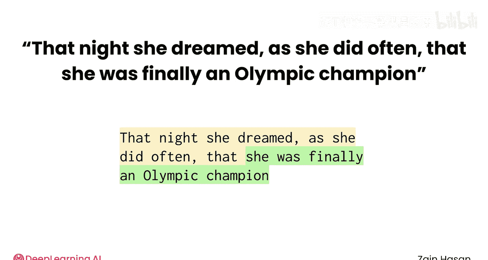

The first technique we'll explore is called semantic chunking。

 which tries to place sentences together in chunks if they have similar meaning。

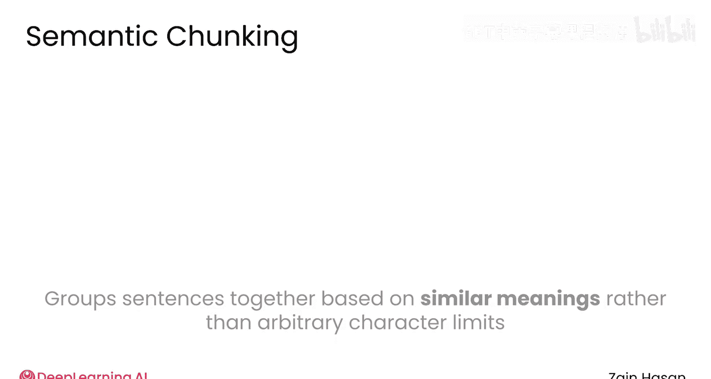

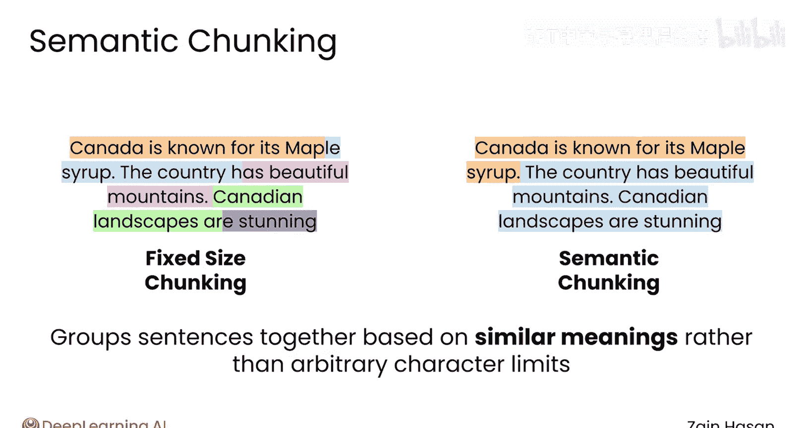

The algorithm works by moving through the document one sentence at a time for each sentence。

 it decides if it's similar enough to the previous sentences and so belongs in the same chunk or is different。

To do this， both the contents of the current chunk and the following sentence are vectorized。

If the two vectors are below some threshold distance away from each other。

 they have similar meanings， and the sentences are added to the same chunk。

This process continues until eventually， the growing chunk is too different from the following sentence。

 At that point， you cut off the chunk and restart the whole process from that next sentence。

 When you plot this out， This looks something like this graph。

 The threshold for vector distance or dissimilarity is in red。

 The measure of how different the growing chunk is from the sentence that follows it is represented by the peaked line。

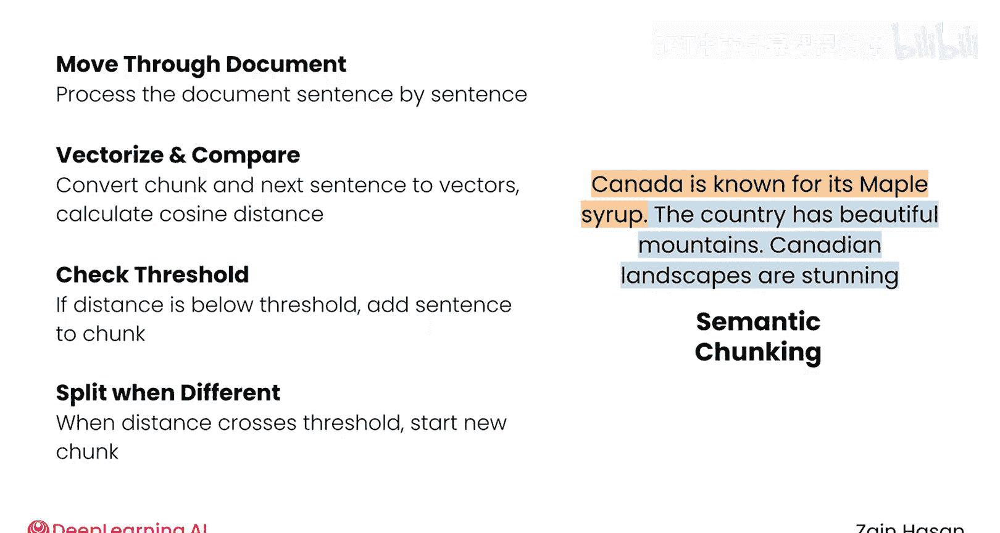

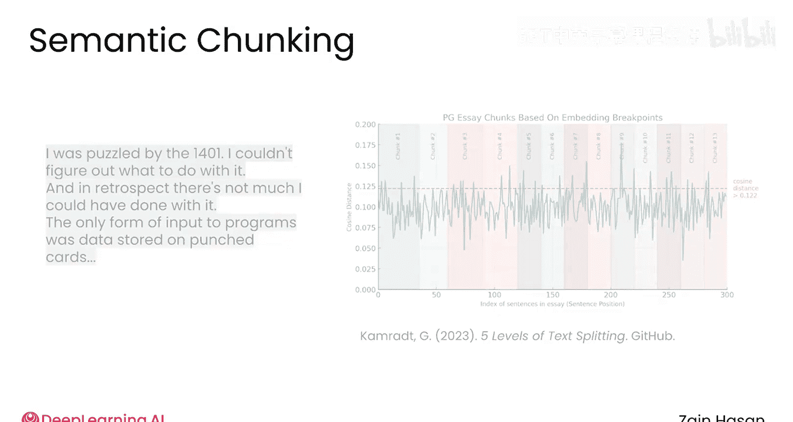

Eventually， the gap between the chunk and the next sentence crosses the threshold and a new chunk is created。

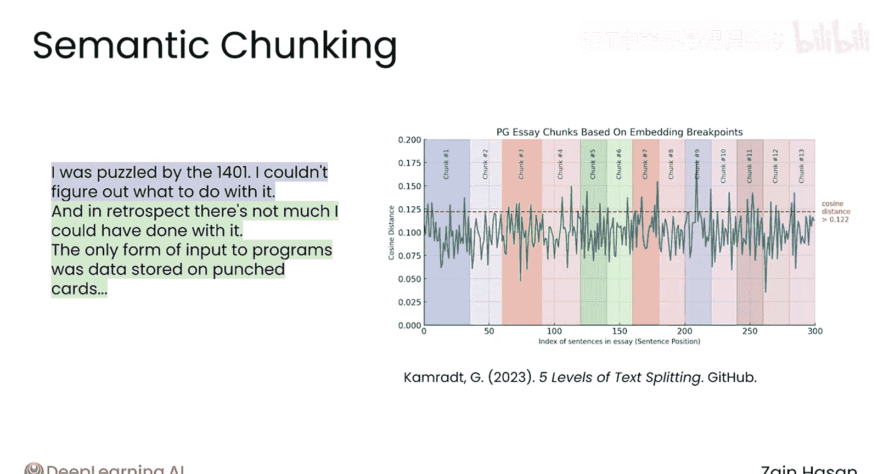

The result of this process is variably sized chunks that follow the train of thought of the author。

 For example， if the author goes off on a conceptual tangent within a paragraph or pursues the same idea across two paragraphs in a row。

 semantic chunking will place chunk splits at the appropriate locations。As you may imagine。

 semantic chunking can be computationally expensive because you're repeatedly calculating vectors for every sentence in your knowledge base。

 In exchange， however， you'll often get high quality retrieval。

 as measured by familiar metrics like precision and recall for even more flexibility。

 you can try large language model based chunking Here you give your document to a language model along with instructions on the types of chunks that you want it to create。

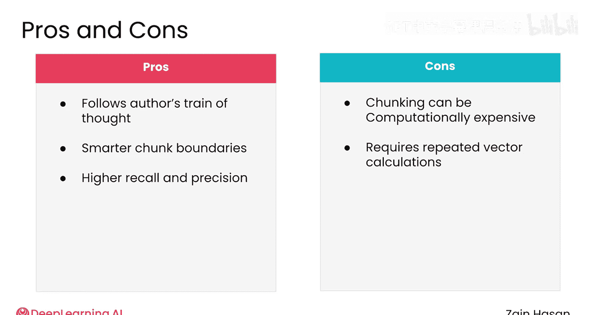

For example， you tell it to separate chunks based on meaning。

 keeping similar concepts together in one chunk and separating the text into chunks When new topics are discussed。

 The language model then generates chunk output the same way it might generate any other text。

While inherently something of a black box approach。

 this is actually a very high performing chunking strategy。And as language model costs decrease。

 LM based chunking is becoming even more economically viable。

 A final improvement to any chunking strategy is to use a language model to add context to every single chunk。

 For example， you can ask the language model to create chunks from a document。

 but also add summary text to the chunk， explaining its context in the broader document。

 An author might conclude a blog post by thanking a list of supporters and contributors。 That means。

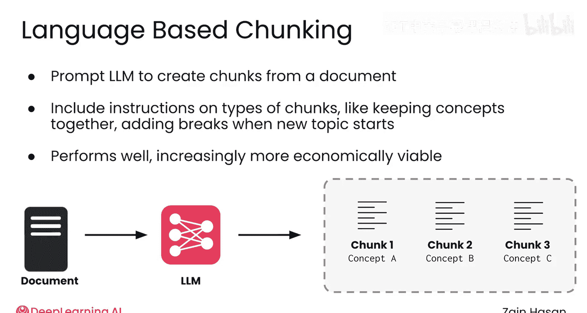

Therell be a chunk near the end of the blog post。 That's just a long list of names making that chunk difficult to interprett on its own。

The LLM could add text to the chunk， explaining its context in the broader blog post。

 This added text is available both when the chunk is vectorized。

 helping drive greater search relevancy， and when the chunk is retrieved。

 eventually helping the LLM understand the overall meaning of the chunk。

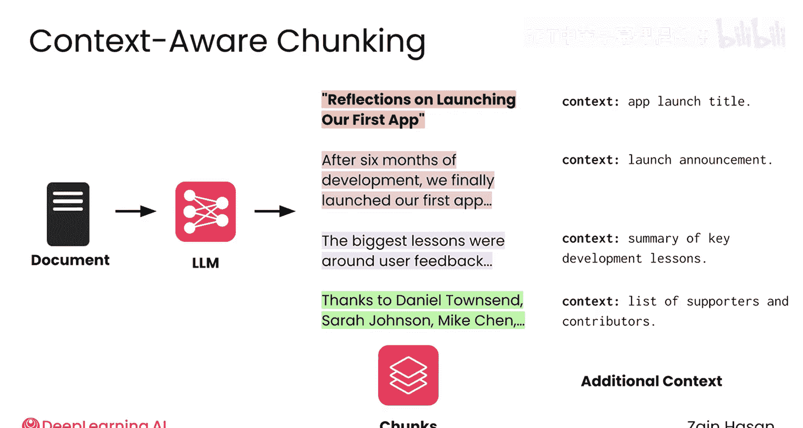

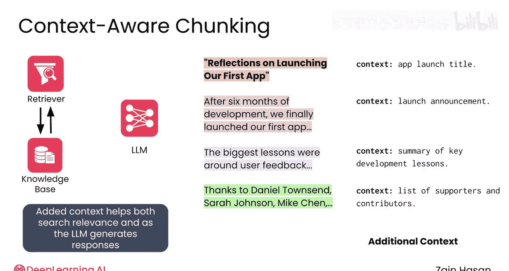

Context to wear chunking requires computationally expensive pre processing。

 since an LLM needs to go through your entire knowledge base one document and chunk at a time to add context。

The benefits， however， are more relevant searches and essentially no impact on search speed。

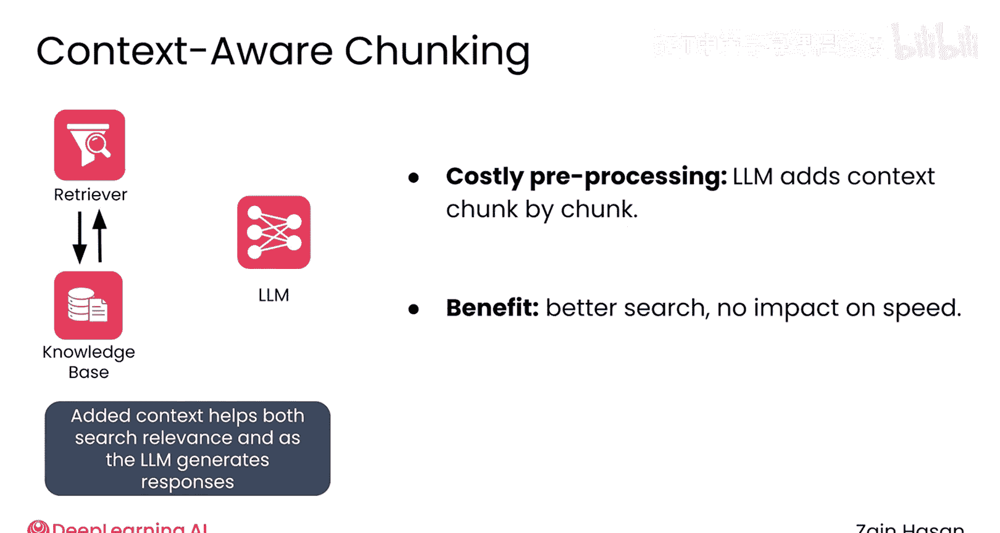

Most rag systems will implement some kind of chunking how sophisticated an approach to use， however。

 will depend on context。Fhix size or recursive character splitting are often good starting points when prototyping a system and are fine default approaches。

Semantic and LM based chunking can lead to higher performance。

 but they're computationally expensive and can be difficult to tune， maintain or audit。

It makes more sense to experiment with a small subset of your data and see if these more advanced techniques are actually leading to improvements in search relevance。

Since context aware chunking can be applied on top of any chunking strategy and can improve both search relevance and subsequent generation。

 it can often be a good first improvement to explore beyond fixed with techniques As a designer of rack systems。

 The goal isn't to implement the most cutting edge chunking techniques in the market。

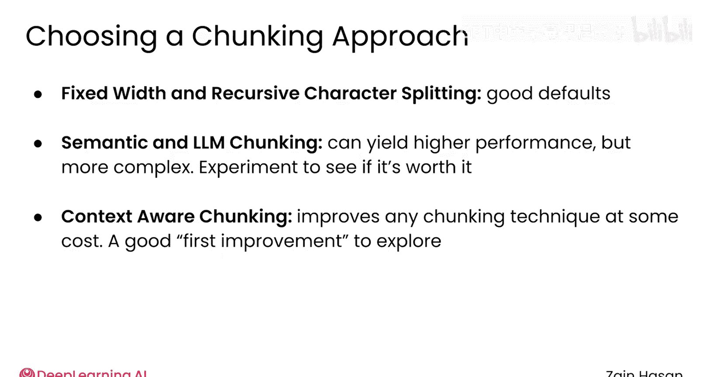

It's to understand what options are available， how suitable they are to your data and whether the costs and benefits make it worth implementing in your system。

 Hopefully， this quick survey of chunking techniques gives you a strong foundation to make those decisions。

