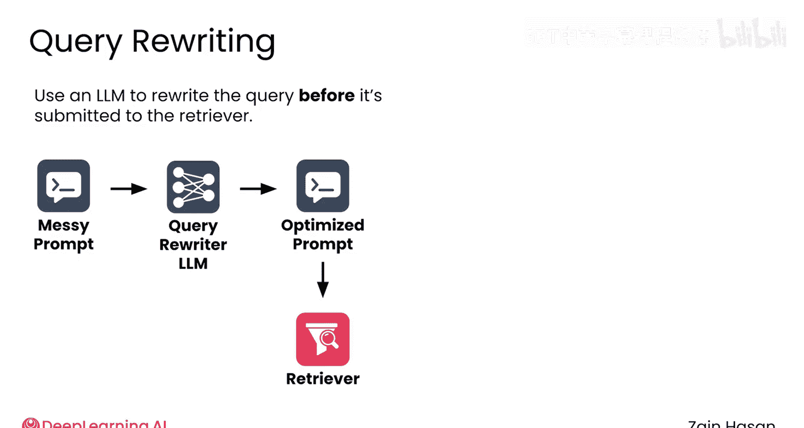
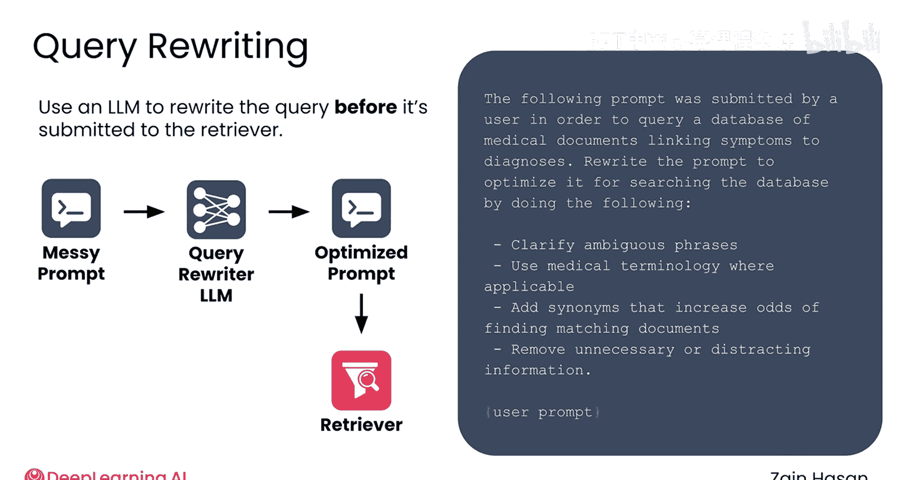
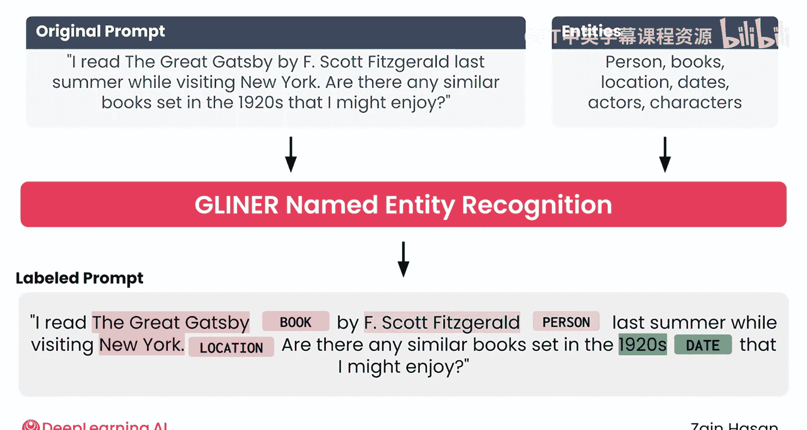
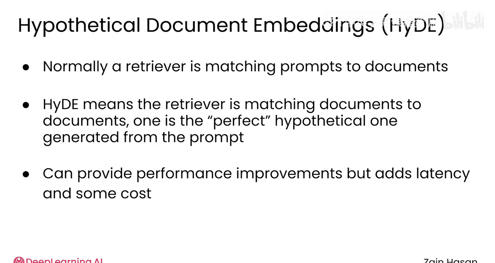

# 吴恩达《检索增强生成｜Retrieval Augmented Generation (RAG)》中英字幕（Claude-3.7-s） - P24：23_查询语句解析.zh_en - GPT中英字幕课程资源 - BV1qsgLzmEg6

An important step in a production ragg system is cleaning up user submitted prompts。

 Rag systems are often deployed in contexts where the end user expects to interact with an LLM in a conversational manner。

 as though they're chatting with another person。 As a result。

 human written LM prompts make for bad stretch queries。

Rather than feeding those prompts directly to the vector database。

 the retriever can parse the prompt to identify its intent， and edit， rewrite。

 or entirely transform the prompt to optimize it for retrieval。

There's a variety of query parsing techniques used， so let's look at a few of them。

The simplest and by far most widely used solution to messy prompt is using an LLM to rewrite the query before it's submitted to the retriever。

 For example， consider a RAg system built around a knowledge base of medical information。

You may set up an LLM as a query review writer with the following prompt。

 The following prompt was submitted by a user in order to query a database of medical documents linking symptoms to diagnoses。

 rewrite the prompt to optimize it for searching the database by doing the following。

Clarify ambiguous phrases， use medical terminology where applicable。

 add synonyms that increase the odds of finding matching documents。

 remove unnecessary or distracting information， and then you insert the user prompt。

A patient might submit the prompt。 I was out walking my dog， a beautiful black lab named Poppy。

 when she raced away from meat and yanked on her leash hard while I was holding it。😊。

Three days later， my shoulder is still numb， and my fingers are all pins and needles。

 What's going on， This prompt clearly isn't optimized for retrieval。

 Here's the rewritten prompt after it's passed through the query re writer。Experience a sudden。

 forceful pull on the shoulder， resulting in persistent shoulder numbness and finger numbness for three days。

 What are the potential causes or diagnoses such as neuropathy or nerve impingement。

This new prompt removes unnecessary information， clarifies ambiguity。

 and even uses a medical terminology that may increase the odds of finding a match in the knowledge base。

While you can and should iterate on the prompt you use for query rewriting in general。

 the benefits you gain from it are substantial and easily justify the additional costs of the LLM call needed to clean up each prompt。

 While basic query rewriting is usually the only query parsing technique you'll need to consider。

 more advanced techniques do exist。 For example， named entity recognition is a technique for recognizing categories of information in the query like places。

 people， dates， fictional characters and so forth。 This information can then be used to inform either the vector search performed by the retriever or the metadata filtering than later in the process。

An example here is for a model called Giner， which is a general named entity recognition model。

 You can give it a piece of text and then a list of types of entities you wish for it to identify like people or dates。

 The model will analyze the query and return a labeled query with identifications of those categories。

 In this particular example。 I've provided some input text and told the Ger model to try and label any mentions of a person books。

 locations， dates， Actctors and characters。 In the response。

 you can see that it's labeled any time it sees these different entities。

This is a very efficient model， and we can run this every time a query comes in。

 including this step adds a little bit of added latency。

 but the quality of the retrieval now can be significantly improved as a result of this。

 Another advanced query parsing technique is called hypothetical document embeddings， or hide。

This approach refines a search query by generating a hypothetical document that would be the ideal result of the search process。

 For example， if yourre attempting to retrieve information on that earlier medical question。

 and LLM would be used to generate a hypothetical document about shoulder and hand numbness resulting from a rapid pull。

 then that hypothetical document is embedded and its vector representation is what is actually used to complete the search。

The idea here is that you're helping the retriever understand not just the intent of the prompt or question。

 but what a high quality result would look like。Normally。

 a retriever needs to match prompts to documents。So to some degree。

 the retriever is matching dissimilar types of texts or apples to oranges。

By generating a hypothetical document， the retriever is now comparing more similar text。

 a hypothetical， perfect document， and the documents actually contained in the knowledge base in practice。

 Hy actually provides performance improvements at the cost of some added latency in the search and some computational resources to run the LM that generates the hypothetical documents。

In my experience， having some kind of query parsing is a key piece of your rag system。

In almost every case， basic query rewriting， just using a nicely prompted LLM to do basic touch ups on user submitted prompt is the right approach。

 more advanced techniques like using named entity recognition。

 hide and others may provide additional benefits， but they can be more complex to run and won't necessarily yield better results。

 experimentiment with these advanced techniques and let the results decide how your project needs to evolve。

