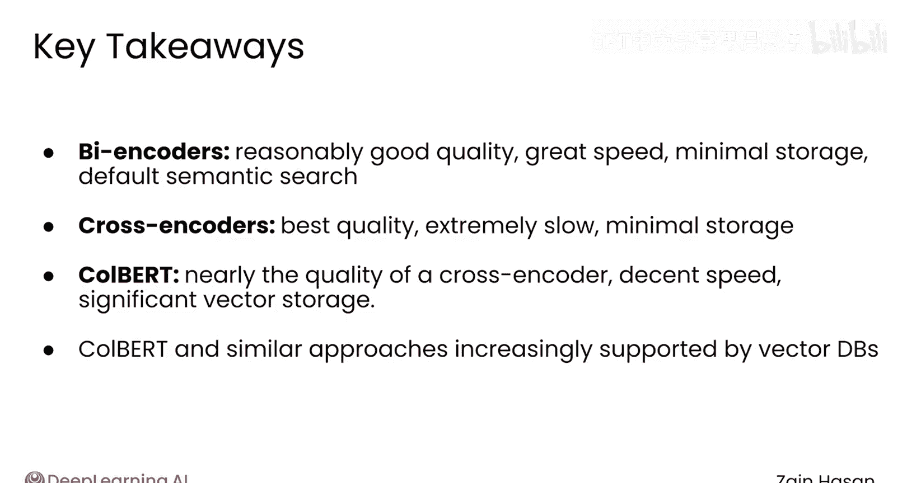

# 吴恩达《检索增强生成｜Retrieval Augmented Generation (RAG)》中英字幕（Claude-3.7-s） - P25：24_交叉编码器与ColBERT模型.zh_en - GPT中英字幕课程资源 - BV1qsgLzmEg6

The semantic search techniques you've seen so far all use of vanilla architecture。

 Each document and prompt are assigned a single vector。

 which are compared to find documents or chunks that are similar to the prompt。

While this approach yields great results， even higher quality retrieval is possible with more sophisticated architectures。

Let's look at two of those， the cross Encor and Colbert。And consider their pros and cons。

The architecture you've seen throughout this course to power semantic search is called a buy Encor。

The documents are each assigned a semantic vector by an embedding model。When a prompt is received。

 it， too， is embedded to a vector。 Then an approximate nearest neighbor's algorithm is used by a vector database to rapidly identify documents whose vectors are close to the prompt vector。

The term by encoder refers to the fact that the documents and prompt are embedded separately。

This is important because it means all the documents can be embedded ahead of time。

 and only the prompt itself needs to be embedded after it's received。

 significantly speeding up search。 If you are willing to give up some of the speed， however。

You can get even higher quality search results。 Let's start with the cross Ender。

 which can provide significantly higher quality document rankings than by encoders。

To score a document， a cross encoder concates the document with the prompt and then passes the combined text into what is essentially a specialized embedding model。

Since both the prompt and document are in the input。

 this allows the model to understand deep contextual interactions between the prompt and document text that a by encoder might miss。

The cross encoder is designed to then directly output a relevancy score。

 usually a number between 0 and 1。You can think of this score as the probability of a positive match between the prompt and the document。

Here's a cross encoder in action， say you have three documents in the knowledge base。

 and you receive the prompt， great places to eat in New York。

The cross encoder concateates the prompt to the front of each document。

Each prompt document pair is then passed through the cross encoder。

 which outputs a probability of a match between the prompt and the document。

If this is a well trained cross encoder， you would expect the first document to score pretty well。

 say 0。7 or 70%。 Since the document is fairly relevant to the prompt。

 You then repeat this process for each document， concatenating the prompt to the front。

Passing the prompt document pair through the cross encoder architecture and generating a score。

A cross encoder will almost always provide better search results when compared to a byenr。

 as measured by common metrics like search relevance。

The main issue with cross encoders is that they scale terribly。

Your knowledge base can easily have millions or potentially billions of documents。

 meaning that for every single prompt， you'd need to run billions of document prompt pairs through the cross encodecor to generate each document's relevancy score。

You also can't do any preprocess to speed things up since crossencoders run on a prompt document pair and you won't have the prompt until a user submits it。

 cross encodecors are too inefficient to use as a default search technique。

 but the quality of the results makes them a great tool for improving the results of other search techniques。

 something you'll explore a bit later in this course。

Some techniques try to split the difference between the speed of by encoders and the quality of cross encoders。

 So let's look at one final architecture gaining popularity known as Colbert。

Cobert stands for contextualized late interaction over Bt。

The idea of Colbert is that you still generate document vectors ahead of time， like in a byenr。

 but try to capture deeper interactions between the text of the prompt and each document like cross Encoder。

To start each document in the knowledge base is embedded。

 but instead of generating one semantic vector for the entire document。

 you generate one semantic vector for each token in the document。

 A document with 1000 tokens therefore needs to be converted to 1000 dense vectors。

When a prompt comes in， it's embedded in the same way。

 resulting in one dense vector for each token in the prompt。Now。

 the idea behind scoring in Colbert is that each token in the prompt tries to find its most similar token in the document。

 Let's look at an example to see how that works。Let's use the same four documents and prompt from before。

 Great places to eat in New York and see how the first document is scored。 First。

 the algorithm finds the vector distance， or， in other words。

 a similarity score between each pair of tokens from the document and the prompt。

 If the prompt has 10 tokens and the document has 100。

 the result is a grid of 1000 pairs of similarity scores。😊。

This creates a grid of how relevant each document token is to a prompt token。 For example。

 the tokens New and York from the prompt would match well with New York and city from the document。

 while eat would match favorably with cuisine。Each prompt token will have a document token with which it has the highest relevancy score。

 These maximum scores are summed up to get one relevancy score for the overall document。

 This is known as the max Sim score。Repeating this process for every document in the knowledge base allows all documents to be scored and the most relevant documents to be retrieved。

Cobert provides both the scalability of a by enr and much of the rich interaction between prompts and documents found in a cross encoder。

 While the computation required to score each document prompt pair is more computationally taxing than in a by encoder。

It's still reasonably fast and possible to use in contexts where real time or close to real time search is necessary。

The biggest drawback of the Colbert architecture is that the number of vectors you need to store increases proportionally to the tokens in both prompts and documents。

If you have a 2000 token document， you would need to store 2000 vectors。In a by encoder。

 you'd only need to store a single dense vector。 The standard by encoder model provides reasonably good quality。

 great speed and requires minimal vector storage space。😊。

This set of attributes make it the default architecture for semantic search cross encoders provide the gold standard when it comes to search quality。

But they're so slow that it's infeasible to use them as a default search technique。

 Colbert provides nearly the quality of a cross encoder， but at speeds much closer to a by encoder。

 And the cost of this trade off is that it requires storing orders of magnitude more vector data。

Increasingly， vector databases are providing support for cobert or similar approaches。

 especially for projects that require precision and deep contextual understanding。 For example。

 in the legal or medical fields， the trade off of significantly increased vector storage memory footprint for search quality may be worth it。

Cros encoders are too computationally expensive to be used on their own for search， but luckily。

 they don't need to be。 Join me in the next video and let's see how cross encoders are integrated into production retrieval systems。

 despite their significant inefficiencies。

