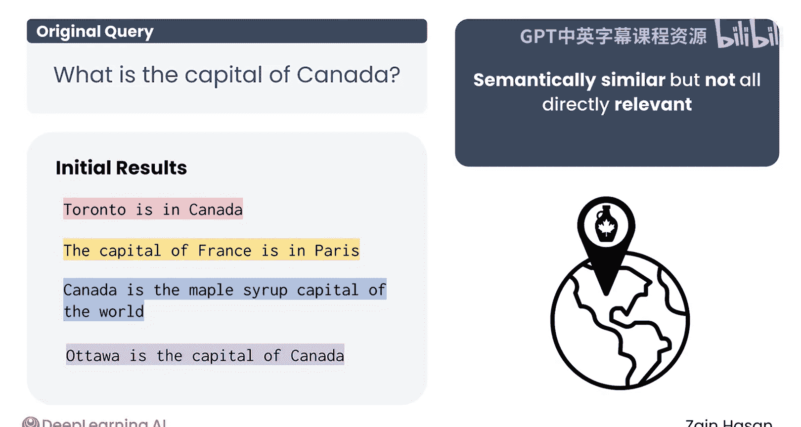
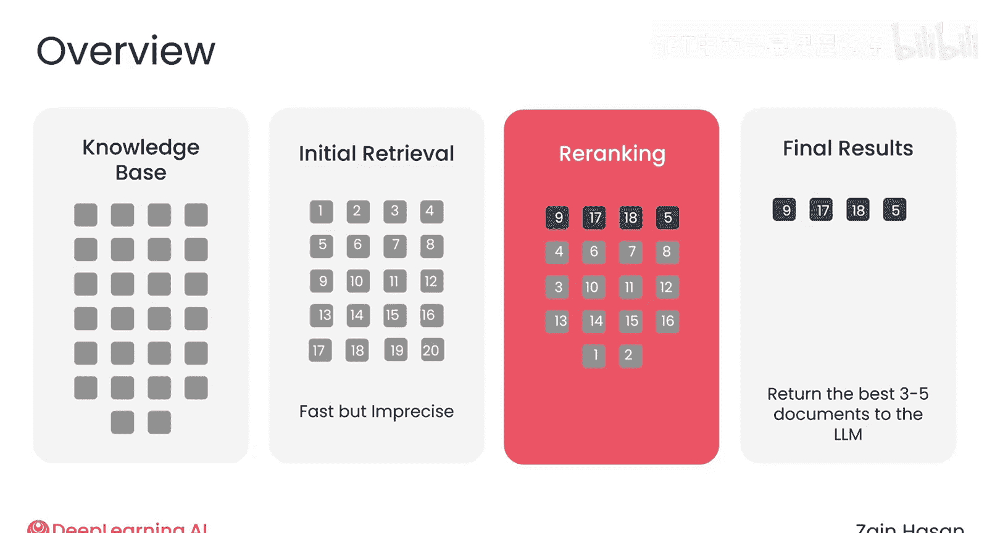
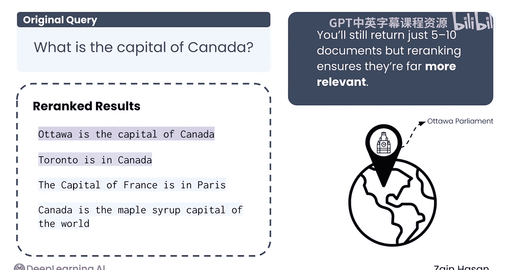
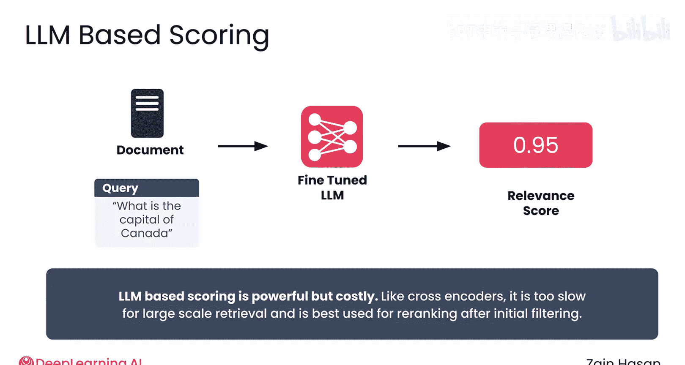

# 吴恩达《检索增强生成｜Retrieval Augmented Generation (RAG)》中英字幕（Claude-3.7-s） - P26：25_结果重排序技术.zh_en - GPT中英字幕课程资源 - BV1qsgLzmEg6

A nice way to get the best of both worlds in semantic search is to just use multiple search techniques together。

Reranking is a post retrieval process in which the initial set of documents returned by a vector database are reraed using high performing but expensive models in order to ensure the absolute most relevant documents are returned。

Let's see how it works。Reranking is all about improving the quality of your retrieval after a collection of documents or chunks has already been retrieved。

 but before they're sent to the LLM。Once the vector database returns results。

 reranking comes in and improves the retrieval quality by rescoring and then reranking those retrieved documents。

 using more capable models， Since only a handful of documents need to be rescord and reraned。

 it's possible to use high performing but costly models that are infeasible to use when searching the entire knowledge base。

Let's look at an admittedly oversimplified example。 If the prompt is， what is the capital of Canada。

 your vector database might retrieve documents that are semantically related。

 but don't directly answer the question。 For example， the phrase， Toronto is in Canada。

 the capital of Frances Paris or Canada is the maple syrup capital of the world。

 are all somewhat semantically related to the prompt but don't ultimately answer the question。

 This is where the reranker can come in to rescore and rera these results so that only the truly relevant documents are ultimately returned。

In systems that use a reraker， you'll usually overfech documents in your initial vector database retrieval。

 for example， you might retrieve somewhere between 20 to 100 documents or chunks using a typical hybrid search approach The reranker will then be used to rescore these documents which leads to a final ranking。

Ultimately， you will still only return a subset of documents retrieved by the vector search。

 perhaps 5 to 10 thanks to the reraker， however， these rerannked documents will be much more relevant than might have been the case if you just performed a simple hybrid search。

 typicallyypically rerannks have a cross encoder architecture。

As you saw earlier， cross encoders provide better results than the standard by encoder。

 but are significantly slower and infeasible to use with millions or billions of documents。

 If a by encoder has already narrowed down the list of documents that need to be considered。 however。

 suddenly， the trade off between quality and time makes a lot more sense。

A cross encoder will add a little bit of latency to your overall system。

Even if only reran 20 to 100 documents， as is typically the case。This trade off， however。

 is almost always worth it。Increasingly， LLM based reranking is also being used。

 the idea is fairly similar to a cross encoder， but instead of providing a prompt document pair to a cross encoder for reranking。

 it's provided directly to an LLM。LLM specifically designed for this task are able to analyze the pair。

 assess their relevance， and respond with a numerical relevance score。

While promising this approach is essentially as inefficient as a cross encodecor， in both cases。

 scoring can't begin until the prompt is received。 and scoring an individual document is still a relatively costly operation。

 As a result， LM based scoring may be further refined。

 but it will remain a reranking technique that can only be used after a typical vector search has narrow down the list of documents that need to be reraned。

 While a rack system doesn't strictly require the use of reranking。

 It is often quite easy to implement and yields much better performance for many vector databases。

 it can be as simple as adding a single line to your search query。

 indicating you want a reraer to be used。

As a result， using a reraker is one of the first techniques you should explore adding to your RA pipeline when trying to improve search relevance。

 typicallyyp you can overfetch 15 to 25 document and then rera between them for a great relevance boost at the cost of a little added latency。

