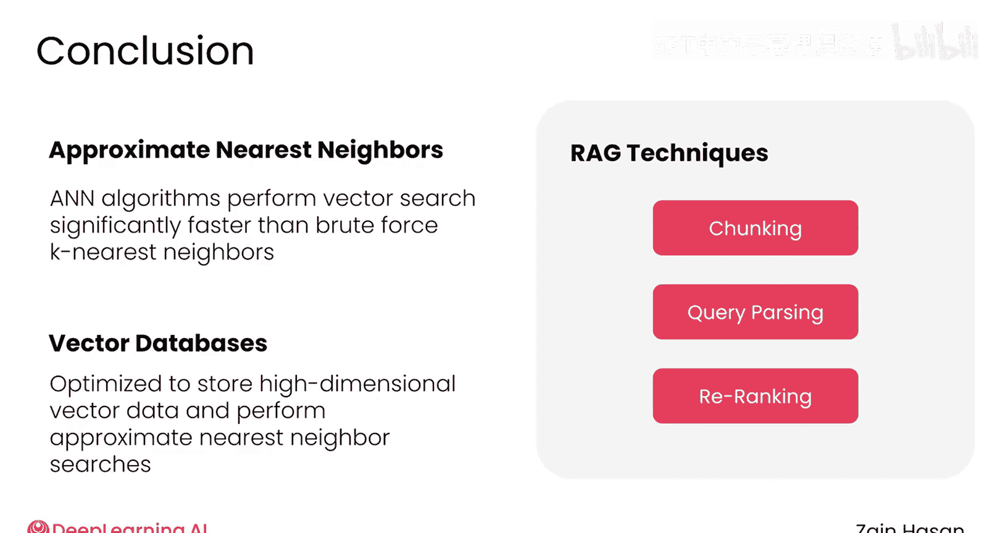

# 吴恩达《检索增强生成｜Retrieval Augmented Generation (RAG)》中英字幕（Claude-3.7-s） - P27：26_模块3 总结.zh_en - GPT中英字幕课程资源 - BV1qsgLzmEg6

Congrats， that brings us to the end of this module。

 Let's do a quick review of the main topics you've seen。😊，First。

 you were introduced to the approximate nearest neighbors algorithm。

 which performs vector searchers significantly faster than a brute force Can nearest neighbors search with the trade off of potentially not finding the absolute best matched documents in your knowledge base。

Next， you are introduced to vector databases， which are optimized to store high dimensional vector data and perform approximate nearest neighbor searches。

This makes them the go to database when scaling up a rag system。 After that。

 you saw several techniques typically used to improve retrieval inside of a production rag system。

 chunking documents into smaller pieces allows vectors to more precisely capture a piece of text meaning and uses less space in an LLM's context window。

Query parsing improves user submitted prompts， so they're optimized for retrieval。 And finally。

 reranking uses highly capable architectures to better identify relevant documents among the set of vector database retrieves with a standard hybrid search for each of these techniques。

 you saw the standard approach you can use in most projects。

 as well as more advanced techniques that can sometimes further boost your retriever's performance。

 Finally。😊，In the end of module project， you got hands on with these concepts。

 implementing them inside a functional rag system。

Awesome， you now have all the skills you need to set up a very capable retriever。 Now。

 it's time to turn your attention to the other major component in a ragg system。

 The large language model that will actually process all of the retrieve documents and generate a response。

😊。

So join me in the next module and let's dive into getting the most out of your LLM。

