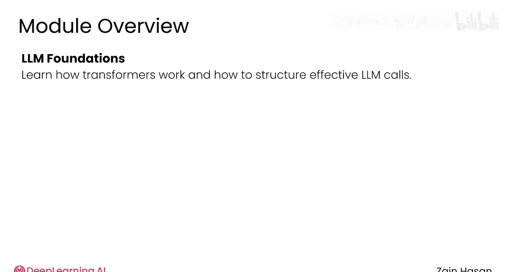
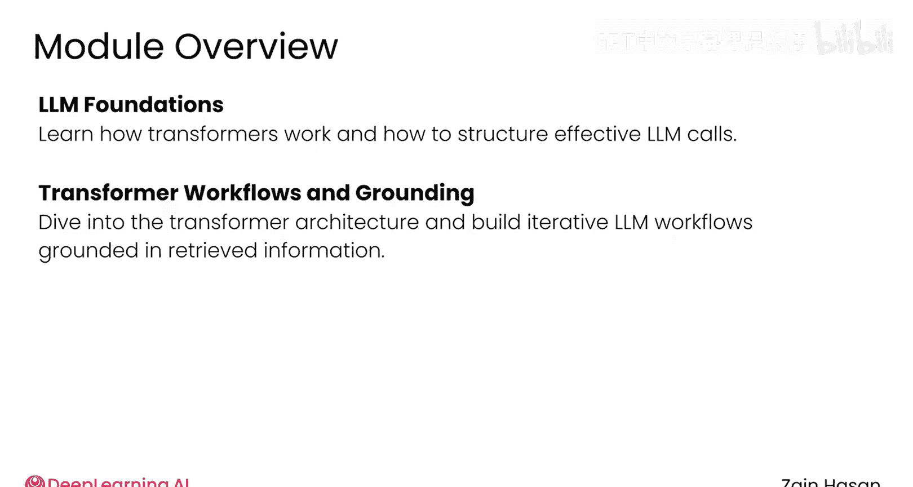
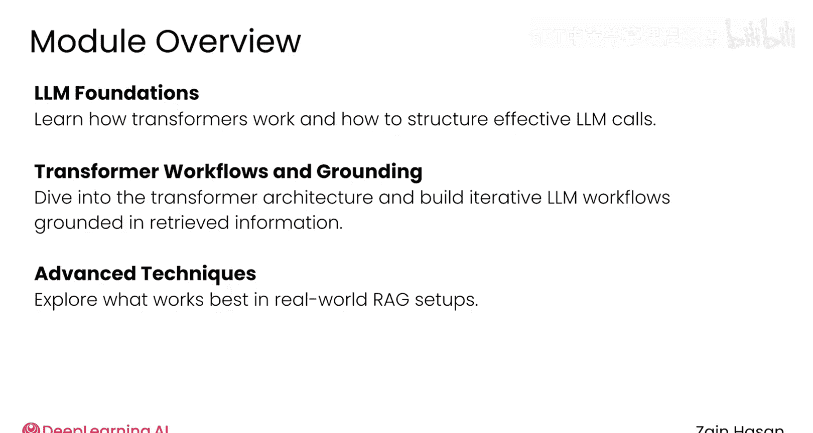
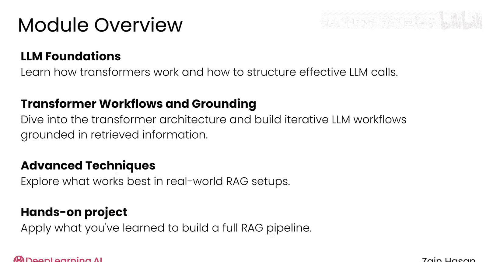

# 吴恩达《检索增强生成｜Retrieval Augmented Generation (RAG)》中英字幕（Claude-3.7-s） - P28：27_模块4 简介.zh_en - GPT中英字幕课程资源 - BV1qsgLzmEg6

The retriever is a critical part of your rag system。

 but the LL M is the real brains of the operation。 The retriever can find and prepare useful information。

 but at the end of the day， it's the LLM that needs to actually use that information to generate a high quality response。

In this module， you'll learn all about large language models， how they work。

 as well as specific techniques that you can use to improve their performance within a RAG system。

You'll dive deep on the transformer architecture that LLMs are built on。

 learn how to construct LLM calls and code， and then iteratively add to that basic workflow to ensure the LLM provides high quality responses that are grounded in the information provided by the retriever。

You will see some advanced techniques that push the limits of LLM performance。

 but also get practical advice for what approaches tend to work for a typical RAG project。 As always。

 at the end of the module， you'll find a handson programming assignment where you'll get to build out a ragG system based on the topics covered in the module。

I hope you enjoy getting hands on with large language models。

 Join me in the next video and let's get started。