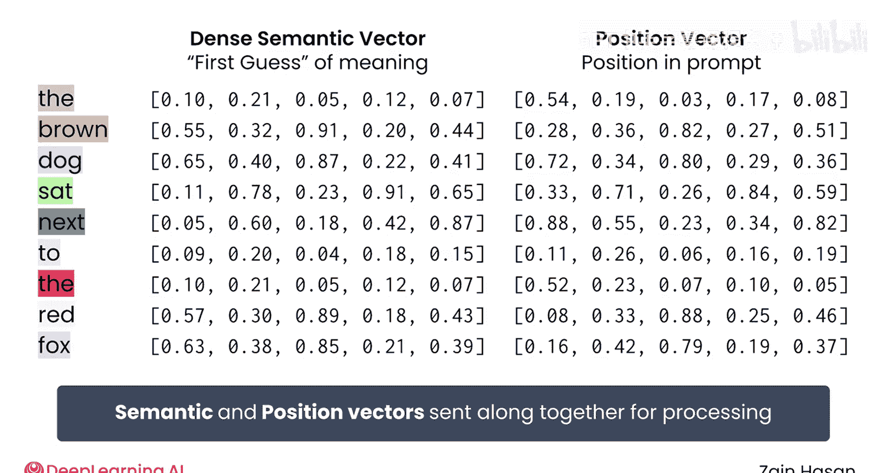
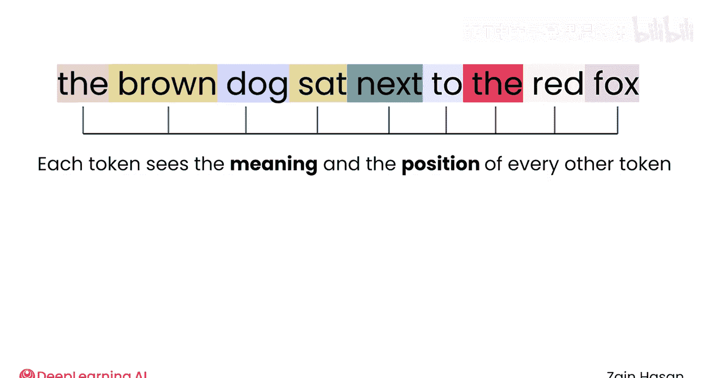
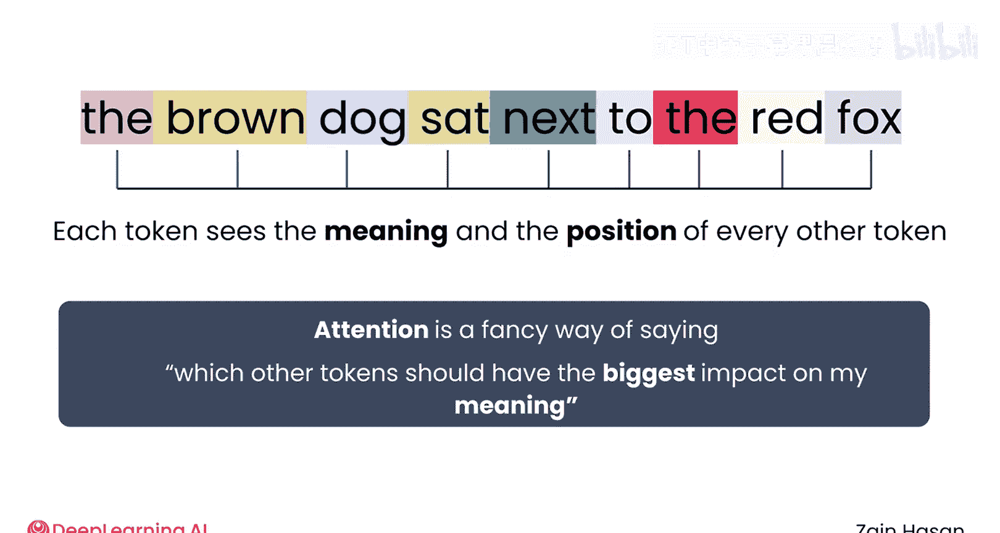
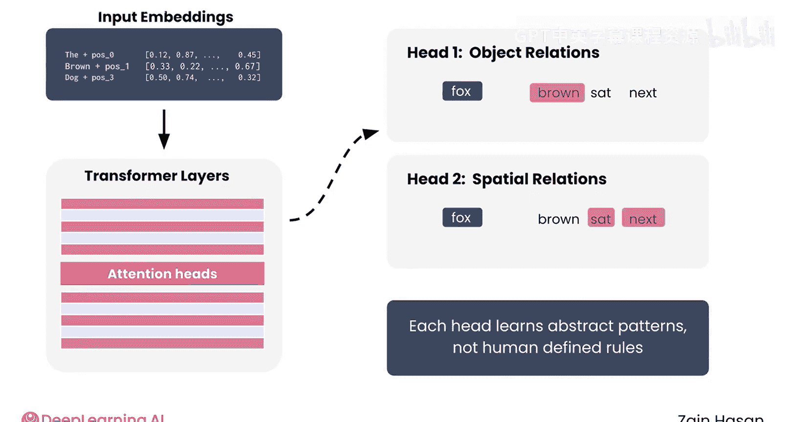
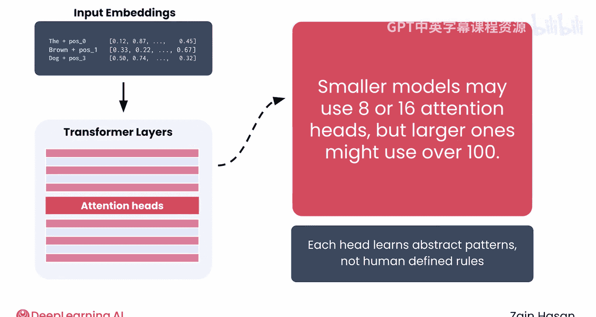
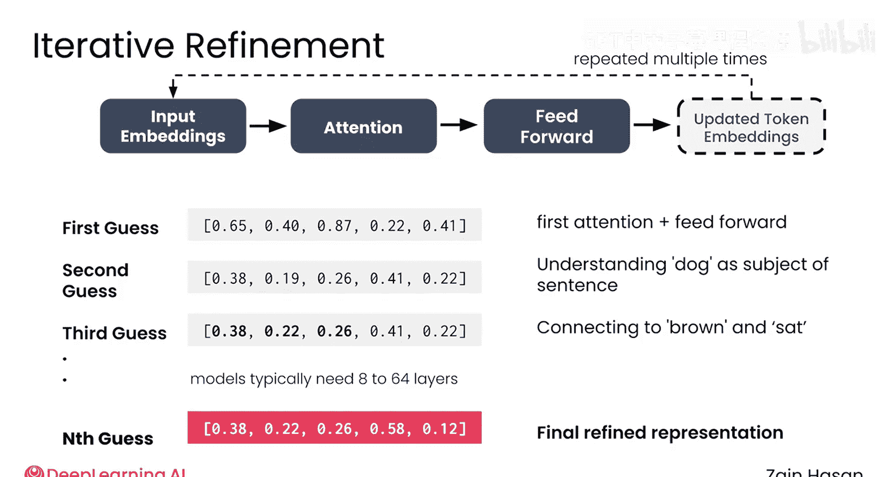
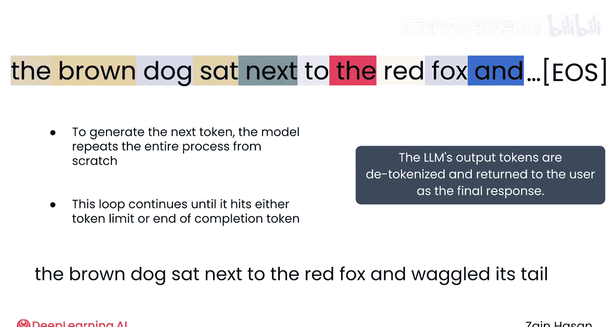
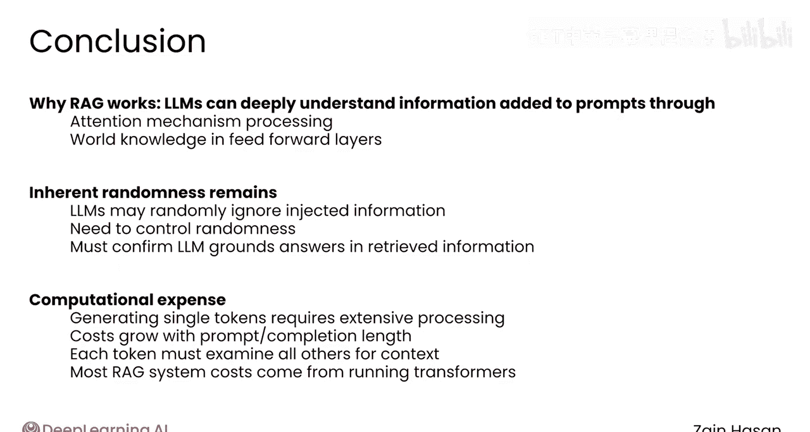

# 吴恩达《检索增强生成｜Retrieval Augmented Generation (RAG)》中英字幕（Claude-3.7-s） - P29：28_Transformer架构解析.zh_en - GPT中英字幕课程资源 - BV1qsgLzmEg6

Your retriever just returned a bunch of relevant documents。

 and you're ready to build your augmented prompt。 S it to your LLM and get back a response grounded in that retrieved information。

You've seen this process many times in this course。

 but now it's time to dive one level deeper and ask， why does this even work？

How is an LL M able to make sense of that retrieved information， More importantly。

 how can you use that knowledge to build even more capable ragg systems to answer all of that。

 Let's look a little deeper at the transformer architecture that LLms are built on。

The transformer was proposed in a seminal paper from 2017 titledAttention is All you need。

 which was focused on the problem of machine translation。 The Transer had two major components。

 An encoder and a decoder。 The encoder would process the original text。

 say a paragraph written in German， developing a deep contextual understanding of the paragraphs meaning。

 The decoder would then use this deep understanding of the German paragraph to generate a new English version of it。

Most LLMs only include the second decoder component。As they just care about text generation。Encos。

 meanwhile， are typically used inside embedding models。

 since their goal is to develop rich semantic representations of text。

 Let's trace a prompt journey through an LLM。 and therefore。

 through the decoder component of a transformer。The first thing that happens is your prompt is split into tokens。

 Once the text is tokenized， each token is assigned an initial dense vector representation。

This vector is basically a first guess of the meaning of that token。These guesses are static。

 so every time you feed an LLM the same token， it'll be assigned the same first guess vector。Next。

 each token is given a positional vector that captures where it's located in the prompt。

 Once these first guess embedding vectors and positional vectors have been created。

 they're sent along for processing。 The tokens now enter the attention mechanism of the transformer。

 Each token essentially looks at every other token in the prompt and can see both their meaning and their position。

Each token then decides which other tokens it should pay the most attention to。

Attention is basically a fancy way of saying which other tokens should have the biggest impact on my meaning。

In a sentence， the brown dog SAT next to the red fox。

 The word dog would probably pay the most attention to brown and SAT since those words directly relate to the dog。

You can think of dog as assigning 70% of its attention to Brown， 20 to sat。

 and the remaining 10% distributed across all the other tokens。

The mechanism used to assign this attention is called an attention head。

 and most models actually include many attention heads that specialize in different types of relationships between words。

You can think of this as one attention head that specializes in relationships between objects and their descriptions。

 so the word Fox might focus all of its attention on brown。

Another attention head might instead specialize in spatial relationships between objects。

And so in that head， Fox might pay much more attention to satAT and next。 In reality。

 the relationships captured by each attention head are not a neat set of relationships assigned by humans。

 but are rather a complex and abstract set of relationships learned during the models's training。

Smaller models might use 8 to 16 attention heads， but larger ones might use over 100。

 The reason this is important is that not only is every token tracking its relationship to every other token in the text。

 but they doing so many different times over each time with a slightly different point of view or focus。

 The result is the attention mechanism develops a very detailed representation of the relationships between all the tokens in the text。

 Once every token has assigned all its attention scores。

 the information enters the feed forward phase。 This is by far the biggest part of the LLM。 Meaning。

 it contains by far the most parameters。

Based on each token's original embedding， position and attention。

 it assigns updated vector embeddings for each token。

 these new vectors are basically a second guess of each token's true meaning。

 but now informed by the context of the other tokens in the text。

Most LLMs then repeat this entire process。 The second guess vectors are fed back into the attention and feed forward mechanism。

 generating new and more refined third guess vectors of each token's meaning。

 a typical LM might actually pass these vectors through these layers somewhere between 8 to 64 times。

 gradually refining its understanding at each stage。Now。

 the L M is ready to start generating based on the highly refined vector embeddings it generated。

 the model asks based on my training data， what tokens are likely to come next。

 This is calculated as a probability distribution across all tokens in the model's vocabulary。

Typically， a handful of tokens have a high probability of appearing next。

But if your model recognizes 100，000 tokens， each one is assigned to probability。

 even if the vast majority are essentially zero。Finally。

 the LLM picks one token from this distribution， weighting the choice by every token's assigned probability。

Probable tokens are chosen more often， but in theory。

 any token has at least a tiny chance of being picked。

 You'll learn more about how to adjust these probabilities。

 And so how the LL M chooses new tokens later in this module。

The chosen token is appended to the end of the prompt， and after all that work。

 the NLM has generated one more token。If you want to generate a second token。

 the model has to repeat the entire process only this time considering both the original tokens and the one it added on。

This ensures new tokens make sense in the context of both the original tokens and the ones it generated。

This means early random token choices will influence which token is chosen later on as well。

To generate a full completion， the model does this process over and over again until it either reaches a token limit you've set for that completion。

 or it chooses to generate a special end of completion token indicating that it's done。

The tokens that the LLM generated might complete a phrase。Or an answer to a question。

 But whatever their purpose， they can be detokenized into plain text and returned to the user。

That was quite a journey through an LLM， so let's look at how parts of this transformer architecture motivate many elements of the design of a rag system。

First， it helps to motivate why Rag works in the first place。

 L Ms are able to deeply understand the meaning and relevance of the information added to the prompt。

 This is thanks to the processing done by the attention mechanism and the world knowledge contained in the feed forward layers。

 Second， it highlights that L Ms are still inherently random。

 Even if you inject meaningful information in your prompt。

 Lms may randomly choose not to generate text based on that information。😊。

Controlling this randomness and confirming your LLM grounds its answers in retrieved information is still necessary and important。

Third。😡，It just highlights how computationally expensive an anm is。

 Gene a single token takes a lot of processing， and that cost actually grows as the length of the prompt or completion does。

 After all， each token needs to look at every other one to fully understand its own meaning。

As you'll explore later， most costs from running a ragG system come from running these powerful but expensive transformer models。

That's a good summary of how L Mms work under the hood。 Now， let's turn our attention。

 No pun intended to how you can refine their behavior inside a rag system。

