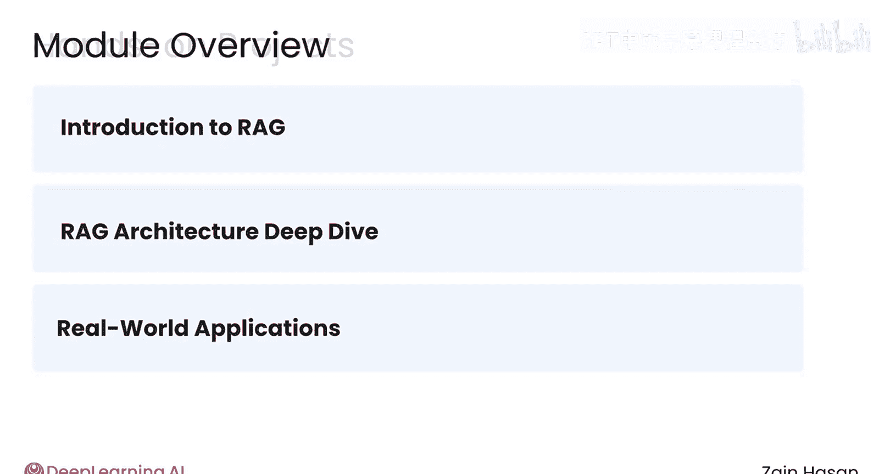
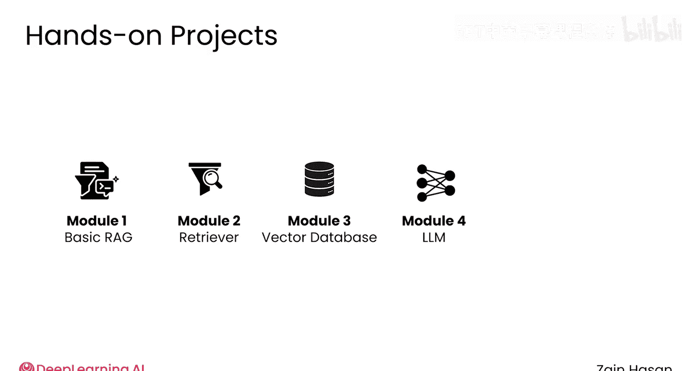

# 吴恩达《检索增强生成｜Retrieval Augmented Generation (RAG)》中英字幕（Claude-3.7-s） - P2：1_模块1 简介.zh_en - GPT中英字幕课程资源 - BV1qsgLzmEg6

Welcome to Module1。If you want to build a powerful rag system。

 you'll need to start with a blueprint in this module， you'll learn foundational ragg concepts。

 get familiar with a ragg system's main components and start building a functional rag system。

 Here's where you can expect to see。 First， you'll get a high levell introduction to Ra。

 including what it is。 why you'd want to use it and how it can improve the quality of responses generated by a large language model。

 Next， you'll get a closer look at the architecture of a ragg system。

 Rag pairs and LLM with a retriever， a component that can help the LLM find relevant information and a knowledge base of trusted information。

You'll do a deep dive on each component and then see how they work together。

RG is useful in a wide variety of contexts， so then youll see several examples of production ragG systems and start reflecting on opportunities to use RAG in your own NLM based projects。

Throughout the module， you'll get hands on with sample code。

 and at the end you'll complete your first programming assignment。

 implementing parts of a simple ragG system。Throughout the rest of the course。

 you'll expand on this first system， adding more complex features like a robust retriever。

 a vector database， more sophisticated uses of an LLM。

 and a variety of techniques for monitoring and evaluation。

There's a lot of exciting topics awaiting you in this module。

 and it sets the roadmap for what you'll learn throughout the entire course。

 joinin me in the next video and let's get started。

