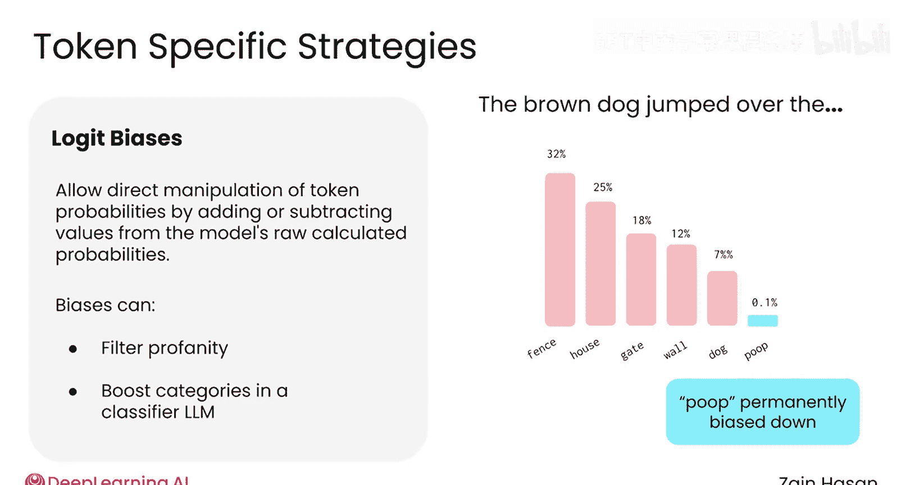
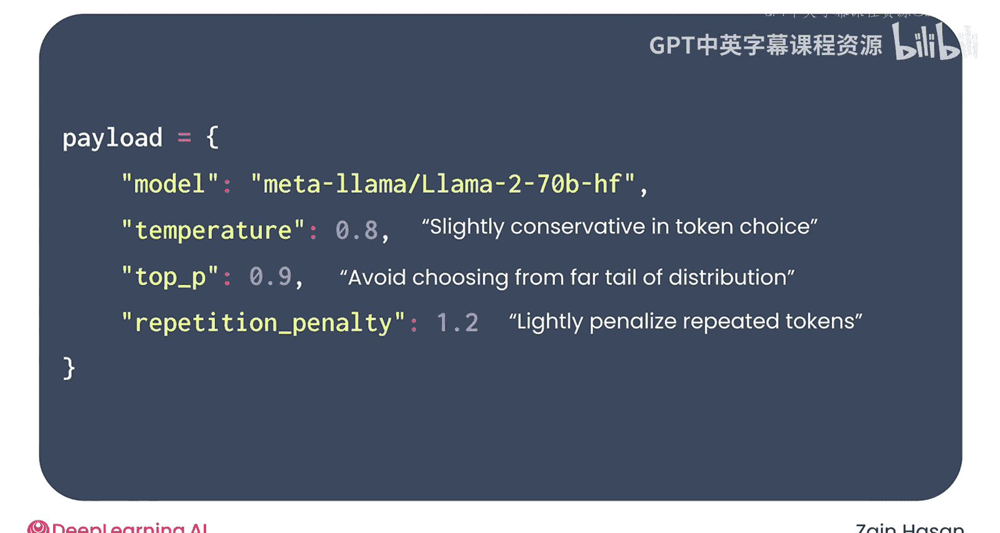
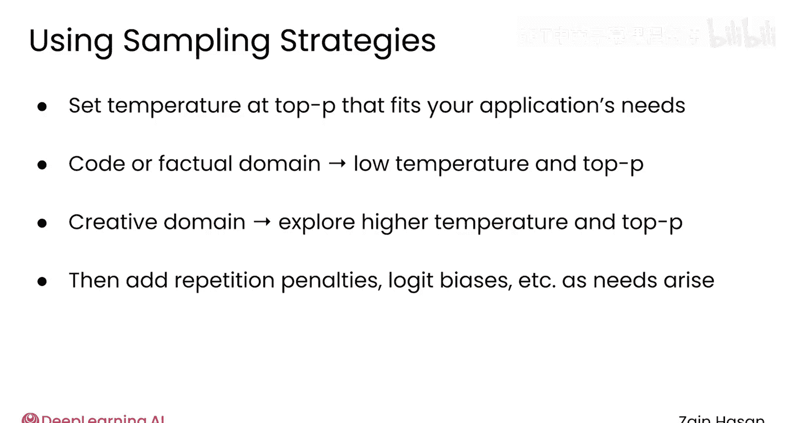

# 吴恩达《检索增强生成｜Retrieval Augmented Generation (RAG)》中英字幕（Claude-3.7-s） - P30：29_LLM采样策略.zh_en - GPT中英字幕课程资源 - BV1qsgLzmEg6

A big part of working with an LLM is understanding and controlling the randomness at the heart of how they operate In this video let's have a look at a typical LLM API and explore the different options they provide to control the way your LLM chooses the next tokens。

Every token， a large language model， adds to your completion， is a weighted random choice。

 If you use an open source La language model， you can see how this choice was made。

 These models will let you see the token probabilities generated at each step。

 which was used to select the next token， For example， for the prompt， the sky is。

This is what the probability distribution looks like。 Blue has a 50% probability of coming next。

 Bright has a 25% probability， and every other token has 10% or less。

 quickly shrinking to less than 1%。Here's what that distribution looks like visually。

When the curve has a tall spike on the left side， you could say the model was confident in its choice。

With only one or possibly a few other tokens having any real chance of being chosen。

A flatter distribution like this， on the other hand， can be interpreted as uncertainty。

 The model has many possible directions。 It could take the completion next， with no clear winner。

Understanding and controlling this distribution curve is a big part of how you tune your LLM's behavior。

 so let's look at a few strategies to do this。One simple approach is to instruct the LLM to not actually make a random choice and just always pick the token with the highest probability。

 This is known as greedy decoding。Greedy decoding's main upside is that it makes the LLM deterministic。

 If you feed your model the same prompt， it will always generate the same response。

The primary downside of greedy decoding is that it can lead to text that is well predictable。

The prose can end up feeling generic or even stilted。

 Another issue with greedy decoding is that the L M will sometimes get stuck producing the same sequence of words over and over again。

The LLM doesn't actually care if the overall completion makes sense。

 The LL M just keeps choosing the highest likelihood next token。

 And once the model falls into a repetitive loop， there's no mechanism to break out of it。

Despite these potential shortcomings， greedy decoding can make sense in instances where highly predictable and deterministic output is desirable。

 like code completion or even as a temporary setting to debug your system。In most instances。

 you don't want to entirely eliminate randomness。 You just want to control it。

 The most widely used parameter to control an LlM's randomness is called temperature。

You can think of temperature like a dial that changes the shape of the probability distribution generated by your LOM。

 A default temperature of one just gives you the original distribution。

 A lower temperature leads to a more spiky distribution with only the most likely tokens having any chance of being generated。

The ordering of the tokens doesn't change， but their probabilities of being chosen do。

Setting temperature all the way down to 0 sets the model to perform greedy decoding with only the single most probable token。

 having 100 per probability， turning the temperature up a bit。 say in the range of 1。1 to 1。

3 will flatten out the probability distribution， giving unlikely tokens a bit more chance of being chosen。

 This leads to more variety， and sometimes more interesting or even creative sounding text。

 setting the temperature too high， will result in a very flat probability distribution。

 All tokens will have about an equal chance of being chosen， even if they don't make that much sense。

Whatever temperature you set your LM to， that distribution curve will still have a long tail running out to the right full of nonsense tokens。

 Your LM has a small likelihood of choosing to help control this。

 A few additional sampling techniques are used。Top K sampling is the most simple and limits the LLM to choosing from the top K most likely tokens。

 For example， you might both set at temperature of 1。1。

 but also limit the LLM to choosing from the top five most likely next tokens。

A similar approach is called top P sampling， which limits the L M to choosing tokens with cumulative probability falling below some threshold。

 For example， you might set a top P of 85%。You would start from the left side of this distribution and keep adding the probabilities of each token until a total is greater than 85%。

 Top P tends to be the more responsive or dynamic of the two approaches in top K。

 the LLM always picks from the same pool of tokens。

 regardless of the shape of the distribution with top P。 If the LLM is fairly certain。

 meaningan a few tokens have a very high probability。

 the LLM will limit its choices to the few most likely tokens。If instead， the LM is more uncertain。

 meaning the distribution is flat with no clear best choice。

 the LM is allowed to choose from a much larger pool of potential tokens。

Some techniques also target the probabilities of individual words。

 rather than the overall shape of the distribution。 For example。

 large language models can have a tendency to repeatedly use the same word or phrase。

 which can sound unnatural。 Many Lms allow you to apply a repetition penalty。

 which decreases the probabilitybabilities of words that have already appeared in the completion。

 This can make the resulting text sound more natural and varied。

 Most Lms also allow you to increase or decrease the probability of specific tokens。

 usually called Loit biasing。This bias will permanently adjust those tokens probability of being chosen up or down。

If you know you don't want your ragG system to generate profanity。

 you could buy as certain words down。 On the other hand。

 if your ragG system is a classifier designed to output one of a few categories。

 you could boost the probabilities of those categories to ensure the NLM always chooses from between them。

Here is an API call combining many of the techniques you've seen in this video。

 This is a fairly sensible， general purpose combination of parameters， a temperature of 0。8。

 a top P of 0。9， and a repetition penalty of 1。2。This LLM will be a little more conservative in its token choice。

 avoids choosing from the far tail of the distribution and lightly penalizes repeated tokens。

 By experimenting with each parameter， you could dial in the LLM's behavior for the context of your application。

Theres a wide array of techniques available to control the randomness inherent in your LLM。

 and this video only covered a selection of the most common ones。 In general。

 I advise setting a temperature and top P that best fits your needs。

 If you're generating code or answering factual questions。

 a lower temperature and a lower top P makes sense。 If you're operating in a more creative domain。

 a higher temperature and top P could give your LLM a more interesting and exploratory tone。

 After that， consider introducing repetition penalties。

 Loit biases or other sampling techniques you research in response to specific issues you identify in how your LLM is performing。

Ultimately， understanding that there are many ways to tune in LLM's random choices and iterating towards the settings that fit your project will get you the performance that you need。

