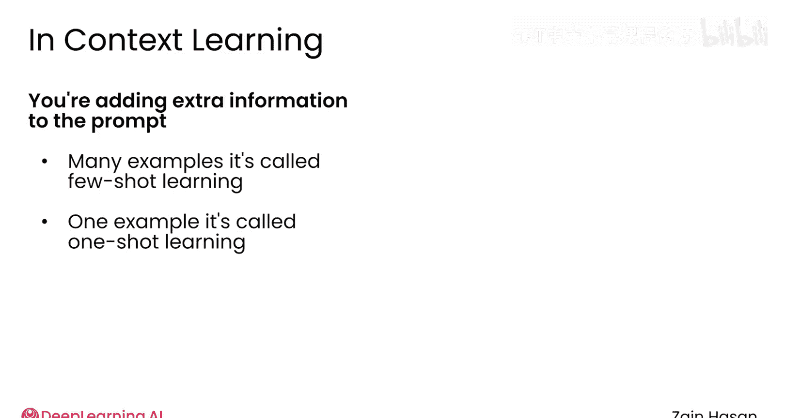
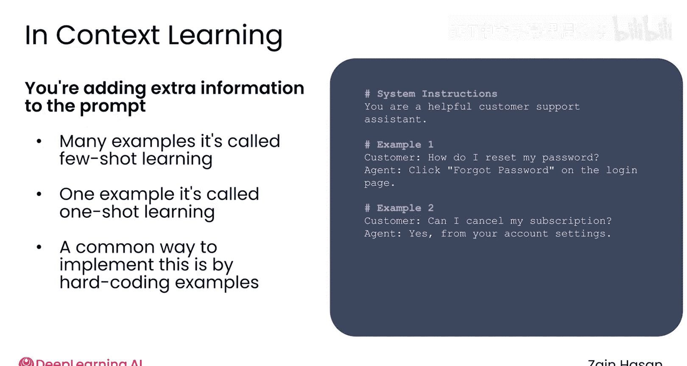
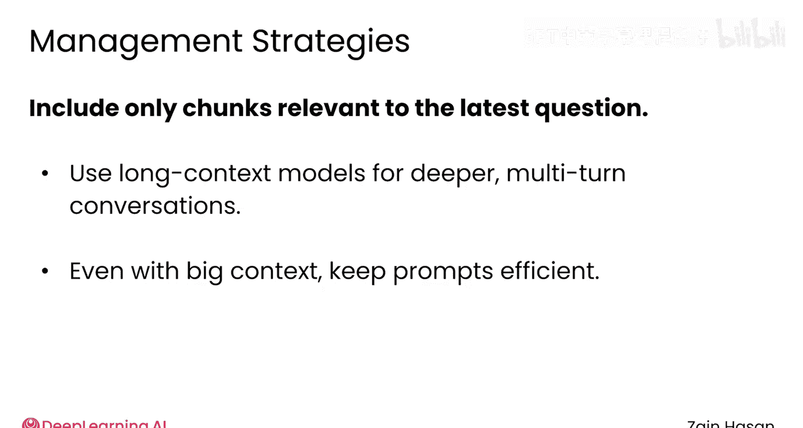

# 吴恩达《检索增强生成｜Retrieval Augmented Generation (RAG)》中英字幕（Claude-3.7-s） - P33：32_高级提示工程技术.zh_en - GPT中英字幕课程资源 - BV1qsgLzmEg6

Once you have a basic prompt template set up for your ragG system。

 you can start trying more advanced prompt engineering techniques。

 Let's have a look at a few of those and when you'd want to use them。

In contexttex learning is a technique which allows you to help the LLM learn what kind of output you wanted to generate by adding examples of them to the prompt。

For example， if you're building a customer service chat bot。

 your prompt can include examples of previous customer requests。

 as well as high quality responses to those requests。

 These examples help the LLM learn the structure and tone it should use when it generates new responses。

 just like in RaG， you're adding additional information to the prompt to ground the way the LLM response。

If you include many examples， this approach is called few shot learning。

If you include just one example， it's called One shot learninging。

There's a few ways to implement in context learning。

 You could just hard code one or more example questions and responses into your prompt in situations where you want a stable set of LlM behaviors。

 This alone could help improve response quality。 If you want to change up the examples each time。

 however， you can use Rag to retrieve example questions and responses from your knowledge base。

For example， if you're working on that same customer service chat bod。

 you could index successful customer chats into your vector database。

When a new customer writes in about a particular topic。

 you can retrieve the text of previous conversations about that topic and inject that text into your prompt。

In many ways， this is just normal rag。But the fact that you're specifically retrieving example responses can help further improve the quality of the LLM's response。

Another powerful collection of prompt engineering techniques essentially encourages the LLM to reason through prompts in a step by step manner。

 For example， you can tell the LLM to first think aloud or think step by step about the best way to approach the problem before actually providing a final answer。

The idea is you're essentially giving the language model a scratch pad to organize its thoughts before answering。

 a common way to do this is to tell the LLM that tokens between scratchpad tags are considered a space for thinking and brainstorming and not part of its final answer。

A similar approach is called chain of thought prompting。 In this approach。

 the L M is instructed to tackle questions in a step by step manner。

 rather than immediately answering them。 The L M might be instructed to first generate the steps needed to answer a question and then follow those steps。

Encouraging the LLLM to plan and take this incremental approach can increase the likelihood that the final responses are more accurate。

Since the LLM will show its work， so to speak， it's also easier to trace down issues when the LLM's reasoning falls apart。

Reasoning oriented strategies like these have been so successful that many L Lis are now designed to be reasoning models right out of the box。

 reasoning models excel at complex reasoning tasks， such as coding， mathematics， planning。

 puzzles and complex workflows that require multiple steps。Under the hood。

 these reasoning models first generate reasoning tokens where they might plan ahead and consider options。

 much like the scratch pad you saw before。 Then they output response tokens with the intended final response to the user。

Some providers of reasoning models will only provide access to those final response tokens。

 others allow you to access the reasoning tokens as well。

These reasoning tokens are part of what makes these models more accurate than their non reasoning counterparts。

 but they're still just regular tokens with all the associated costs of generating them。As a result。

 reasoning models are typically slower and more expensive to run。Depending on your context。

 building a rag system around a reasoning model may be well worth the higher costs of each LLE call。

 For example， reasoning models can be particularly good at assessing the relevance of the retrieved documents。

And can be more skilled at deciding how best to incorporate that information into a response。

Especially one that requires more complex reasoning steps。Interestingly。

 many prompt engineering techniques don't work as well with reasoning models。For example。

 you don't need to ask them to think step by step as this is something they've already been trained to do。

They also may not do well with in context learning as they try to incorporate the provided example responses into the current question being answered。

They tend to perform better with specific goals that you want them to work towards and very specific information about the format that you want them to answer in。

You can still provide high level guiding principles and explicitly state approaches you want the model to take or avoid After that。

 however， you can just give them the entire context dump of documents retrieved from your RAG system。

New models， including reasoning models， are constantly being released， however。

 and most LLM providers will include information about how best to prompt them。

As you start employing more prompt engineering techniques。

 context window management will become important。 Remember。

 the initial prompt and whatever tokens that NLM generates for the completion。

 both use up portions of its context window， whether you're injecting documents from your retriever。

 adding in context learning examples to every prompt or having a reasoning model。

 plan itss responses before answering a question。 All of these advanced techniques increase the length of your prompt。

 the generated response or both。It's easy to rapidly fill up your context window if you're not paying attention。

With single turn conversations， the best fix is to just validate your getting value from your prompt engineering technique。

 If chain of thought prompting or in context learning isn't giving you better performance。

 it's better to just remove those components from your system。

 Multiti turn conversations can quickly eat up your context window。

As each back and forth message needs to be included in the prompt。

A variety of approaches collectively referred to as context pruning addresses this issue。

 A simple solution is to keep only a fixed number of recent messages in the prompt。For example。

 the last five sent by the user and the LLM。More sophisticated approaches use a separate L limb to summarize older messages。

 shrinking their size， but preserving their key points。

If you're using a reasoning model in a multiter conversation。

 you'll almost certainly want to drop reasoning tokens from the chat history and just keep the response tokens。

Likewise， in a rag system， you usually only want to include the chunk's retrieve to support the response to the most recent question。

 not every question that came before it。 Of course。

 if your application needs multi turned conversations with deep and rich context。

 you can always switch to using a model with a longer context window。That said。

 you'll still want to be thoughtful about how you design prompt。

 as even on models with longer context windows， long prompt are slow and expensive to run。

Prompt engineering techniques can improve the performance of your LLM。

 but your rag system doesn't necessarily need to employ them。

 a simple prompt template and a well written system prompt might be all you need for your project。

When it comes to more advanced techniques， I advise you add them to your project only after it's clear you need them。

Prompting in general can be more of an artrc than a science。 So whatever strategies you use。

 experiment with different prompt and find the ones that work best for your system。

