# 吴恩达《检索增强生成｜Retrieval Augmented Generation (RAG)》中英字幕（Claude-3.7-s） - P34：33_幻觉处理机制.zh_en - GPT中英字幕课程资源 - BV1qsgLzmEg6

Hallucinations are a constant concern when working with LLMs。

 and even a well designed rag system can still hallucinate。Detecting hallucinations。

 reducing them and ensuring the LM accurately site sources are therefore the most important parts of building your rag pipeline。

 Let's have a look at a few ways this is done。Imagine you get your first rag system up and running。

 a customer service chatbot for an online store。 a user writes in and asks if the company offers student discounts。

The retriever finds information about discounts for both seniors and new customers。

 both of whom would receive 10% off。 Meanwhile， the L M system prompt encourages it to be helpful with customers。

 All of these factors influence the L M， which responds。 Abute。

 you can get 10% off with a valid student I D。 The same great discount we offer are seniors and new customers。

 The user is delighted and continue shopping on your site。 eager to claim their discount at checkout。

 The only problem。 That student discount doesn't actually exist。 The L M just made it up。😊。

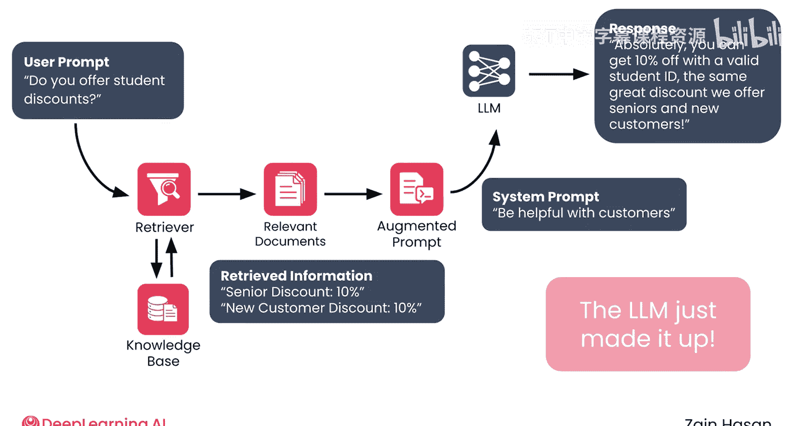

It's important to remember why LLMs hallucinate in the first place。

 A language model is designed to produce probable text sequences。

With a bit of randomization thrown in for variety， probable text sequences are often factually accurate。

 but not always。And language models aren't designed to differentiate between true and false。

 just probable and improbable。Hallucinations are problematic for a few reasons。

The first is obvious enough。 you just don't want your language model to provide inaccurate information to your user。

The second is that almost by definition， hallucinations sound plausible。

 and so can be more difficult to detect than total nonsense。 Finally， over time。

 occasional hallucinations can cause your users to lose trust in your rag system。

 even if the majority of generated content is accurate。Of course。

 a big reason you'd build a rack pipeline is to reduce hallucinations。

The information you retrieve from your knowledge base can help ground an LLM's responses and possibly provides information missing in the model's training data。

Even so， ragg systems are still prone to hallucination。

 So additional steps to prevent them are necessary。 hallucinations can come in many types and sizes。

 Go back to that discount。 and LL M might accurately describe the very real senior discount and how to claim it。

 but misate the discount as 5% instead of 10。 in more extreme cases。

 the L L M might inaccurately state there isn't a senior discount when actually one exists。

 or as you saw earlier， invent entirely new discounts。 your company doesn't offer。

 This means you'll need to evaluate the texture L M generates on many levels if you want to feel confident in its accuracy。

 Now， here comes the cold， hard truth。

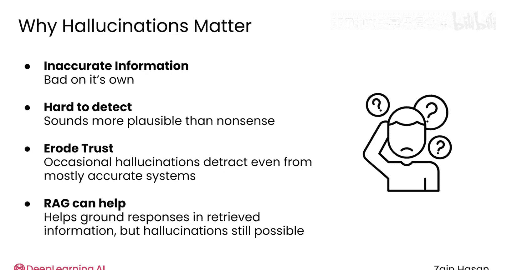

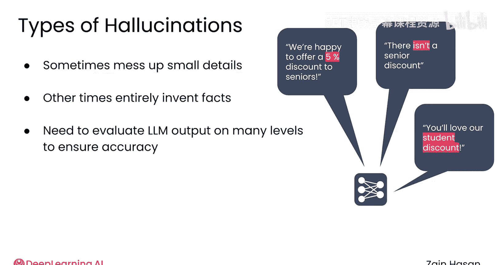

There's no perfect solution for hallucinations。Or at least not currently。Luckily， however。

 ragG is one of the best approaches currently available。

 and there is ways you can refine ragG systems to further decrease the frequency of hallucinations。

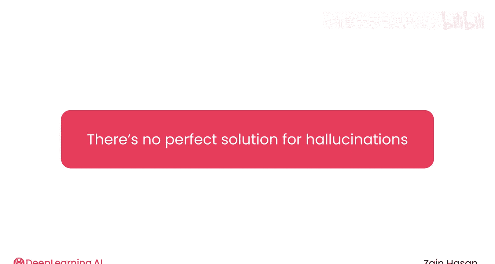

To start， think through how you detect hallucinations in LLM output if you didn't have a knowledge base。

Without a trusted， external source of truth to compare that output to your options are pretty limited。

 One approach， however， is self consistency checking。

 where you have the model repeatedly generate completions for the same prompt and check if the factual information contained within them is consistent。

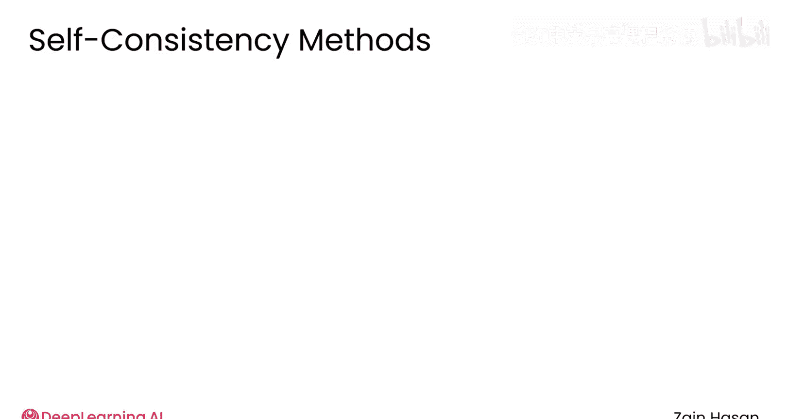

The underlying idea is that if the language model is hallucinating information。

 itll do so inconsistently and factual differences across completions will be detectable。

 In practice。 however， this method can be costly and unreliable。

 if you have a knowledge based to reference， that's the best place to start。

 Since inside a rag system， you do have access to a knowledge base。

 the best approach to decrease hallucinations， is to ensure responses are grounded and retrieved information。

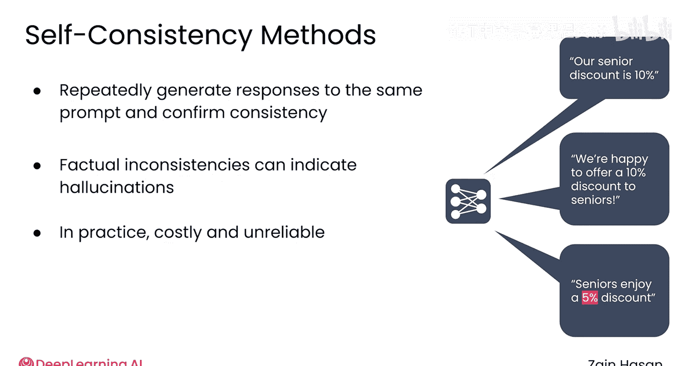

For example， you could modify your system prompt to say that the LLM can only make factual claims based on red information。

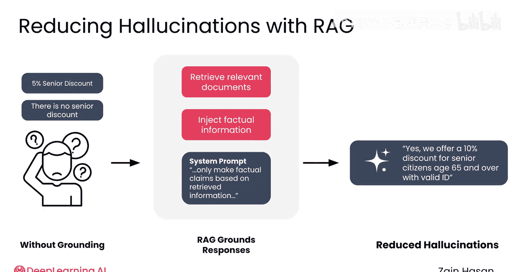

If you want further confidence that the LLM is basing its responses on retrieved documents。

 you can further require the LLM to cite its sources。

Sometimes this just means prompting the model to cite sources at the end of each sentence or paragraph。

 This can further increase the likelihood that the LM grounds its responses in the retrieved sources。

 and citations also make it easier for a human reader to verify claims in the response。

 A risk with this approach， however， is that the LM will just hallucinate the citations。

Some models fine tuned to site sources will generate valid citations more reliably。

 but if you want more confidence in your citations， you'll need to use an external system。

For example， context site is a system that scores how well a response is grounded in a set of source materials。

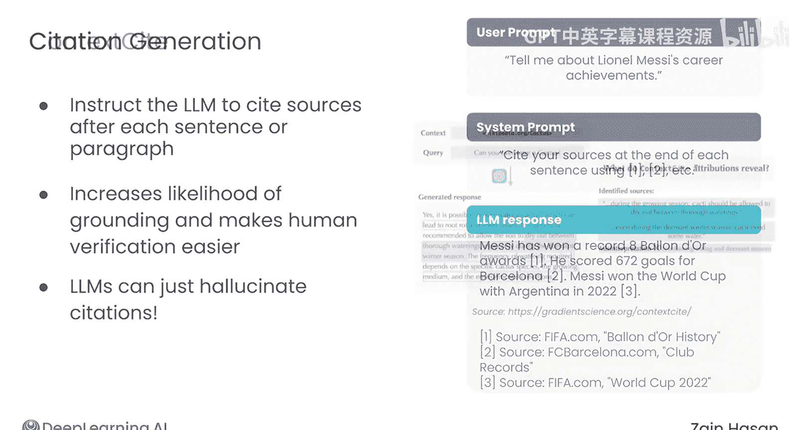

The model processes the response sentence by sentence。

 and it attributes each sentence to one of the context documents that were retrieved and provided to the LLM contexttex site then generates tags for each sentence noting which document is the source of that sentence。

In cases where the statement does not have supporting material， it's labeled no source。

Some implementations may even provide a similarity score between the sentence and the identified source document。

These tags can either be used to generate source citations in the final generated LLM output。

 or as a part of evaluation of how frequently the LLM is grounding its responses in the documents retrieved by a RA system。

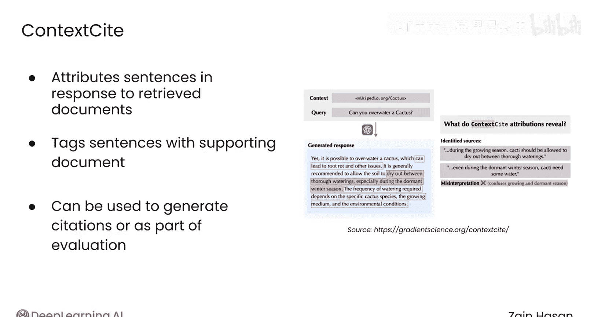

Recent efforts， such as the ALCE benchmark aim to measure how well a system references and site sources when generating responses。

 the system provides preassembled knowledge bases and sample questions you would then use your RAG system on these prompts to ask the ALCE system to evaluate the generator response。

Scores are generated for three key metrics， fluency， correctness and citation quality。

 In other words， how clear is the final text， how factually accurate。

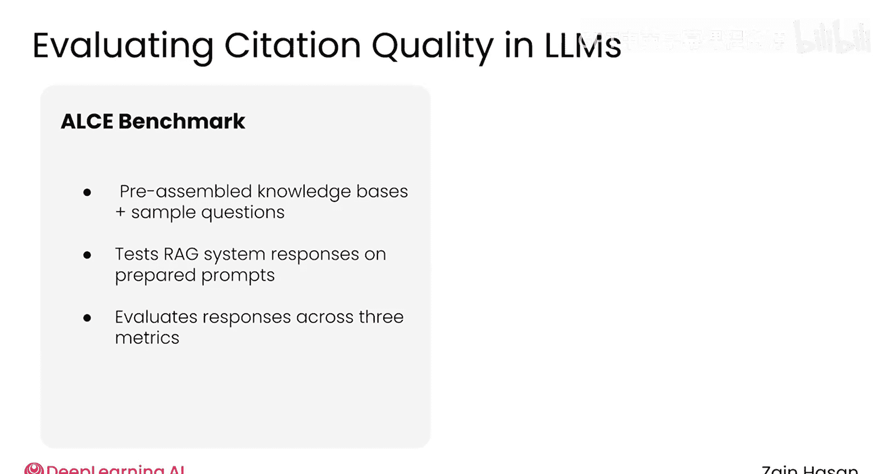

And how well do the provided citations align with the correct sources to cite。

These benchmarks don't control hallucinations in your production system。

 but they do give some sense of how well your system is avoiding hallucinations and sighting sources。

 hallucination detection is a constant challenge in an LLM based system。

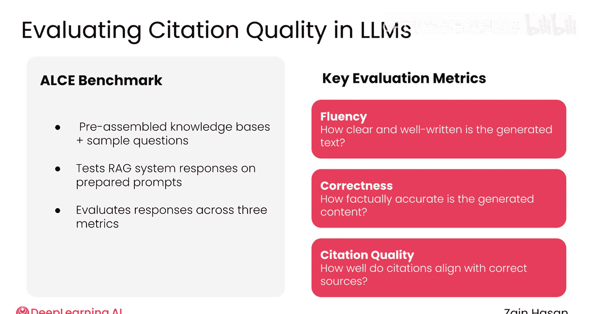

That said， by building a rag system， you're already taking the single most effective step to minimize hallucinations。

After that， focus your energy on ensuring the LLM grounds its answers in retrieved information by refining your system prompt。

 Finally， test your system using hallucination focused benchmarks to ensure your system is providing grounded。

 well cied responses。Together， these approaches can significantly reduce hallucinations and help you build a system that provides trustworthy responses。

