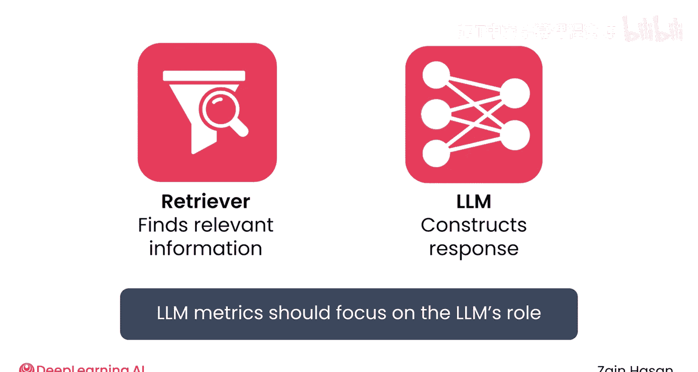
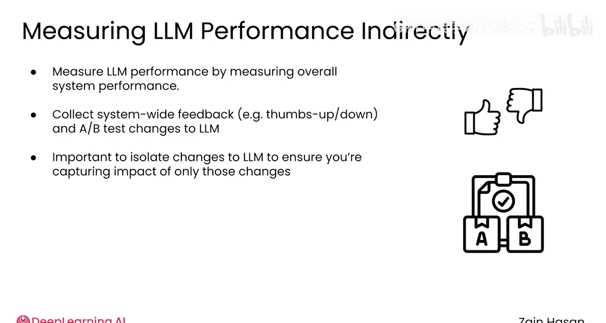

# 吴恩达《检索增强生成｜Retrieval Augmented Generation (RAG)》中英字幕（Claude-3.7-s） - P35：34_大模型性能评估.zh_en - GPT中英字幕课程资源 - BV1qsgLzmEg6

Whether you've just built your first proof of concept rag system or are iterating on a system already in production。

 you'll want to know how well your LLM is performing。

 whether you're considering adjusting your model's temperature， updating your system prompt。

 or even swapping in an entirely new model。In order to make an informed decision。

 you'll need to have metrics on hand to measure each decision's impact。

 Let's look at some common methods for evaluating your LLM's performance。

 Since your L M is operating inside of a complex system to start。

 it's important to be clear on what specific tasks your L M is responsible for。

Your retriever's job is to find the relevant information from the knowledge base。

 your LLM's job is to use that information to construct a high quality response。

This means that when considering adjustments to your LLM or even replacing the underlying model entirely。

 you want to make sure the metrics you're using focus on the LLM's role and the broader ragg pipeline。

If the problem ultimately lies with your retriever。

 you don't want to waste time rewriting your system prompt。

If you assume your retriever is operating well， then it should find mostly relevant information。

 perhaps with a few irrelevant documents added。The job of your LM then is to respond to the user prompt。

 incorporate the relevant information into its response。

 cite it appropriately and resist getting distracted by any irrelevant information that was retrieved。

 Note， most of these LM specific behaviors are somewhat subjective。

How can you say quantitatively that a response does a good job of answering a user's original question or ignoring irrelevant information？

As a result， most LLM specific metrics rely on using other LLMs to assess the quality of a response。

 incorporating LLMs into the evaluation process allows for some degree of flexibility or subjectivity in a scalable way。

A good source of these RAG specific metrics is the Open source Ragas Library。

Let's look at a few metrics it provides。Response relevancy measures whether a response is actually relevant to a user prompt。

 This metric checks whether the response was relevant to the original prompt。

Regardless of whether it's factually accurate。 Here's how it works。 First。

 the response generated by your rack system is fed to a new LLM that generates several sample prompts。

 It believes could have LED to that response。Then， both the original user prompt and the sample prompts are embedded to a semantic vector。

Next， the cosine similarity between the actual user prompt and each sample prompt is calculated。

 Finally， these similarity scores are averaged， giving the ultimate measure of response relevancy。

Note this metric doesn't necessarily ensure the response is providing factual information。

 but it does check whether you can reasonably work backwards from the response the L M gave to the prompt it was originally given。

To measure whether the LM is actually using retrieved information。

 you could use the faithfulness metric。 This metric uses a language model to identify all the factual claims made within the response。

It then uses more language model calls to determine how many of these claims are supported by one of the pieces of information retrieved from the knowledgeway。

 The percentage of the claims that are supported is the faithfulness for that particular prompt retrieval and response。

Other metrics included in the Ragos Library take similar approaches to assess things like sensitivity to irrelevant information retreat from the knowledge base。

 or ability to accurately cite sources。A pattern across all these metrics， however。

 is the reliance on LLM calls at some point in the Eval process。

 and even possibly examples of ground truth correct answers。

This speaks to the fact that the role of the LLM in a ragg system is complex and difficult to evaluate with more simplistic automated metrics。

 In addition to these LM specific evals， there are ways you can use metrics that run across your entire system to evaluate LM performance。

 For example， if your users can mark responses from your ragg system with a thumbs up or thumbs down rating。

 you can then AB test changes to your system prompt and see what impact the change has on overall user satisfaction。

The idea here is that you measure system wide performance but isolate changes to LLM settings。

 allowing you to attribute changes in overall performance to changes to your LLM。

LLM performance metrics are useful tools for deciding to adjust your LLM settings or even switch to a new model。

Since the quality of an LLM's responses are somewhat subjective。

 you should plan on using either LLM as a judge based EVs or human feedback to assess LLM quality。

A combination of these techniques will allow you to confidently evaluate how well your LLM is operating。

