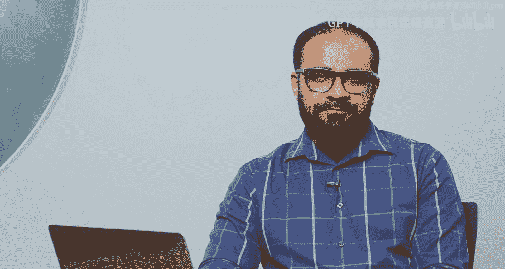
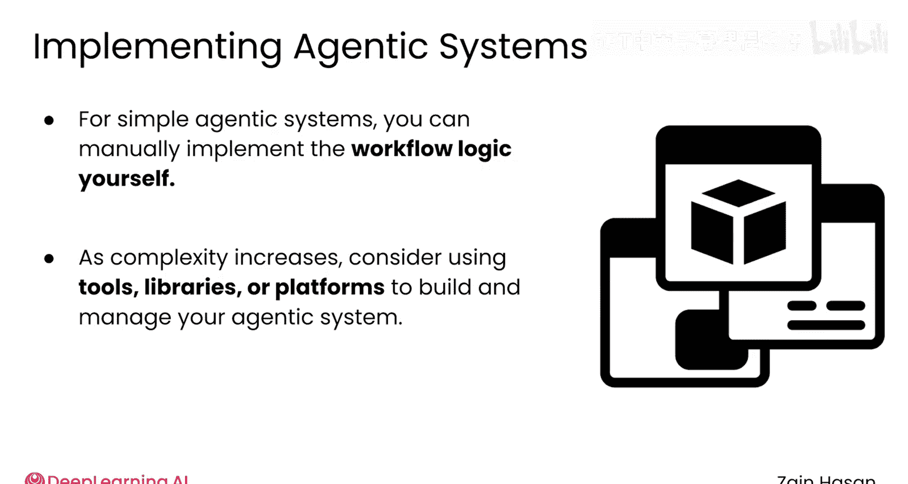

# 吴恩达《检索增强生成｜Retrieval Augmented Generation (RAG)》中英字幕（Claude-3.7-s） - P36：35_自主式RAG系统.zh_en - GPT中英字幕课程资源 - BV1qsgLzmEg6

As your rag system matures。A powerful way to improve its performance is to start introducing agentic workflows。

An agent workflow means using several LLMs throughout your ragg system。

 each one responsible for a single step in the overall process。

You've already seen this idea with LMs used to perform tasks like query expansion。

 promptory writing or citation generation， there's a huge array of compound systems like this you could build。

 so let's look into how you can further improve the quality of your rag system by building it in an agent way。

Typically， the way you use a language model is to feed it a prompt。

 and it spits how a response simple。In an agent system。

 there's two main changes to this bottle first。Tasks are now treated as a series of steps and decisions。

Each of which can be completed by a call to a different LLM。Second。

 LLs are given access to a wider array of tools like a code interpreter， web browser。

 or in the case of Rag， a vector database of information to reference。

 Here is one possible agent workflow for a ragg system。A user submits a prompt to the system。

 and it is first processed by a small router LL M。 This LLM's job is to determine if the prompt actually requires a call to the vector database。

 It's been specially tuned for this task and will only output either yes。

 meaning the prompt does justify retrieval from the database or no。

 meaning the prompt can be answered without retrieval。Based on the router LLM's decision。

 the prompt is either sent to the vector database for retrieval or skips that step。

If no retrieval is completed， the prompt is sent directly to a separate LLM to generate a response。

If her retrieval step was requested， a separate evaluator LLM is used to determine if the retrieved documents are sufficient to answer the question。

Based on this evaluator LLM decisionsion， additional retrievals from the vector database may be requested Once sufficient information has been retrieved。

 an augmented prompt is constructed and given to the LLM to generate a response。 At this point。

 a final LLM goes through this response and add citations。

This is just one possible agententtic rag system， but it highlights a few key points that are true for any agententtic system。

First， you can think of designing an a system essentially as drawing a flow chart。

 each LLM in the diagram is still just taking text input and generating text output。

 but the system is set up so that each LLM is completing one task on the prompts journey through the ragG system。

Second， you don't need to use the same LLM for each step in the workflow。

 The router and evaluator LLM in the setic system could be lightweight models that are fast and cheap to run since they have a single and relatively simple task。

 you could then use a larger model to generate the draft response and pick a model that specializes in citation generation for that step。

 As you think about adding a workflows to your RAg application。

 Here's a few common patterns to consider。A sequential workflow just moves output in a linear fashion through a series of LLMs。

 This might mean that every prompt sent to your system moves through an LLM based query parser。

 query writer and citation generator as part of the generation process。

Each LLM just focuses on one step of the overall process and can therefore specialize at that step。

A conditional workflow uses an LLM to decide which of many paths a prompt should follow。

 You just saw a router LLM implement this workflow to decide if a retrieval is necessary to respond to a prompt。

You could also use a router to determine which of several LLMs with different strengths and specializations should be used to generate a response。

An iterative workflow works similarly to a conditional workflow。

 but it routes the prompt to an earlier point in the overall system forming a loop。 For example。

 if your ragg system is designed to generate code that integrates with an existing code base。

 It's possible the system would need multiple attempts to write work code。

 An evaluator LLM could be used to assess each draft。

 perhaps with the assistance of a code interpreter and provide feedback until it deems the solution suitable。

Finally， you can create parallel workflows in which an orchestrator language model breaks a prompt into multiple distinct tasks and assigns each task to separate LLMs。

 On the other end， a synthesizer language model recombines their work if your application is say comparing the key insights from two research papers。

 you might want two different LLMs to summarize and evaluate each one。

 and then have the orchestrator combine their findings。For simple agenttic systems。

 you can just implement the logic of your desired workflow yourself as things get more complicated。

 However， there is a wide variety of tools， libraries and platforms designed to help you build and manage an agent system。

 The creative possibilities when building agent systems are truly endless。

There's also an important mindset shift at play here。

LMs start to look a little less like standalone solutions and more like modular pieces that fit inside a larger workflow。

Suddenly， you're more than happy to use smaller models or models that only excel at a few tasks because their capabilities are well aligned with the portions of the workflow they're responsible for。

Adding a components can give you the flexibility to build even more capable ragG systems。

