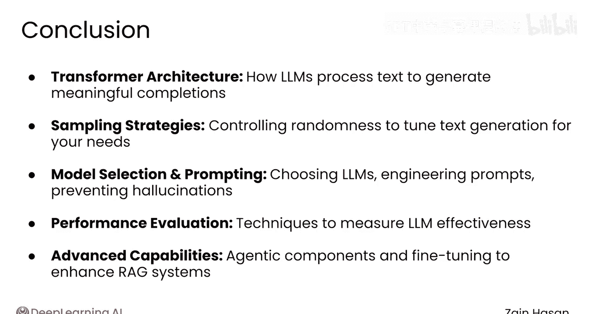
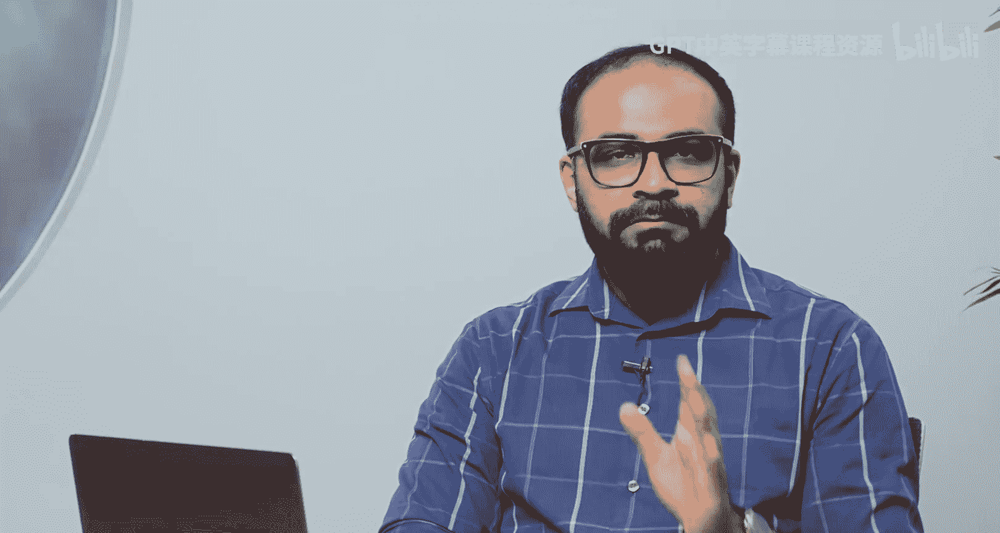

# 吴恩达《检索增强生成｜Retrieval Augmented Generation (RAG)》中英字幕（Claude-3.7-s） - P38：37_模块4 总结.zh_en - GPT中英字幕课程资源 - BV1qsgLzmEg6

Nice work completing this module。 There were a lot of LLM topics covered here。

 So let's do a quick review of everything you saw。😊，At the beginning of this module。

 you went deep into the heart of a transformer， understanding how it processes text to develop a deep understanding of its meaning and generate relevant completions。

 You then saw how various sampling strategies can be used to tune the randomness inherent in how a language model generates text to fit the needs of your application。

Next， you learned how to use benchmarks to choose your LLM。

 a wide variety of prompt engineering techniques， and how to detect and prevent hallucinations。

Then you learned a wide variety of techniques used to evaluate LLM performance， and finally。

 you looked at how adding agent components or fine tuning models can push the limits of what your RAG system is able to do。

At this point， you have a strong foundation in LLM concepts and have all the tools you need to build your first RA system。

 so join me in the next and final module of this course to see how your RAG application can go from a simple prototype to a production ready system。

