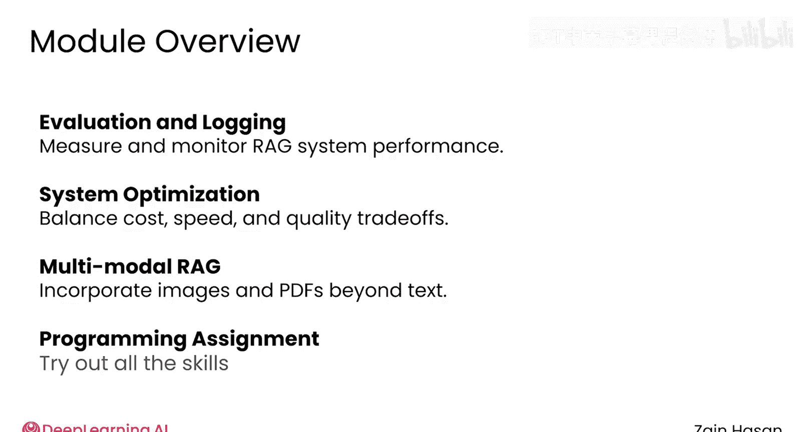

# 吴恩达《检索增强生成｜Retrieval Augmented Generation (RAG)》中英字幕（Claude-3.7-s） - P39：38_模块5 简介.zh_en - GPT中英字幕课程资源 - BV1qsgLzmEg6

At this point， you know all the skills you'll need to design and build your own rag system。

 Once you are ready to move that application into production。 However。

 a number of new considerations arise in this module。

 you'll learn how to get your rag system production ready。

To start， you'll review a variety of evaluation strategies for RAG systems and platform for running those Evals。

Whether you're looking at individual components or your overall system。

 you'll want the ability to observe your system's performance。

You'll also explore how logging can help you trace individual calls to your RAG system and identify the cause of low quality responses。

To conclude this look at Evals， you'll learn how to build custom data sets from your application's traffic in order to test changes to your rag system using actual customer data。

In the next section， you'll explore a variety of trade offs you'll often encounter when designing and tweaking your RA system。

Whether you're looking to control cost， memory footprint or latency。

 you'll investigate strategies that help align a RAG system with your project's needs without significant loss and response quality。

Finally， you'll explore some cutting edge approaches to incorporate multimodal data into systems。

 allowing your systems to pull from a knowledge base that contains image or PDF data in addition to text。

As always， the module concludes with a programming assignment where you can try out all the skills you've learned。

I think you'll enjoy this final module focused on making your production rag system even higher performing。

 join me in the next video and let's get started。