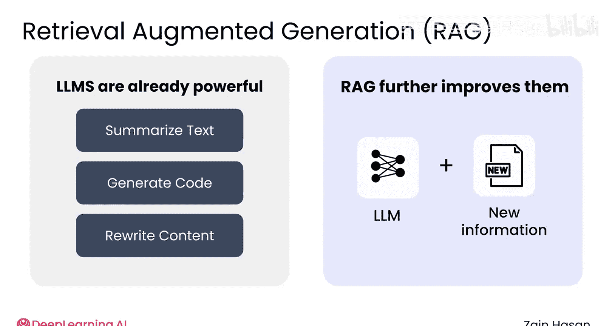
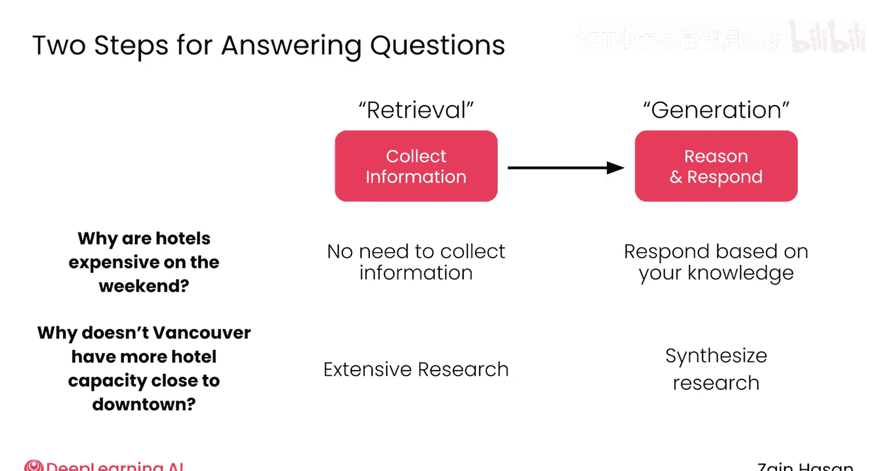
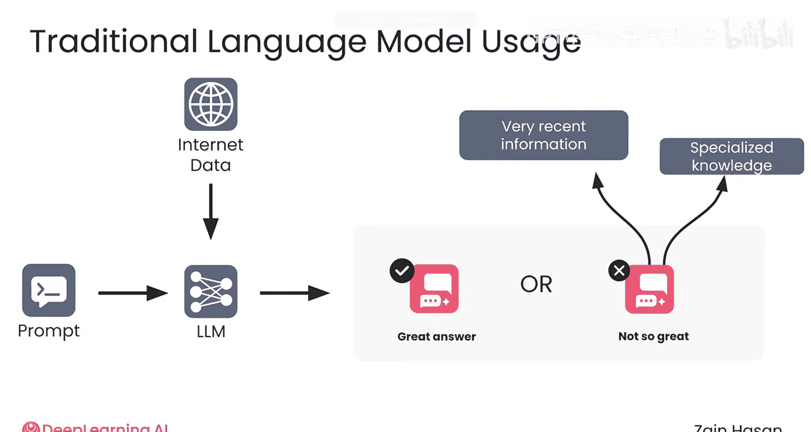
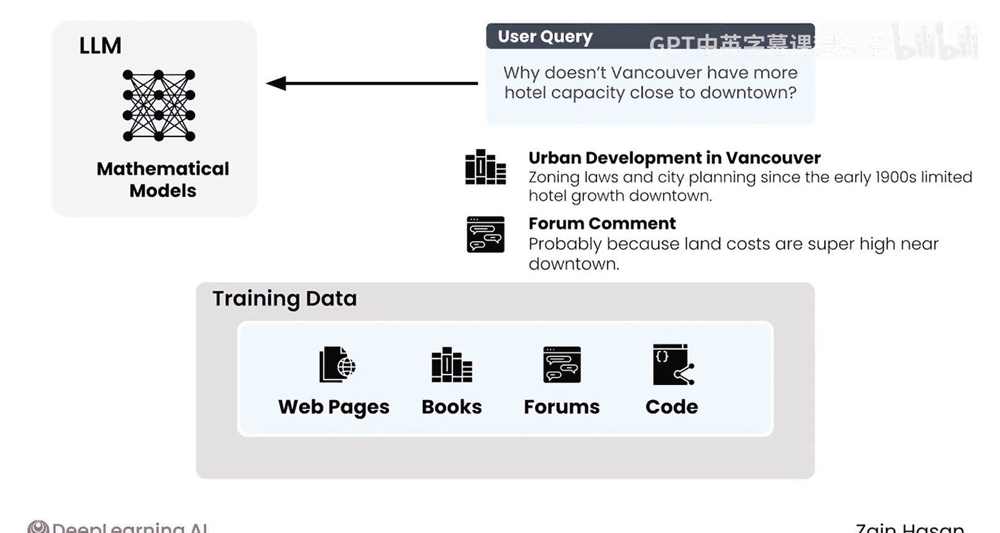
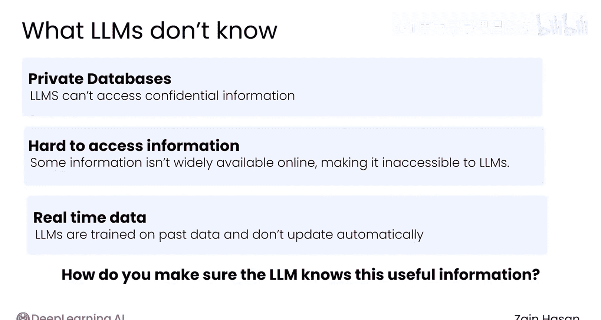
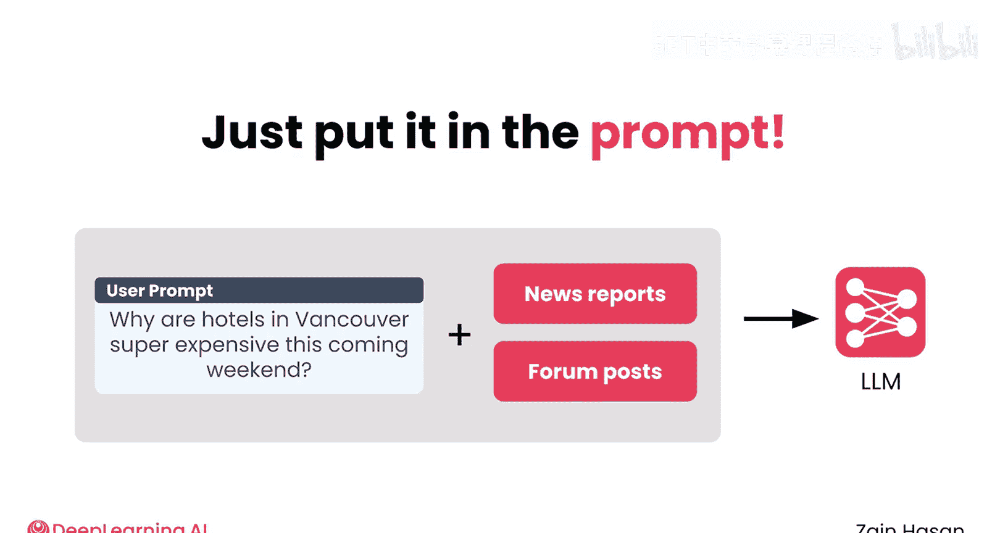
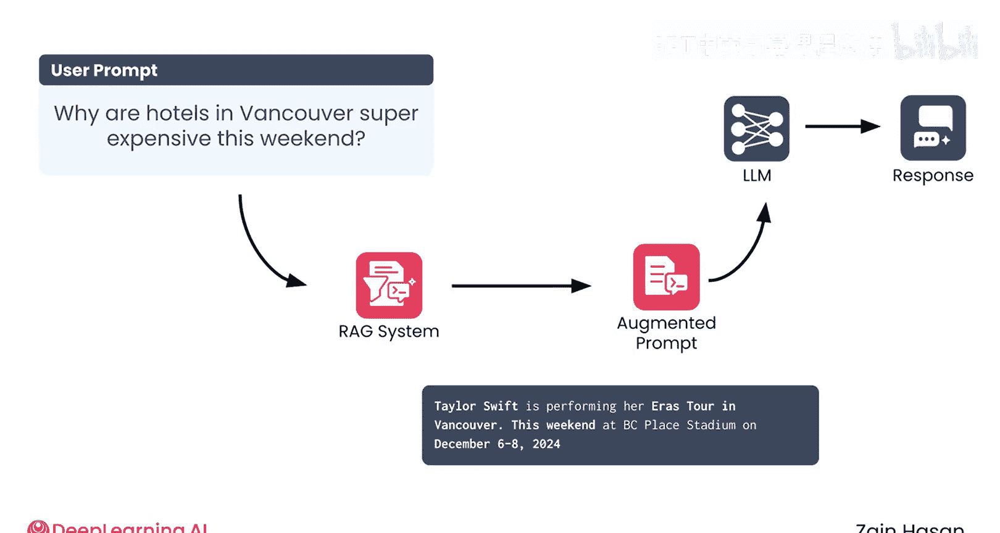
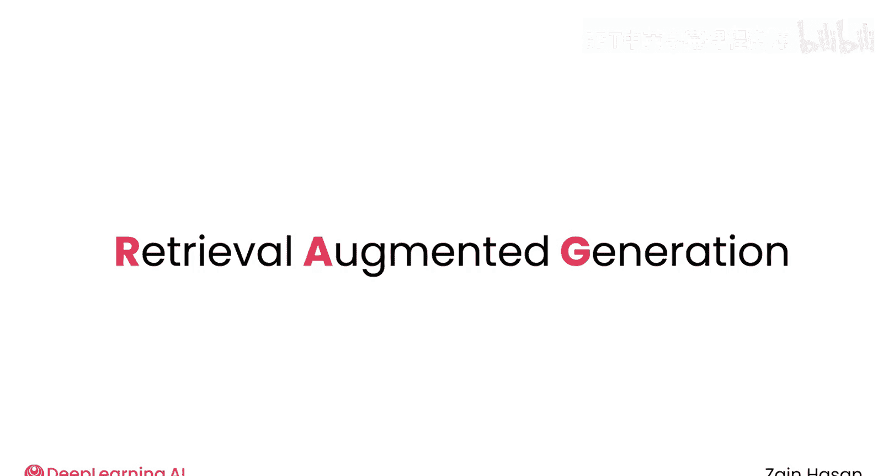

# 吴恩达《检索增强生成｜Retrieval Augmented Generation (RAG)》中英字幕（Claude-3.7-s） - P3：2_检索增强生成技术导论.zh_en - GPT中英字幕课程资源 - BV1qsgLzmEg6

L limbs are remarkable tools。 They can answer questions， summarize and rewrite text。

 provide feedback on documents， generate code and much more。

 These types of tasks seemed out of reach for computers just a few years ago。

 and interacting with one can fit a lot like working with another person。

Rags an approach that further improves the performance of large language models by giving them access to information that they don't know from their training。

To help highlight that idea， let's look at a few examples。Suppose I ask you the question。

 why are hotels expensive on the weekend。You can probably answer that question。

More people travel on weekends， so there's more competition for rooms。Now， suppose I asked you。

 why are hotels in Vancouver super expensive this coming weekend？

You'll need more information to answer this one。

If you search online， you might find that international superstar Taylor Swift is in town this weekend for a two night residency with that additional information。

 you again probably could answer the question。

Finally， suppose I asked you， why doesn't Vancouver have more hotel capacity close to downtown？

To answer this question， you'd probably need to do some deep research into the history of Vancouver's development。

 urban planning in general， and so forth。In other words。

 you'd need access to a lot of specialized information。

 You can think of the way you'd respond to these questions as two phases。 First。

 you collect any necessary information， and then you reason over that information to develop your response。

As you saw with the first question。Sometimes you don't need to collect any information based on your knowledge of the world。

 you're ready to respond right away。 Other times， though。

 you might need to collect a little bit or even a lot of information in Rag。

 the process of collecting useful information is called retrieval。

And the process of reasoning over that information and responding is called generation。

LLMs benefit from the retrieval stage for basically the same reasons you do。

 You'll learn more about LMs throughout this course。But for now。

 you can think of them as kind of like a person that has a wide variety of general knowledge from reading huge chunks of the internet。

When you prompt an LLM， it relies on this knowledge to generate a response For many prompts。

 this works great。In other cases， though， the LLM doesn't know the information it needs to respond accurately。

The prompt might be about a very recent event or some specialized information it hasn't previously seen just as was true with you。

 It's unreasonable to expect LLms to be expert on every topic。

 and they provide much better responses when they have access to better information。

Recognizing that LLMs also benefit from a retrieval phase is the core idea of RAG。Of course。

 LLMs aren't people who spend a lot of time on Wikipedia， instead。

 they're mathematical models that have been trained on massive data sets taken from all over the open internet。

During the training process， the model learns any information contained in the training data。

 When you send a prompt to an LLM， yourre hoping information relevant to your question was included in the training data。

 Ily many times。 Unfortunately， lots of information won't be included。

 Companies keep private databases， some information is just hidden or hard to access。

 and with news being published every minute of the day。

There will always be information out there that an LLM wasn't trained on The question then is how do you make sure the LLM knows this useful information？

The short answer， just put it in the prompt。 The key idea of a ragg system is that you can modify a prompt before sending it to the large language model。

 In addition to the user's original question， you can add in information that helps the LLM respond。

If you asked a ragg system， why are hotels in Vancouver super expensive this weekend。

 it would first perform a retrieval step to gather relevant information。

 The language model would then be provided in augmented prompt that includes both the original question and any retrieved information。

 Now， the LLM has the information it needs to respond accurately。

Of course， this information needs to be retrieved from somewhere。

 The component of a ragg system that handles this process is called a retriever。

 The retriever manages a knowledge base of trusted， relevant and possibly private information。

When the rack system receives a prompt， the retriever finds and retrieves the most relevant information from the knowledge base to share with the LLM。

The model then uses that retrieved information when it responds to the prompt。

The name retrieval augmented generation， which is admittedly a mouthful。

 hopefully now makes more sense。All you're doing is improving or augmenting the way an LLM generates text by first retrieving relevant information from a knowledge base。

This is a high level description of how RAG works， but sometimes it can be more useful to see some example applications。

 so join me in the next video where I'll talk through some ways ragG is already used。

