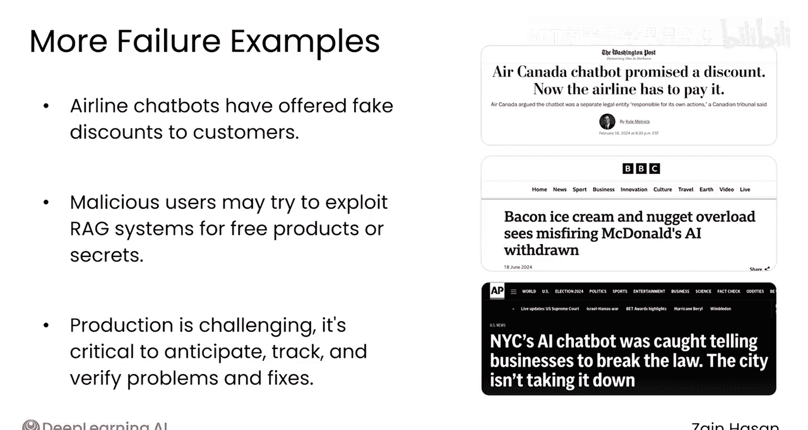

# 吴恩达《检索增强生成｜Retrieval Augmented Generation (RAG)》中英字幕（Claude-3.7-s） - P40：39_生产化部署的挑战.zh_en - GPT中英字幕课程资源 - BV1qsgLzmEg6

Production environments put entirely new strains on your RAG system and navigating those challenges requires a different set of skills than is required when prototyping to start this module。

 let's just review what new challenges your system will face once it's being used by actual customers。

The first set of challenges you'll encounter in production simply arise from scaling up more traffic。

More users cantrain the throughput of your system， whether it's how many requests they can handle at once or the latency between receiving a request and returning a reply。

 More requests also means more memory and compute usage， which eventually means higher costs。

 keeping up raw system performance at scale can be challenging。

 a second category of challenges comes from the variety and unpredictability of prompt your system will receive once it's in the hands of your users。

 even with rigorous testing， it's difficult to predict every type of request your rag system will receive。

You may find your system struggling on some of these new requests。

 even if it performed well on pre launch testing。 Another challenge in production is just that real world data is often a mess。

It's not uncommon for data to be fragmented， poorly formatted， missing metadata， and so forth。

 A lot of data also isn't even in a text format at all， but instead is found in images。

 PDFs and slide decks。If you want to include this data in your knowledge base。

 and you'll need a way to access it。Security and privacy issues are also a concern。

 a lot of rackC systems are deployed expressly because the data in your knowledge base is private or proprietary。

Ensuring the data remains private while allowing authorized users to access it when using a rack system is important functionality On top of all these challenges。

 the biggest issue with production is that mistakes can have real business impact。

 whether financial or reputational。When Google first launched its AI search summaries feature。

 it responded to some prompt by advising users eatte rocks for the nutritional benefits they provided。

 When Google investigated the cause of this issue， it turned out that a user had asked how many rocks should I eat。

And admittedly silly and hard to predict question when the system retrieved information on the question。

 many of the articles or forum conversations it found were comical。

 but the system failed to recognize that fact。Google subsequently fixed this issue and even wrote a blog post explaining the source of the bug。

 but they're far from the only company to run into trouble after launching an LLm based product。

 airlineline chatbots have promised well-meaning customers discounts that don't actually exist。

 malicious actors will try to trick your rag system to sell them your product for free。

 or reveal secret information。 Production is simply a challenging environment for your ragg system to operate in。

 And so having systems in place to anticipate problems before they happen。

 track them down when they do and verify that changes you make lead to real improvements is critical。

 There's a variety of techniques you can use to address all of these production challenges。

 Join me in the next video to see the first of these。 Build a robust observability system。😊。

