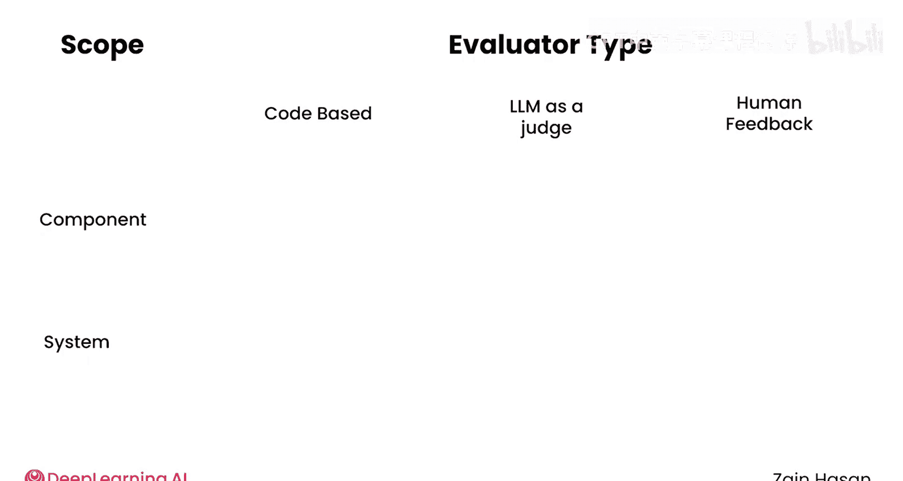
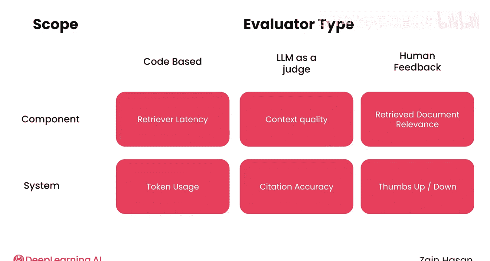
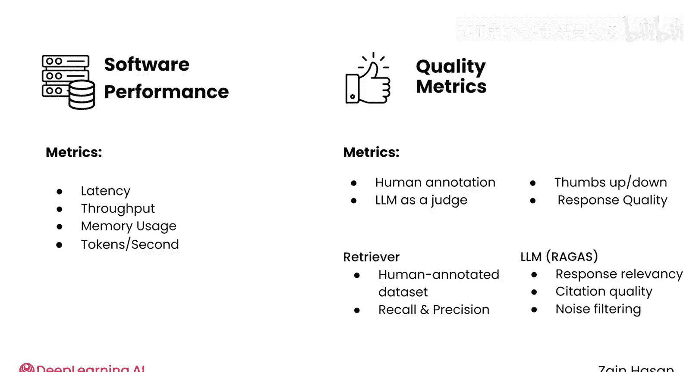

# 吴恩达《检索增强生成｜Retrieval Augmented Generation (RAG)》中英字幕（Claude-3.7-s） - P41：40_RAG评估策略实施.zh_en - GPT中英字幕课程资源 - BV1qsgLzmEg6

A good first step to handling production challenges is building a robust observability system。

 To start， let's look at the different components it should include。

An observability platform needs to track a few different kinds of information。 First。

 H to track common software performance metrics like latency， throughput， memory and compute usage。

As with almost any production software system， you'll want to know how many requests your system is handling。

 how long it takes， and how many resources it's consuming。 Next。

 you'll need to track a variety of quality metrics。

 qualityity here could mean everything from user satisfaction with the final replies they receive。

To the recall of your retriever。Beyond knowing how quickly or efficiently your system is operating。

 you'll want to know if the final results meet the quality standards you've set。

It also matters how this information is collected and reported。

 Your system should capture aggregate statistics over time to help you track high level trends in performance and quickly identify regressions。

Separately， the system should record detailed logs。

 These will allow you to trace the journeys of individual prompts through your RA pipeline。

 particularly useful when you're trying to understand the source of poorly performing responses。

 Finally， your evaluation system should ideally enable experimentation。

If you're considering switching to a new language model。

 Ading a system prompt or tweaking the settings on your retriever。

 you want to either run customized experiments in a secure environment or A B test changes with users in production。

 the ability to monitor the impact on performance and quality metrics is what should ultimately help you decide if you want to move these experiments into your production system。

With that high level structure in mind， let's look at the specific metrics you'll want to track。

 A good framework for thinking through all these is scope and evaluator type。

 Spe here means whether an evaluation is targeting a component of your rag system or the overall system。

 Evaluator type。 Meanwhile， asks whether the eval is code based uses Llm as a judge or relies on human feedback。

 You can think of these two dimensions forming a grid with the evals you choose living in one of the resulting squares。

 Let's explore each dimension and then look at where some common evals fall within that grid。😊。

Let's start with Eval scopepe system level Evalals are usually for summarizing overall system performance or giving a high level view of how things are going。

Component level evals， meanwhile， help you debug the source of individual issues。 For example。

 you might track the latency on your overall system and find that it's too high in order to track down the source of that issue。

 However， you need component level evals to track whether the retriever。

 your LM or another component entirely is ultimately causing the problem。

 Evaluator type focuses on how the eval is generated。 code based evals are the cheapest。

 simplest and most straightforward to implement。This could be everything from just recording the number of prompts to your system processes a second to running unit tests to ensure your LLM is outputting valid JSON。

What matters here is that these eths can be run automatically。

 are deterministic and are nearly free to run。 On the other hand of the spectrum is human feedback and evaluation。

 One common example is users of your application marking responses with a thumbs up or thumbs down。

Even if it doesn't give you a lot of detailed information。

 the fact that more users mark your responses with thumbs down is a useful indication that you have a problem to fix。

 You might give users a text box to give more detailed feedback as well。

 Other evals can be run automatically， but depend on human input at the outset。 For example。

 you can have humans precompile data sets of the prompt and the relevant documents that should be retrieved。

 once that data set is compiled， you can rapidly calculate common metrics like precision and recall。

 but it's worth remembering that at some point， a human needed to compile that initial test dataset set。

In general， human feedback and annotation is a more costly approach。

 but it captures the information that code based Evals will miss。LLM， as a judge。

 tries to split the difference by using a language model to grade different components of your system's performance。

 For example， an LLM might determine whether the documents retrieved by a retriever are actually relevant to the user's prompt。

 LLM as a judge is more flexible than code based evals and cheaper than human feedback。

 LLM as a judge still needs to be carefully tuned。 However。

 Model can have biases and favor responses generated by a model from their own family。

They also need clear rubrics and typically perform best with discrete standards like relevant or irrelevant。

 rather than a grading on a scale from 0 to 100。Let's see how all of these different evaluation concepts can be put together into a simple but comprehensive set of metrics you could start out collecting。

 A good idea to start is to collect both software performance and quality metrics for each major component。

 and then the overall system。 system performance metrics like latency throughput。

 memory usage or tokens generated per second are code based evals。

 making them cheap and easy to collect。 You can readily capture this data at both the component and system wide level for quality metrics。

 you typically will need to rely on techniques that use human annotation or LM as a judge。😊。

For system wide quality metrics， you can allow users to give you thumbs up or thumbs down on generated responses。

 giving you feedback on overall response quality for evaluating a retriever。

 you could spend the time to compile a human annotated test data set of prompt and expected retrieved documents。

 allowing you to calculate common metrics like recall and precision to evaluate LLM quality。

 you'll typically use LLM based Evals like those found in the Ragas library to assess things like response relevancy。

 the quality of citations or how well the LLM is ignoring irrelevant retrieved information。

An approach like this gives you visibility into both the performance and quality of your overall system and individual components。

It also captures a nice balance of cheap evals like latency and more expensive metrics that rely on human annotation or LLM calls from there。

 you can decide which additional areas you would like to look more closely at。

That's a quick high level look at what components a rag observability system should include and trade offs that go into designing it。

 Join me in the next video and let's take a closer look at some of the considerations that arise when you actually go to implement this system。

