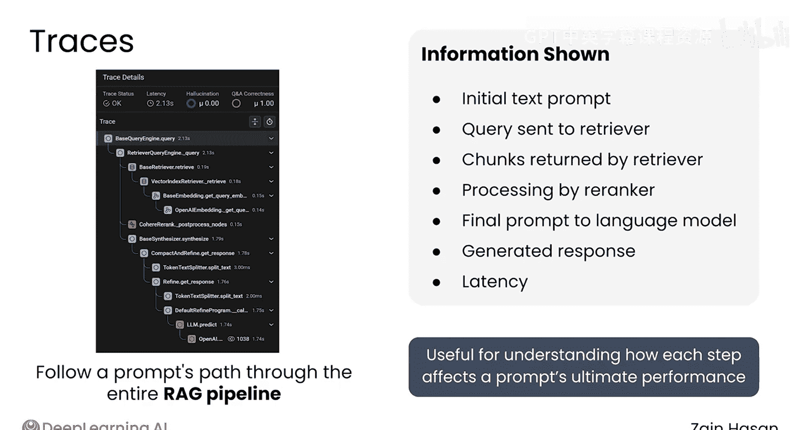
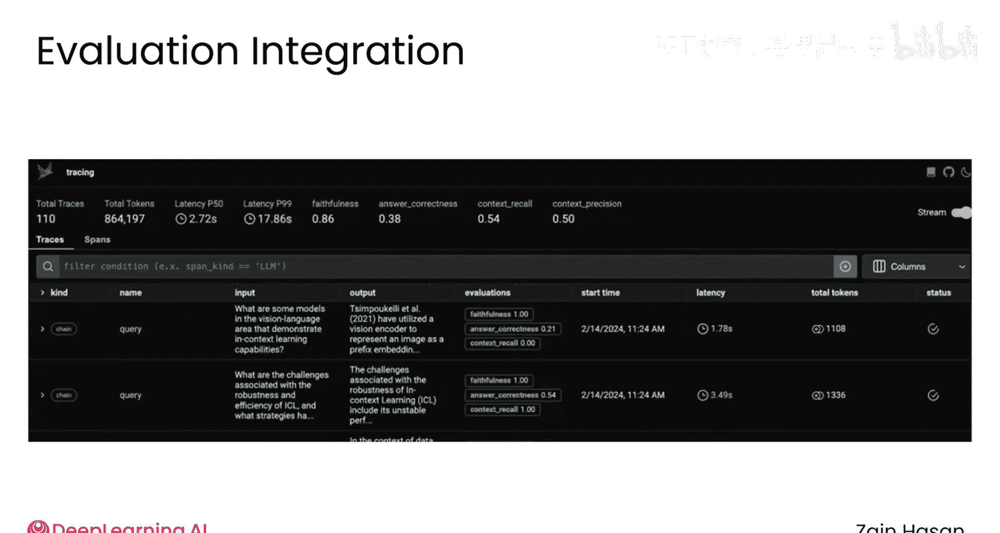
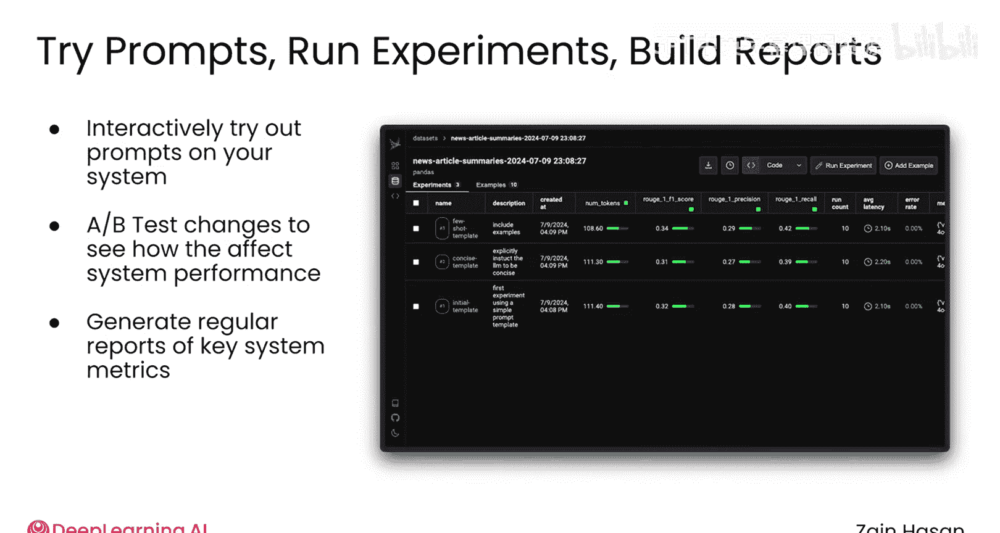
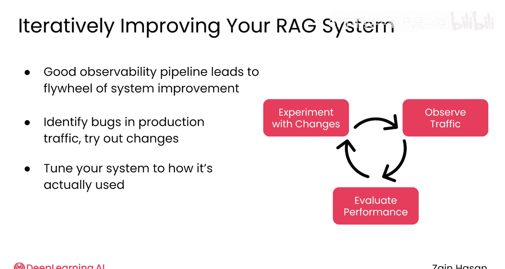

# 吴恩达《检索增强生成｜Retrieval Augmented Generation (RAG)》中英字幕（Claude-3.7-s） - P42：41_日志监控与可观测性.zh_en - GPT中英字幕课程资源 - BV1qsgLzmEg6

Once you know what metrics you want to collect about your RAG system。

 you actually need to build the system to collect that data。

Let's look at the tools available to you to implement your observability system。

 There are many observability platforms available for LLM based applications。

These are designed to perform common evaluation tasks like capturing the system wide or component level metrics。

Helping log system traffic and enabling experimentation with new system settings。

Using a platform like this means you're spending less time designing and implementing your observability system and more time monitoring your rag system's performance and experimenting with ways to improve it。

 As an example， let's look at an open source observability and evaluation platform called Phoenix。

Built by the company arise。It provides a number of tools that help you evaluate your ragg systems's performance。

 Let's look at a few of those tools， starting with perhaps the most commonly used one， traces。

 a trace allows you to follow a prompts path through the entire rag pipeline。

 See how it's modified by each component in the system。 For example。

 you could see the initial text prompt。 The query that is sent to your retriever。

 What chunks the retriever returned， how those chunks were processed by your reranker。

 What prompt was ultimately sent to your core language model。

 and the final response that was generated。Useful information like the latency of each step can also be recorded following traces is a common tool for evaluating a rag system。

 whether it's an early prototype or already in production。For example。

 if you know that a prompt performed poorly in your RAG system。

 you can trace its path and try to determine which step is the source of the error。

 The Phoenix platform also makes it easy to collect many of the evals you've already seen in this module。

 For example， it integrates with the Ragos library， you've used for different evaluation metrics。

 So if you want it to calculate the search relevancy of your retriever or whether your LLM is accurately citing retrieved sources。

 it's easy to add those evaluation steps。

Once you have a basic evaluation pipeline set up， you can start running simple experiments。

 For example， you can iteratively try your own prompts and see how they would be processed by your RAg pipeline。

 You can also AB test changes to your system to see how they impact system performance Fe like this help you decide if a new system prompt actually improves response quality。

 or see what kind of performance gains you get from adding a reraner While tracing gives you access to lowlevel information。

 You also typically want highleve aggregate statistics or track system performance。

 Phoenix is able to provide daily reports of key metrics from the accuracy of the retriever to your model's hallucination rate。

😊。

While Phoenix and other LLM observability platforms cover most of the evalals you'll want to collect about your RAG system。

 there will be some gaps。 for example， it's not a great tool for monitoring the compute and memory usage of your vector database in these instances you can use more classical monitoring and observability tools like Datadog and Grfana。

A good observability pipeline ultimately leads to a flywheel of system improvements by seeing how your system handles real production traffic。

 you're able to identify bugs or target areas for improvement and then see the impacts of changes you make Over time。

 this lets you tune each component over your system to best match the way your users are actually using it。

😊。

A valuable tool in this process is the ability to create custom data sets of prompt rack system as previously processed。

By saving and then rerunning these prompts through your system。

 you can see the impact of system changes on actual prompts your application has received。

So let's go on to the next video and see what it looks like to build one of those custom data sets。

