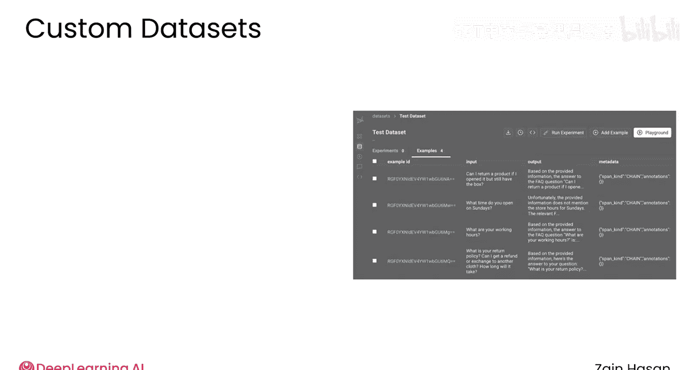
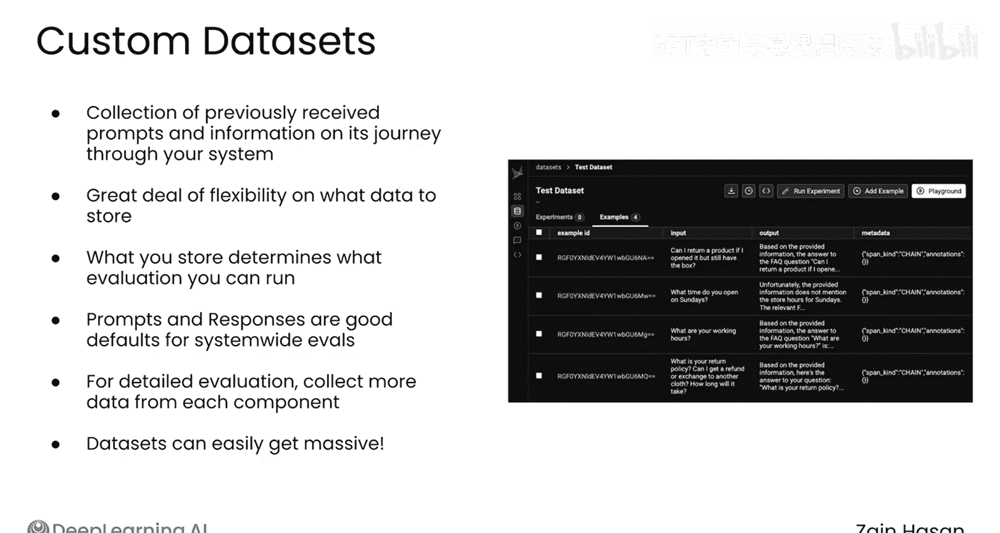
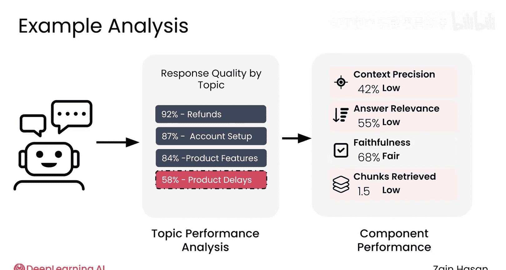
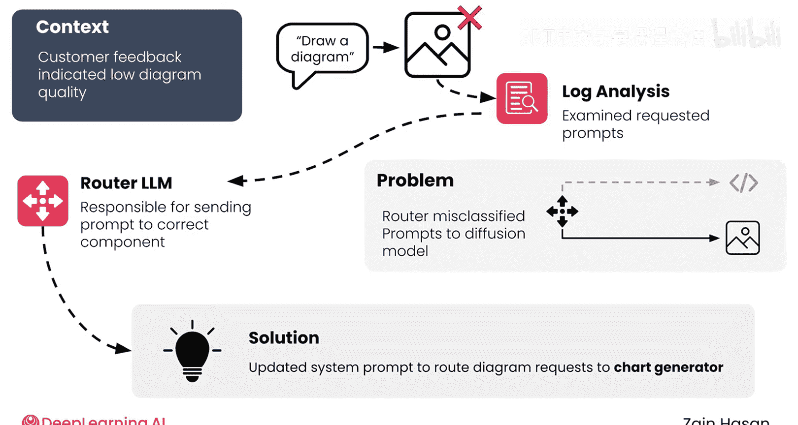
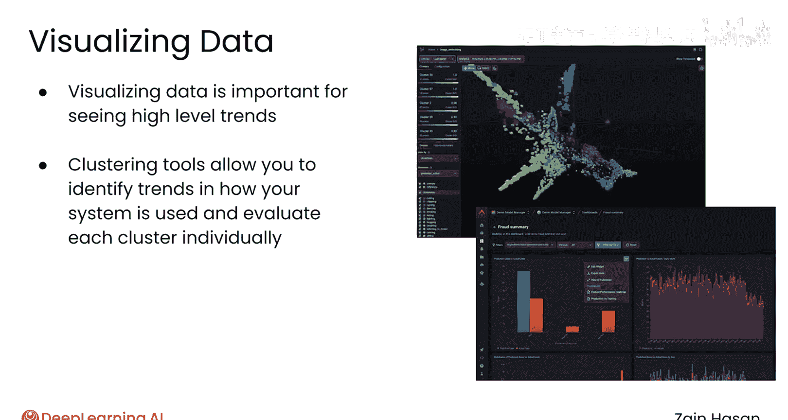

# 吴恩达《检索增强生成｜Retrieval Augmented Generation (RAG)》中英字幕（Claude-3.7-s） - P43：42_定制化评估体系.zh_en - GPT中英字幕课程资源 - BV1qsgLzmEg6

Creating a custom data set of prompts your system has received allows you to both deeply understand how your system performed in the past and then run experiments to see how a redesign of your system might change performance on real world prompts。

Let's look at how to build one of those。A customized dataset is just a collection of prompt to your system as previously processed。

 as well as any information you choose to collect about that prompts journey through your system。

 You could choose to save just the initial prompt and final response。

 or you could add tons of information to your custom data。

Like which documents your vector database retrieved the way those documents were ranked before and after your reraker。

 the output of your query re writer and so on and so forth。With so much flexibility。

 an important decision when building a custom data set is what data do I store， The simple answer is。

 what do you want to evaluate。For example， you'll almost certainly want to save the input prompt submitted by users and the final responses generated by your rack system。

 These two basic data points give some sense of system performance and would let you track how responses change with edits to prompts。

That information， however， really only helps with end to end evaluation。

 If you want to do component level evaluations to know how well your retriever。

 reranker or query re writer are performing only to save the input and output data used by each of those components。

Typically， you'll want to have these detailed component level steps recorded， and as a result。

 the tables used for logging calls to a RA system can easily have dozens of columns。

 storing everything from the ID of the customer who made the call to the text chunks your rerank or si through to the output of each router LM in your agent workflow。

😡。

Storing a wide variety of data like this allows you to analyze each component of the system individually and examine performance across many dimensions。

 For example， if you're building a customer service chatbot。

 you could filter by question topic to detect that questions about refunds or receiving high quality responses。

 but questions about product delays are not performing well at all。

 When you go to investigate why those product delay related prompt， LED to low quality responses。

 you might be able to analyze the logs to detect that your retriever isn't able to find many relevant documents for those prompts。

 maybe you need to add more relevant information to your knowledge base。

If you build the right observability system in place， you'll be able to detect problems。

 pinpoint their sources， and feel confident that solutions are working。

Let me share one example of this from my own career。

 I was working on a specialized rag system that had the ability to generate text。

 images and code back charts and diagrams using mermaid J S。

We started to receive complaints that the quality of some of the diagrams generated by the system was quite low。

Working backwards through our logs， we realized that many of these issues arose when users asked the system to draw a diagram。

 The router language model misinterpreted this prompt。

 and so sent it to the text to image model used for image generation。

 These models are pretty good at generating images of people or things。

 but pretty bad at generating charts。 Once we realized the source of the problem。

 we were able to update the system prompt for the router Llm so that those prompts would create code backed charts and not generated images。

 thanks to a robust monitoring and logging system once we received customer reports of the issue。

 it was straightforward to track down its source and quickly get a fix into production。

While sometimes you'll want to track down poorly performing individual prompts like this。

 once you're logging lots of data， you'll often want to visualize it。

 This can let you identify high levelve trends in the performance of the overall system or of each component。

 For example， you could visualize all of the input prompts that go through your system and use some sort of clustering algorithm to identify the high levelve topics your customers are asking about。

 like product launches or troubleshooting questions。

 if you can differentiate all of these different prompts。

 then you can run your eval pipeline on only that type of prompt and see if your system is underperforming for certain types of questions。

Custom datas are an important tool for personalizing your RAG application to the requests to your system processes。

 incorporating them into how you evaluate your system is the best way to improve the way your system responds to the actual prompt and questions your users are asking。

