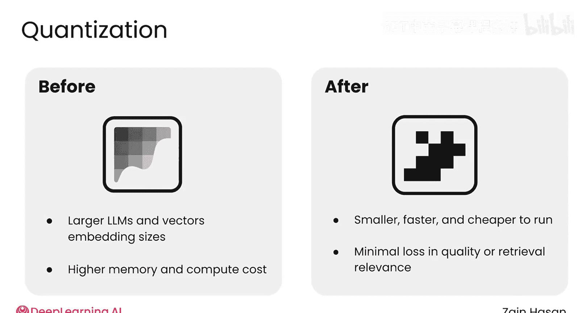
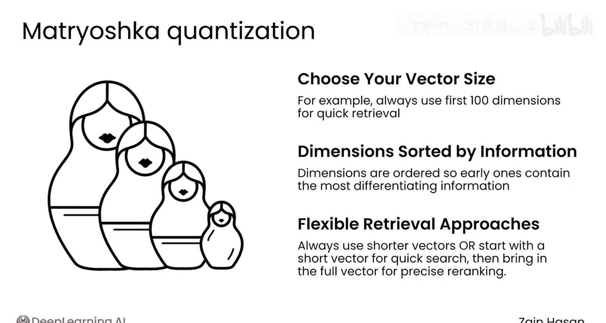

# 吴恩达《检索增强生成｜Retrieval Augmented Generation (RAG)》中英字幕（Claude-3.7-s） - P44：43_模型量化技术.zh_en - GPT中英字幕课程资源 - BV1qsgLzmEg6

Once you're able to evaluate your rag system and experiment with different configurations。

 you'll be ready to take on some familiar trade offs in many software projects， cost， speed。😊。

And quality。You'll explore these trade offs over the next few videos， but first。

 let's introduce an important concept， quantization。

In short， quantization is compression for both LLMs and vectors generated by embedding models。

 Quaantization replaces the model weights inside an LLM or the values of an embedding vector with a compressed lower precision data type。

This makes the models or vectors respectively smaller， cheaper and faster to run。

 often without much sacrifice in retrieval relevance or response quality。

 Let's have a look to see how it works。 A good analogy for quantization is image compression。

 This high quality image uses 24 B of data to represent the color at each pixel。

 The colors look great， but it does use quite a lot of data to store all that information。

 You can compress the image by using 12 or even 6 B for each pixel。😊。

The compressed images are one half and one quarter of the size of the original。

 which is a significant memory saving。 That said， the 12 bit image already doesn't look as nice。

 And in the6 bit image， there are many visible color artifacts。

Depending on where you're using the image， however。

 this drop in quality might be worth the substantial memory savings。

Quantization takes the same approach to LLms and embedding vectors。

 shrinking their size with some loss and quality as a trade off。

 Let's start by looking at how it works for LLms。 The parameters in a typical language model use 16 B of memory each。

 with modern models ranging between roughly a billion to a trillion parameters。

 These models are huge。 requiring lots of memory to store them and powerful GPUus to run them。

 Quaantized models compress those 16 B parameters down to 8 or even 4 B equivalents。

 This significantly reduces the GPU memory required to run the model at the cost of a little model performance and quality。

 Quaantized embedding vectors work similarly， A fairly typical 768 dimensional vector will use 768。

32 B floating point numbers。 That's 3 kiloB of data for every vector in your knowledge base。

Higher dimensional models can easily require many times that much。

 Once you are storing millions or even billions of these vectors。

 you've got huge amounts of vector data to deal with。

 These vectors need to be stored somewhere to use them。

 and especially if you want to use them in rapid vector search。

 They need to be loaded into expensive Ram。 Inerger quantization is a commonly used approach for shrinking these vectors。

It replaces the 32 B floating point numbers with a much smaller integer， for example， an 8 B integer。

 This means that your vectors are now immediately one quarter of the original size。

 a massive space saving。These integer values are also remarkably easy to calculate。

 Here's how the process works。You find the minimum and maximum values that appear in each dimension for your vector data。

 This will define the range that values in that dimension will fall between。

 Then you divide that range into 256， equally sized sections。

 The amount of unique values you can make with 8 bits。 Those sections are then numbered 0，1，2，3。

 and so on up to 255。Each floating point number from your original vectors are then just assigned an integer value equal to whatever section it falls within if you also store the minimum value and the width of each section。

 you have all the information you need to calculate an approximation of the original 32 B float。

 but using only 8 bits of data。Despite using only a quarter of the data and a seemingly naive compression algorithm。

8 bit integer quantization performs remarkably well for benchmarks like recall it K。

 you might only see a drop of a few percentage points with 8 bit quantization。

 These quantized embedding vectors， mean， allow for less data to be stored in your vector database。

 while powering faster search as the calculations required have been simplified。

Quantized atms also often have only minor drops in performance when measured using commonly reference benchmarks。

 Meanwhile， they use less GPU memory and can generate text more rapidly。 In other words。

 these are huge memory and performance gains for a small drop in quality。

 While 8 B integer quantized vectors are commonly used1 B or binary quantized vectors are also gaining popularity。

 This approach compresses the size of a vector by a factor of 32。

 from 32 B per dimension to just 1 B， which is a massive saving。 at this level of compression。

 Each value in your vector is either a 1 or a 0， and just tells you if that value at that dimension was a positive or a negative number。

😊，As you might imagine， at these extreme compression levels。

 performance can drop noticeably for embedding model based retrieval。 That said。

1 bit quantization results in significantly smaller and faster vector based retrieval。

It can also be paired with other techniques， for example。

 performing fast retrieval based on a 1 bit quantized embedding model and then rescoring using the full original 32 bit vector。

Another way to shrink the size of your vectors is to use a matriosshka embedding model based on the Russian word for nesting dolls。

 These vectors are designed so that you can choose to use only a subset of a vector's dimensions when doing things like comparing similarity。

For example， if the full vector has 1000 dimensions。

 you could choose to use only the first 500 or the first 100 dimensions to enable this behavior。

 Bariashka embedding models have a special property。

 Their dimensions are sorted by how information dense they are here。

 information means how much statistical variance you'd expect to see in that dimension when embedding large amounts of text。

In a typical embedding model， every dimension would have roughly the same amount of variance or information。

In a mattriageka model， thanks to the training process used。

 earlier dimensions will have more variance， which means more information content。

 Later dimensions have less variance， meaning they provide relatively less information。

 And so you pay less of a penalty for excluding them。Theres a few ways to use matreoska vectors。

 You could choose to only ever use the first 100 dimensions。

 saving space and leading to faster computations while preserving the maximum possible amount of information。

 or you could always perform initial retrieval using the first 100 dimensions。

 then pull the remaining 900。 Now using the full 1000 dimensions out of slower。

 cheaper memory to essentially help rescore the initial set of documents you retrieved。

The flexible properties of matreageka models make it best suited for dynamic environments where you may want to quickly switch from low to high fidelity vector representations while these advanced techniques show what's possible at the cutting edge of quantization。

 the core takeaway is that you probably should experiment with using integer quantized LLMs and embedding models。

Most NLM and embedding model providers will make eight or4 bit quantized models available alongside their base models。

The space and cost savings they provide can be significant。

 and the quality reductions are quite small。

