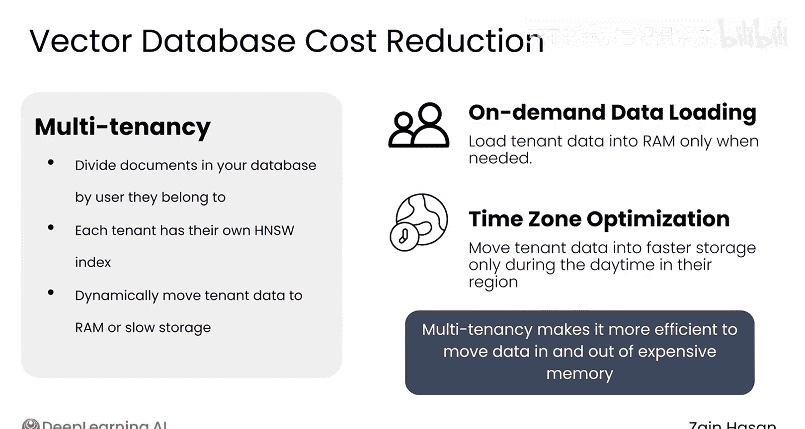

# 吴恩达《检索增强生成｜Retrieval Augmented Generation (RAG)》中英字幕（Claude-3.7-s） - P45：44_成本与响应质量的平衡.zh_en - GPT中英字幕课程资源 - BV1qsgLzmEg6

Now it's time to talk about every engineer's favorite topic， the budget。

When you're designing your first rag system， you'll probably focus on exploring what's possible and getting a working prototype。

As you start scaling your system to hundreds， thousands or even millions of requests。

 cost considerations become increasingly important。

 so let's have a look at what strategies are available to you to limit a system's costs while still providing high quality responses。

The two largest costs in a typical Ra application will be your vector database and your large language models。

 Let's start by looking at some ways to manage LLM costs。

 One way to reduce LLM costs is to experiment with using smaller models。

Whether it's the core LLM responsible for generating a final response or router LLms in an agent system。

 you might be able to achieve similar overall quality with smaller and therefore cheaper models。

 Model can be smaller， either because they contain fewer parameters from the outset or because the values of their parameters have been quantized to a lower precision format like 8 bit。

 In either case， you'll often be pleasantly surprised at how well smaller models perform。

 especiallyly if your LLM will be performing a limited number of tasks。

 fine tuning a small model can lead to good results at a low cost。

A second straightforward approach is to experiment with ways to limit the number of input and output tokens。

 Rag prompts can rapidly grow in size， especially if you retrieve many lengthy chunks for each prompt。

Experiment with retrieving fewer documents or， in other words， reducing top K。

 Many L limbs can be long winded。 And remember， you pay for every token they generate。

Updating system prompts to encourage succinct responses or even setting a firm token limit is another straightforward way to reduce costs。

Whether you're reducing model size or prompt length。

 having a robust observability pipeline in place will allow you to assess the impacts of these changes and decide if the trade off between cost savings and response quality reduction are actually worth it。

Another possible approach is to host LLms on dedicated hardware。 Cloud LM providers like Together AI。

 AWS and Google offer convenient inference endpoints。

 and they often make sense to use when you're building a prototype。

If your project is scaled to thousands or millions of requests， however。

 you might want to save money by running models on dedicated hardware rented from those same companies。

 The additional benefit of dedicated endpoints is better reliability。

 since that hardware is only serving your user traffic and nothing else。

When using dedicated hardware to host models， you'll pay per hour for the GPus your model requires at scale。

 however， the cost savings by paying hourly versus paying per token can be very significant when looking to save money on your vector database。

 It's important to know that most databases offer you multiple types of memory。 Typically。

 there are three kinds of memory to consider here。 Ram disk memory and cloud object storage。

 Ram is the fastest， but most expensive。 Cloud object storage is the slowest but cheapest and disk memory sits somewhere in between Ram is often several times more expensive per gigabyte than disk memory。

 which is itself several times more expensive than cloud storage。If you want to save money。

 then you want to make sure you're only paying to keep information in fast and expensive storage if it'll actually benefit your system's performance。

 The H and SW index， for example， should be kept in Ram to ensure vector search runs as rapidly as possible。

 Your documents contents， however， probably don't need to be stored in Ram。

 You might then decide to put your most commonly accessed documents and disk memory and your rarely access objects and cloud object storage。

 Many vector databases include features that help you monitor this trade off and can even help dynamically move data into different kinds of storage based on your application' needs。

A typical example of this approach is multi tenancy。

 which means dividing all the documents in your vector database by the user or organization they belong to。

 For example， you might have 1 million documents in your vector database owned by 1000 different users。

Each user should only be able to access their own documents。

 so each user will actually have their own HNSW index for the documents associated with them。

 This system makes it easy to quickly load a tenant's data into fast。

 expensive memory only when necessary。 for example。

 you might wait until a customer actually logs into your website to load their vectors into Ram。

 or you could default to keeping the data of your European tenants and store storage during the nighttime in Europe。

In either case， you're just moving data in and out of expensive memory。

 but organizing information by tenant makes it easier to perform this task in an efficient way。

 The core idea of all of these optimizations is that as an engineer。

 you need to understand the source of your costs and ensure they're justified by performance for LLMs。

 smaller models and shorter prompts is usually the way。

For vector databases， storing smaller amounts of data in expensive storage and moving between RA。

 disk and object storage are the primary ways to save costs。

Experimenting and monitoring the performance impacts of these changes will allow you to decide if the cost savings they bring are worth it。

