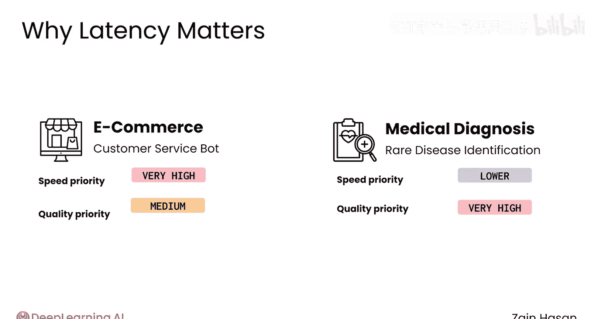
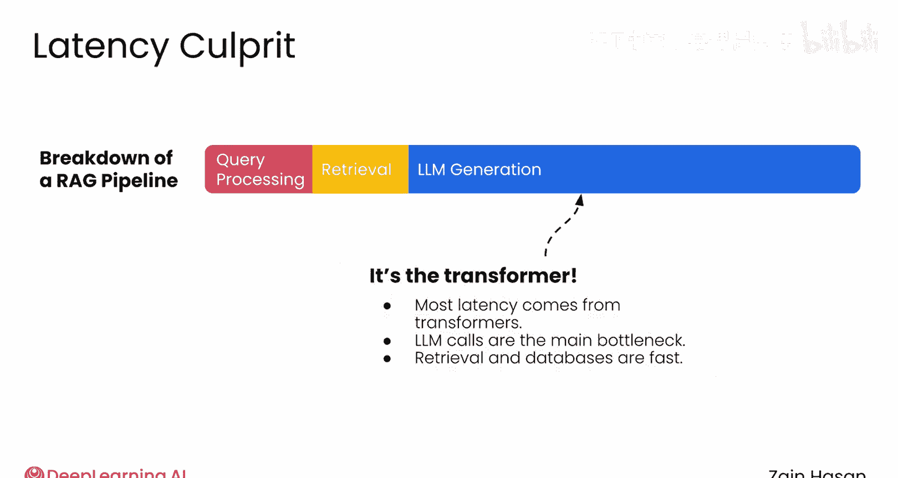
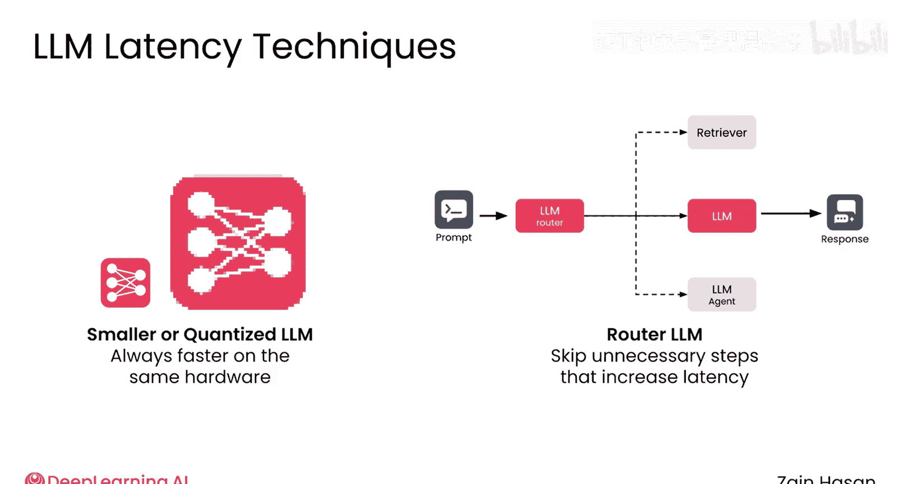
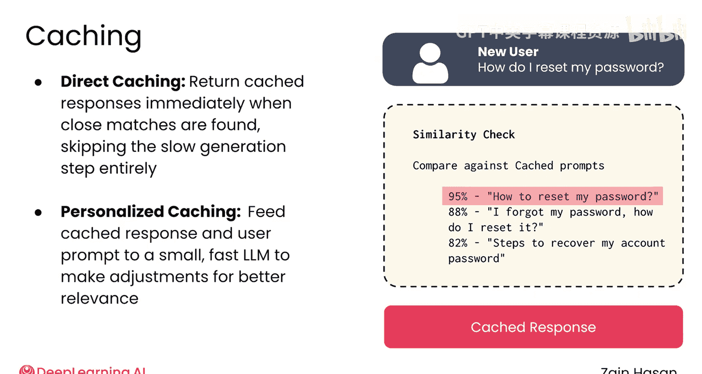
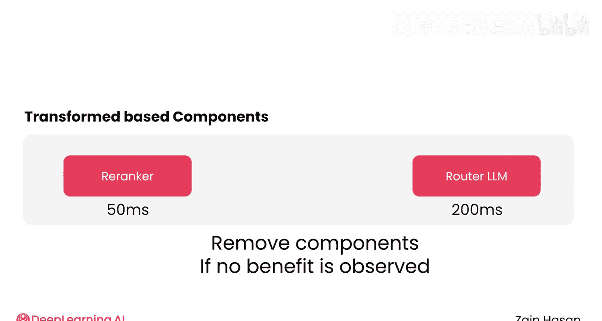
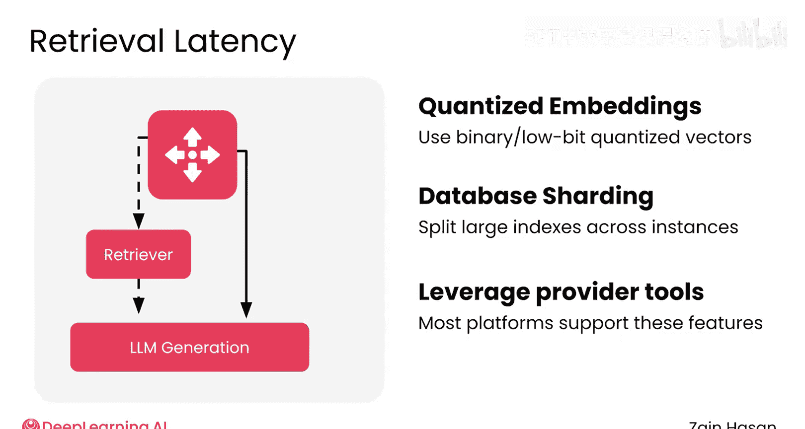

# 吴恩达《检索增强生成｜Retrieval Augmented Generation (RAG)》中英字幕（Claude-3.7-s） - P46：45_时延与响应质量的权衡.zh_en - GPT中英字幕课程资源 - BV1qsgLzmEg6

Another important balancing act that you have to consider for a ra application in production is the time any one query takes or latency versus the response quality。

 simply adding a retriever to your system adds latency。

 and as you add more components to increase response quality like reranking or building more complex agententtic systems。

 latency can increase。 So let's look more closely at this tradeoff and how you can find the right balance for your system。

How important latency is to your system depends heavily on the context in which it'll be used。

 Custom browsing an ecommerce-commerce site have notoriously little patient for slow response times。

 So you'd probably optimize your item recommendation service to have very low latency。

 possibly at the cost of not recommending the perfect item from your catalog。

 a rag system designed to help doctors diagnose rare diseases， on the other hand。

 would likely be optimized for response quality， Even if that means responses take much longer to produce。

 when tackling latency and easy guideline to remember。

 is that almost all of it is the result of running a transformer。 As a result。

 the biggest culprit will be your large language model calls。

 While retrieval does add a little bit of latency， In particular。

 some transformer based re-ranking techniques， Mo databases and in particular vector databases are very fast and scale well。

If you want to cut down on latency， the best place to start is your core language model。

One effective approach here is to just use a smaller language model。

 smaller LLMs or quantized models will always run faster on the same hardware。

 assuming the same memory is available。Another approach is to use a smaller router LLM whose job it is to look at the prompt and decide whether a smaller or larger LLM is the right tool for the job。

If a query requires complex reasoning， it can be routed to a larger and more powerful model。

 Meanwhile， simple queries can be routed to smaller and faster models。

 This helps keep latency down for simpler prompts while allowing latency to increase only for the more complex prompts that require it for systems that often receive very similar prompts。

 Caching can also help with latency。 To do this， you maintain a cache of frequently submitted prompts and the responses。

 When new prompt is received， you rapidly compute similarity scores between the new prompt and those in the cache。

If you find a close enough match， you can immediately return the cache response entirely skipping the relatively slow generation process with careful tuning。

 this approach can greatly improve system latency for many prompts。

 If you want to still make use of caching， but somewhat personalized responses。

 you can still retrieve cash responses， but then feed the cache response and user prompt to a smaller and faster LLM to make small adjustments to the response to make it more relevant to the prompt。

 Once you have optimized that latency of your core LLM。

 The next step is to address other transformer based components in your pipeline。😊。

This might be a query writer， a reraker or a router LLM and so forth。

 Each of these components serves an important rule， but they also increase latency。

My advice here is to measure both the latency each component is adding to your system and the incremental response quality they provide。

You might realize you're not getting much benefit from your query writer， for example。

 and opt to remove that component。 While generation is typically the biggest source of latency。

 there are still ways to eliminate latency caused by your retriever。

 One approach is to use embeddings that are binary quantized in your vector database。

This simplifies the underlying vector distance calculations and helps speed up retrieval。

 sharding larger databases into separate instances， especially once they get quite large。

 can also help reduce search latency。These are common approaches to improve latency in any database。

 and most vector database providers include tools to help you implement them。

There's almost always some latency versus quality trade off in your rag system to start。

 you should understand how much latency your system can tolerate。If you need to reduce latency。

 start by addressing your core LLM， then move to the other transformer or LLM based features。

If latency is still an issue， take on other components of your pipeline with a robust observability system in place。

 you should be able to see the impact of your changes and iteratively reduce latency to the levels your project needs。

