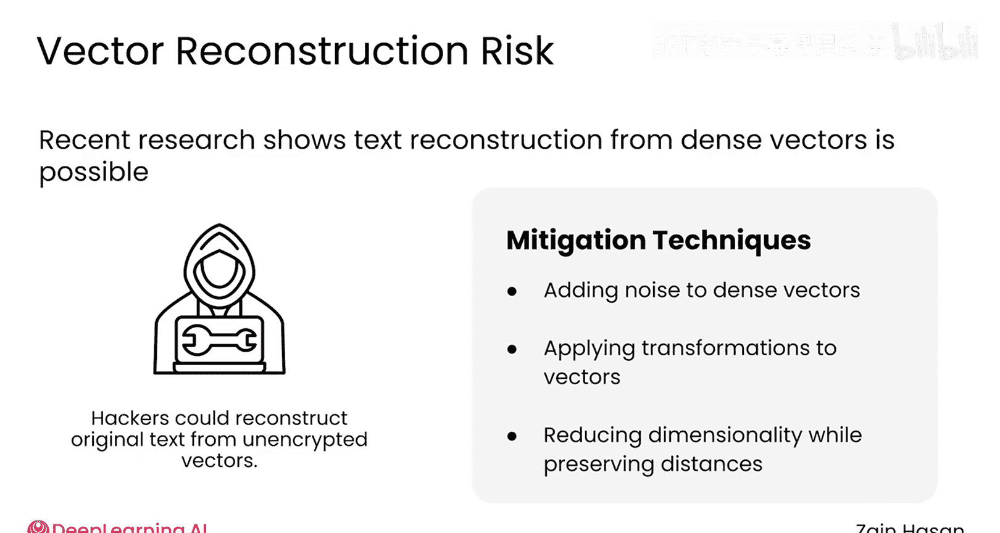
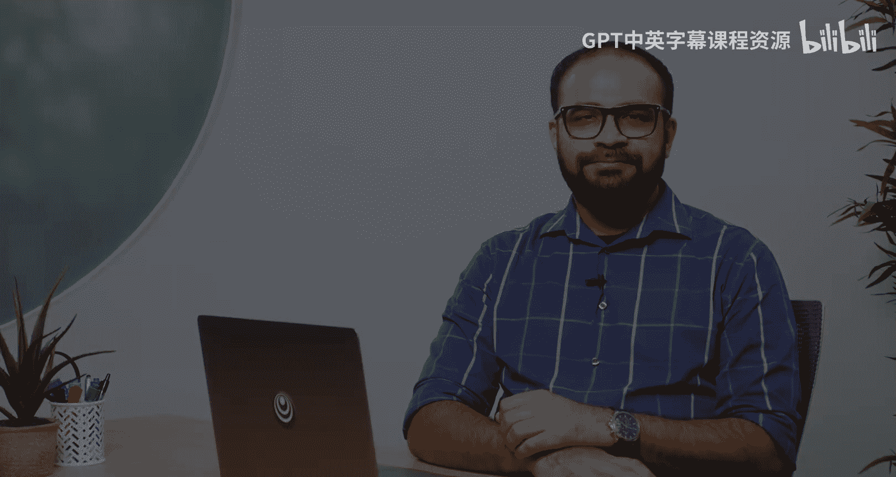

# 吴恩达《检索增强生成｜Retrieval Augmented Generation (RAG)》中英字幕（Claude-3.7-s） - P47：46_安全防护机制.zh_en - GPT中英字幕课程资源 - BV1qsgLzmEg6

Let's talk about securing your Ag application。Cybersecurity is a deep and constantly evolving field。

 so itd be impossible to address every possible security risk。 Instead。

 let's have a look at some of the security challenges and opportunities that are unique to a rack system。

The main focus here will be on securing the information in your knowledge base。

 A common reason you choose to build a rack system in the first place is because you have private or proprietary information。

 That information has intentionally been kept off the open web where an LLM is much more likely to have been trained on it。

 even after you've built a rack system， you likely still want to keep that data private。

There's a few ways the information in your knowledge base could be leaked。

 One is that a user could just request it directly from the prompt they submit。

A well worded prompt could convince an LLM to directly quote information in the retrieved chunks from your knowledge base。

Even with safeguards in place， it's a reasonable assumption that users of your application can at least indirectly access the contents of your knowledge base。

There is a couple of straightforward solutions here。

 One is authenticating users in a manner appropriate to the information they're allowed to access。

 For example， if your knowledge base contains private company data。

 ensuring only logged in employees can prompt your rack system is a good start。

 A second important approach is to ensure that data is split across multiple tenants based on role based access or R back privileges。

 In other words， if a user prompt leads to a retrieval from a vector database。

 the user should theoretically only have access to documents based on their role and access levels。

While in theory， you could keep all documents in a single tenant and use metadata filters to determine which documents a user should have access to in practice。

 this technique is too prone to failure。Metadata filtering is best used for personalization。

 but not security for security， having multiple separately stored tenants is a much more reliable approach。

Another way knowledge based data could theoretically leak is if prompts are being sent to an LLM provider to generate completions。

 The augmented prompt to your sending will contain documents or chunks of retrieved text from your knowledge base。

 And at that point， you lose control of security。Depending on the security level of the information in your knowledge base。

 this may not be a tolerable risk。Luckily in these instances。

 you can choose to run a RA system entirely locally on premises。

 This means hosting the LLM and the vector database on your own hardware while this may introduce additional complexity and cost overhead to your project。

 you also now have control of the contents of your knowledge base across the entire RAg pipeline。

 if you both want to deploy a rack system and need to ensure a high level of security for your knowledge base。

 this step of moving the entire system onprem might be worth it。

Yet another way your knowledge base might be compromised is that it's simply directly hacked just as is possible with any traditional database。

 One way traditional databases defend against unauthorized access is by encrypting their content。

 This means that even if a hacker gets access to the database。

 they can't readily access the encrypted information。

Vectctor databases present some unique challenges for this attack vector in order for an A and an algorithm to operate。

 at least the dense vector representations of your documents need to be stored in memory in a decrypted manner。

 The text of the chunks themselves could be stored and retrieved in an encrypted manner and then later decrypted to build the augmented prompt。

Some vector database providers now provide this service。

 or you could choose to encrypt and decrypt chunks yourself。

 This adds additional complexity and possibly some latency to your system。

 but offers an additional level of security。 Those dense vectors that need to remain unencrypted。

 Unfortunately can still pose some security risks。 Re research has shown the possibility of reconstructing the original text from its dense vector representations。

 In other words， if you encrypt your chunks， it's possible a hacker could still reconstruct them from the unencrypted dense vectors。

Some techniques are currently being explored to address the security concern。

 like adding noise dense vectors， applying transformation to them。

 or reducing dimensionality in a way that preserves distances while obscuring semantic meaning。

 Each of these techniques adds complexity to your retriever， however。

 and tends to reduce system performance。The somewhat unique potential security vulnerability of vector databases is a subject of ongoing research。

 but is worth being aware of。 This attack requires a hacker to both get direct access to your database and use experimental techniques to reconstruct text from dense vectors。

 but is a possible security concern。 This is just a quick look at security for your rag system。

 but hopefully helps highlight the concerns that are unique to Ra。

 The primary takeaway here should be to remember that your knowledge base likely contains some private information。

 and that you should understand and control how that information is accessed。

Pairing the techniques in this video with a broader set of cybersecurity precautions should help improve the security of your production rag system。

