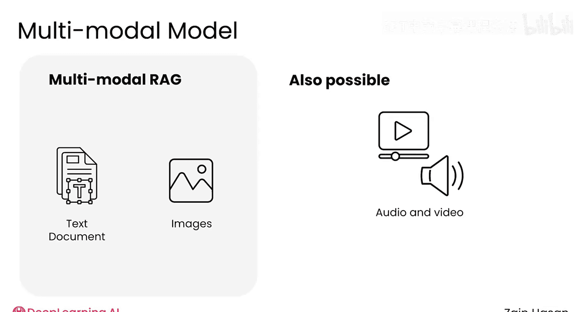
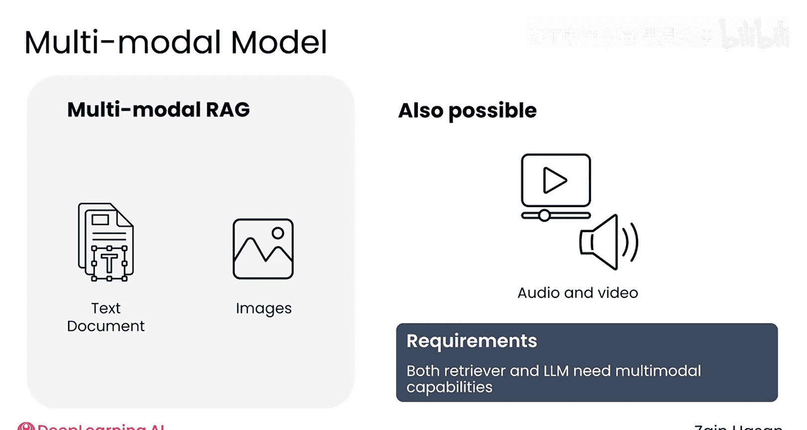
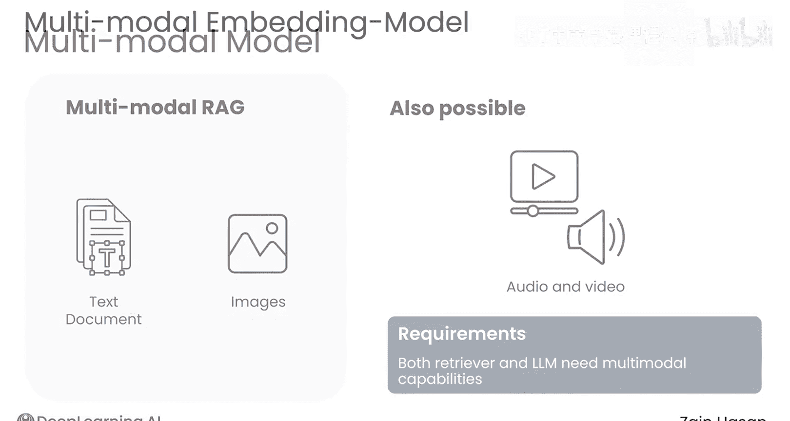
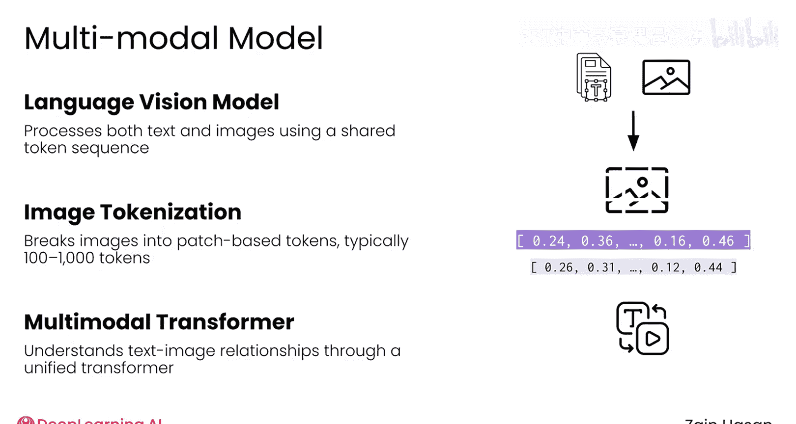
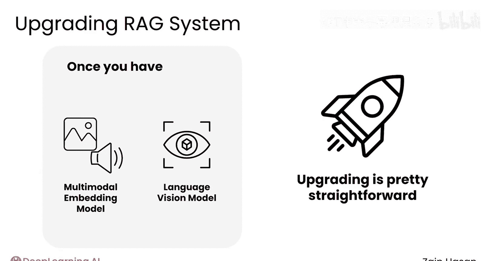
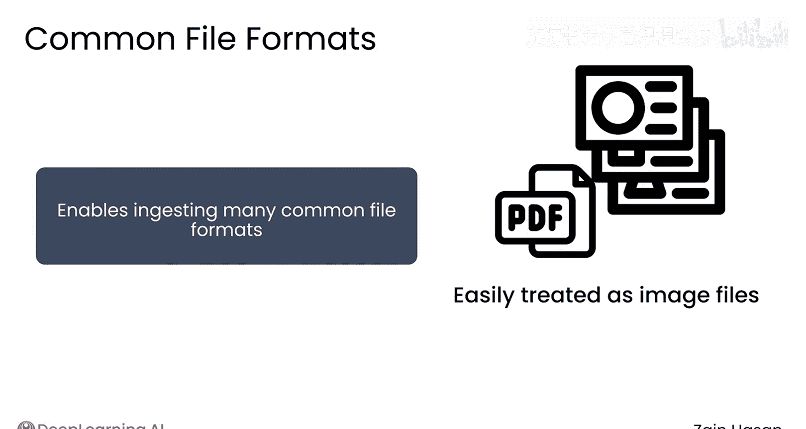
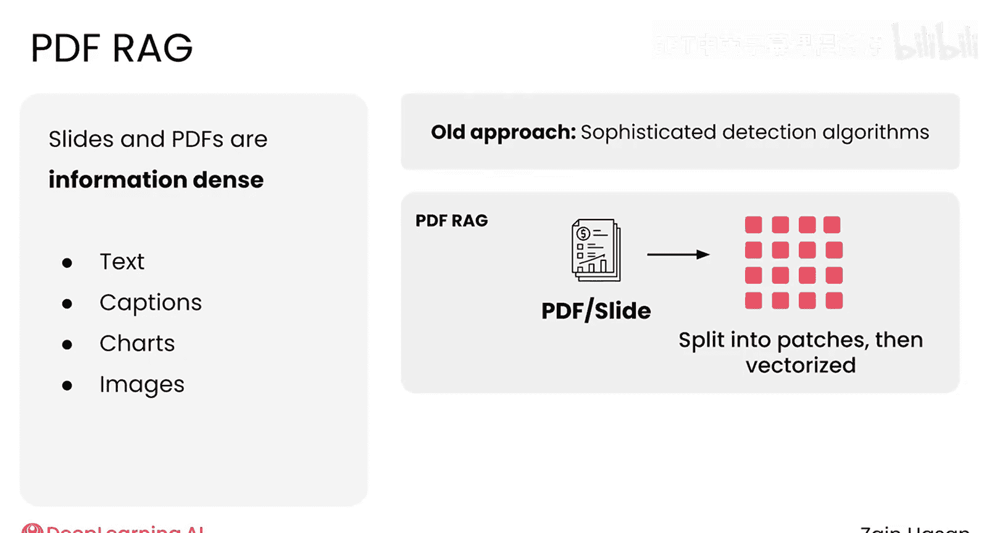
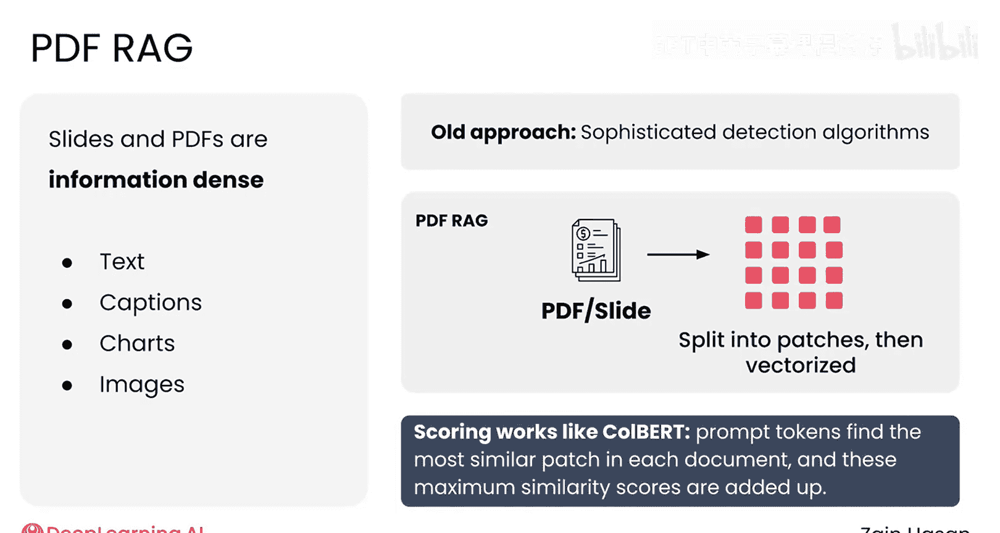
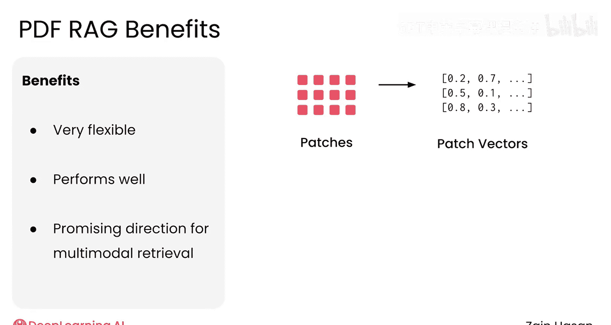
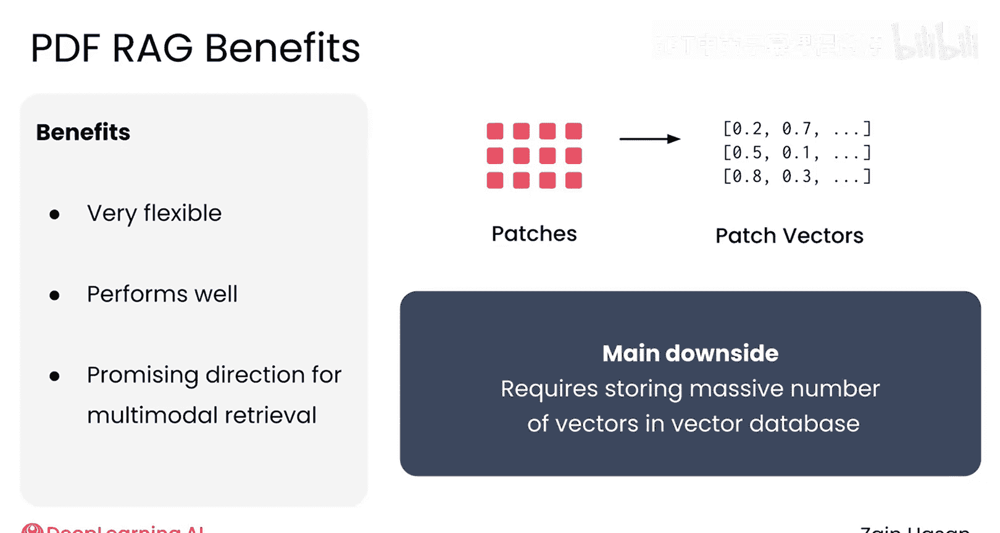

# 吴恩达《检索增强生成｜Retrieval Augmented Generation (RAG)》中英字幕（Claude-3.7-s） - P48：47_多模态RAG系统.zh_en - GPT中英字幕课程资源 - BV1qsgLzmEg6

Throughout this course you've seen RAG systems built on top of text data。

 but these days information is stored in a huge variety of formats， slide decks。

 PDFs or images also include valuable information that youd ideally like to include in your knowledge base and make available to your LLM。

Thanks to cutting edge developments on multimodal models。

 it's increasingly possible to build rag systems that handle a wide variety of data types。

 Let's have a look at how they work。A multimodal model is one that is designed to handle multiple data types。

 The most common pairing is text and images， but audio and video are also possible。

 a typical multimodal rack system is one that can accept both text and images as prompts stores。

 both text and image files in the knowledge base and ultimately generates text responses。

In order to power these new capabilities， both the retriever and the LLM need to be updated to have multimodal capabilities。

 let's look at how each component needs to be changed。

The first component that needs to be made multimodal is the embedding model used by the vector database。

 A multimodal embedding model is one that can embed multiple formats of data into the same vector space。

 If you use this kind of model to embed both the words dog and puppy。

 you would expect their vectors to be fairly close to one another As with a texton embedding model。

 If you give the same model and image of a dog。 however。

 that image's vector would also end up in a nearby part of the vector space。

 If you em in image of a tree and the word tree， those two objects would also be embedded close to one another。

 but in a different part of the vector space。 In other words。

 multimodal embedding models work just like text embedding models。

 placing items with similar meanings closer together。 thanks to their design。 however。

 they can perform this same function with multiple types or modalities of data。

 Once you have a multimodal embedding model， vector based retrieval works in a very familiar way。

Both images and text from your knowledge base can be embedded into the same vector space when a prompt is received。

 that same multimodal model is used to embed the prompt， whether it's an image or text。

 Then vector search is completed as normal， returning the images or documents whose vectors are closest to the prompt vector。

 the text and images retrieved from the knowledge base can then be added to the augmented prompt as normal and sent along to the language model。

In order for a language model to process both text and images。

 you'll need to use a language vision model。 This kind of model works very similarly to a text only LLM。

 but has the ability to process images that have also been tokenized。In order to do that。

 the images must be tokenized。A typical process for tokenizing an image is to break the image into separate patches。

 which are each represented as a token。 depending on the resolution。

 imagess might be represented somewhere on the order of 100 tokens on the lower end to approaching 1000 tokens on the higher end。

What matters here though， isn't so much how many tokens are used。

 but rather the fact that these models are designed so that both images and text can be converted into a token sequence just as with text only models。

Language vision models then work very similarly the standard L Lms passing this multimodal token sequence through a transformer that can develop a nuanced understanding of both the text and images in the prompt and their relationships。

 The model then typically will produce text tokens as output， responding to the initial prompt。

 Once you have a multimodal embedding model and a language vision model Upgrading your rag system to store both images and text in the knowledge base is pretty straightforward。

The high level architecture is essentially identical， but it can now handle both text and images。

The nice thing about updating a rack system to handle images is that this enables your system to ingest many common file formats that are readily converted to images。

 slides and PDFs， for example， are easily treated as image files。

A challenge with these formats， however， is just how information dense slides and Pdfs can be。

 A single page or slide can contain text， charts， captions and images。

 A single vector would struggle to capture all the nuance on one page of a Pdf。 In other words。

 you need to chunk your images。 just like you would chunk your text。 Initially。

 this was done with fairly sophisticated techniques to detect different portions of a Pdf page。

 These algorithms attempt to determine which piece of the page is a chart， which is an image。

 which is text and so forth。 In practice。 However， these techniques are still pretty error prone and finicky。

A newer approach called PDF Ra just splits every page into a grid of squares without worrying about whether those boundaries fall at sensible locations。

Each square is then embedded into a dense vector by a multimodal embedding model。

 This means your page is represented by， say，1000 vectors instead of one。

Vectctor search then works very similarly to Colbert。

Each word in the prompt looks for its best matching square on a given page。

 these scores are then added up to score the overall page of the document。

This approach is very flexible， since any image can be split up into a grid of squares。 in practice。

 it also performs well at retrieval tasks。 The fact that this approach is so flexible and performs well means it's a promising direction for powering multimodal retrieval。

Its main downside is that it requires your vector database to store a massive number of vectors。

 Nevertheless， vector database providers are increasingly implementing tools to enable this kind of multimodal retrieval。

 and you should expect it to continue to get easier to build rag systems around multimodal knowledge bases。

 Multimodal rag is still a cutting edge technology with rapid and active developments。

 Most atm providers offer a language vision model， While multimodal embedding models are relatively more experimental offerings。

 That said， as you look to push the frontier of what your ragg system can do。

 expect to see exciting and ongoing progress in the world of multimodal rag。😊。

