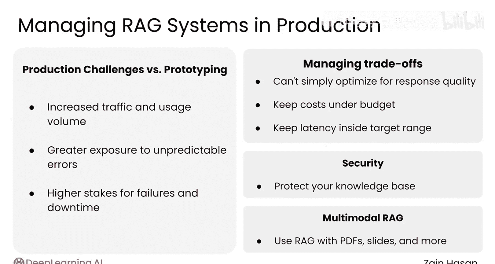

# 吴恩达《检索增强生成｜Retrieval Augmented Generation (RAG)》中英字幕（Claude-3.7-s） - P49：48_模块5 总结.zh_en - GPT中英字幕课程资源 - BV1qsgLzmEg6

That brings us to the end of this module and the end of this course。 Congratulations。

 Let's have one last look at the topics you saw throughout this module and then bring the course to a close。

😊，In this module， you learn all about managing your ragg system once it's in a production environment compared to the prototyping phase of a project。

 Product adds new challenges， ranging from higher traffic to unpredictable errors and， of course。

 higher consequences for mistakes。 This is why a well designed evaluation system is so important。

 It enables you to ensure your system is running smoothly and trace down problems when they arise。

 You saw how a balance between component level and end to end evals。

 as well as a mixture of classic software performance and Rag specific quality metrics ensures you have a comprehensive picture of how well your system is handling real world traffic。

😊，Another part of operating a production system is managing tradeoffs。

 Usually you can't simply optimize your system for response quality。

 but need to keep system costs under a budget or a system latency inside a target range。

 having some strategies in mind for tackling both trade offs。

 as well as a good evaluation system to track the impacts of your changes will help you pick the right balance of system settings to fit your project。

 Finally， you explored some unique security challenges for a ragG system and explore the ways multimodal rag is pushing the limits of what RaG systems are able to accomplish。

You now have all the foundations unique to start designing and building your own production ragg system。

 I hope you've enjoyed learning how Rag works from the principles on up。

 And I hope you're leaving this course with new ideas in mind for what you want to build next。

 I really do appreciate you joining me for this course。

 and wish you good luck wherever your AI journey takes you next。😊。

