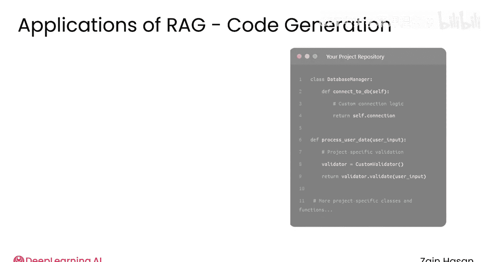
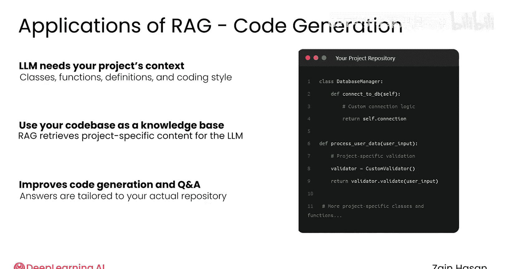
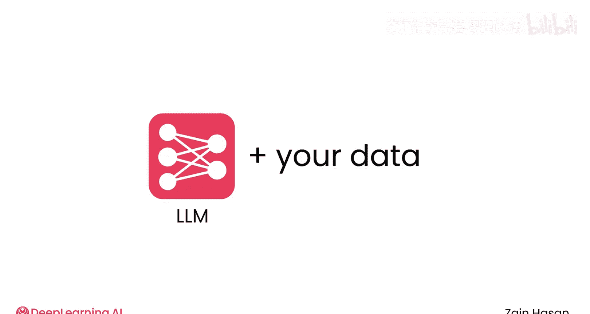

# 吴恩达《检索增强生成｜Retrieval Augmented Generation (RAG)》中英字幕（Claude-3.7-s） - P4：3_RAG的实际应用.zh_en - GPT中英字幕课程资源 - BV1qsgLzmEg6

As you just saw， the core idea of rag is to pair an off the shelf LLM with a knowledge base of information it might not have had access to when it was trained。

Many LLM powered systems implement this model， so let's explore a few of them now。

One important application of RAG is for code generation。

This is significant because while language models have been trained on lots of code。

 conceivably every public Git repository， generating correct code for a specific project requires specialized information。

The LLM needs to know the classes， functions， and definitions in the project。

 as well as the overall coding style being used。Building a RAG system that uses your own code base as the knowledge base makes this information available to an LLM。

By retrieving relevant classes， definitions， and files from your repository。

 an LLM is much better able to generate code or answer questions relevant to your project。

Another major application is customizing chatbots to an individual company。

 Every company has its own products， policies and communication guidelines。

 treating these enterprise documents as a knowledge base allows you to deploy ELMs in a variety of useful ways。

You could build a customer service chatbot that knows information about your company's products。

 current inventory or common troubleshooting steps。

 you could deploy an internal chatbot that accurately answers questions about company policies or direct you towards useful documentation In either case。

 the knowledge base helps ground the LLM's responses in your company's specific products or policies and helps minimize instances where the LLM generates generic or misleading responses RaG has significant applications and healthcare and legal domains。

In these instances， the knowledge base might contain legal documents from a particular case。

 text from recently published medical journals and so forth。

 in fields like these in which precision is imperative and the amount of niche and potentially private information is vast。

 a rag based approach might be the only way to deploy an LLM based product that is sufficiently accurate and uses private information。

Another major application is an AI assisted web search。Historically。

 search engines have worked like a retriever。Given a search query。

 they return relevant websites Today， search engines will provide AI summaries of these search results to quickly present the most useful information in a skimable way。

These AI web summaries are basically a RAG system whose knowledge base is the entire internet。

While large scale rack systems can be powerful， the same is true for highly personalized ones。

Personalized assistance in your text messages， email， client， word processor， calendar。

 and so forth are now able to help you send messages， organize your schedule， draft documents。

 and complete projects big and small。In each case， the more context the LLM has about the project you're working on。

 the better they're able to support that work。In these cases。

 knowledge base might be relatively small， for example， your text messages， contact list， emails。

 or a folder of documents。These kinds of documents are dense with important context。

 so a rack system with access to the small scale personal information can complete tasks in a way that is significantly more relevant to what you're doing。

As you can see， the Rag model has applicability in a wide variety of contexts。 Many companies。

 organizations， and even you have collections of information that could be used to enhance the quality of text generated by an LLM。

 whenever you have access to information that likely wasn't used to train a large language model。

 There is a potential for building a useful Rag application。

They might even allow LLMs to be used in contexts that were otherwise impossible。

As you continue through this course， hopefully you'll start seeing opportunities in your work and life where a RAG approach would be useful。

For now， though， join me in the next video and let's dive deeper into the architecture of a rag system。

