# 吴恩达《检索增强生成｜Retrieval Augmented Generation (RAG)》中英字幕（Claude-3.7-s） - P5：4_RAG架构概览.zh_en - GPT中英字幕课程资源 - BV1qsgLzmEg6

You've already seen the most important components in a ragg system， namely the LLM itself。

 a knowledge base of relevant information and a retriever that inserts the knowledge base。 Now。

 let's look at the overall architecture of a ragg system and how these components work together。

Let's start by looking at how you normally use a large language model。

 You type a prompt and send it to the LLM。 The LLM processes the prompt and generates a response。

 The user experience for a rag system is actually identical。

You submit a prompt and get back a response。

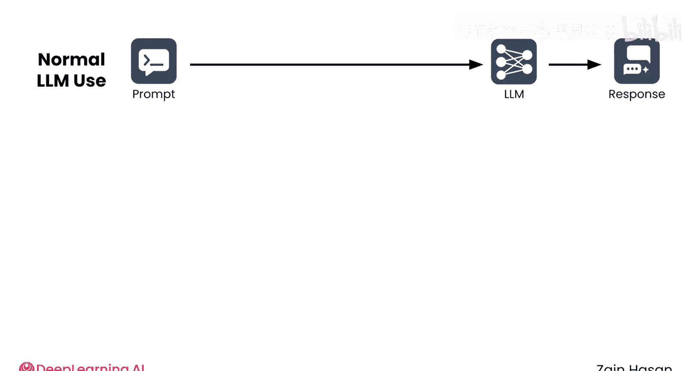

Inside the system， however， there's a few more steps。 When the ragg system receives your prompt。

 it first routes it to the retriever。 The retriever has access to the knowledge base。

 which practically speaking is just a database of useful documents。

The retriever queries the database， returning documents that it determines are most relevant to the prompt。

Next， the system creates an augmented prompt， incorporating information from the relevant documents into the original prompt。

 For example， an augmented prompt might be answer the following question。

 Why are hotels in Vancouver so expensive this coming weekend。

 Here are five relevant articles that may help you respond。

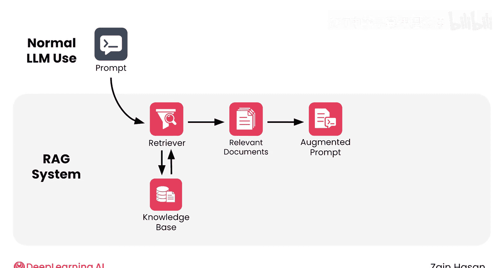

And then insert text from the articles。

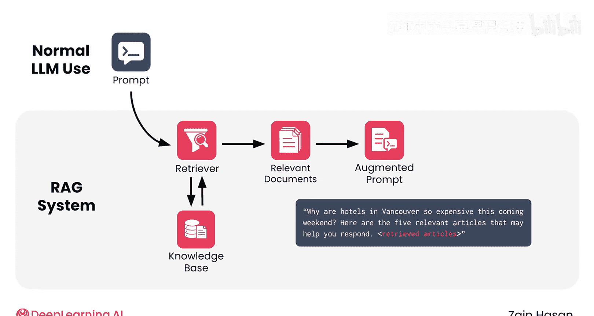

At this point， the system operates like any other LLM。

 the augmented prompt is sent to the LLM and it generates a response。

The LM is able to respond based on both the knowledge it learned from its training data。

 as well as any additional context provided by the retrieved documents。

The user experience is the same as always， perhaps with a little bit of added latency。

 you type a prompt and you get back a response。 thanks to that side route through the retriever。

 However， there is a higher likelihood。 The response is accurate， up to date and context aware。

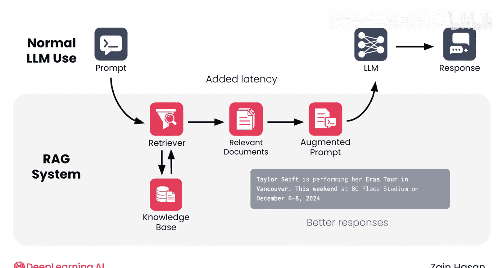

As you just saw， the main difference between using an LLM directly and a ragg system is the addition of the retriever。

 This fairly straightforward edition， however， allows for a number of advantages。

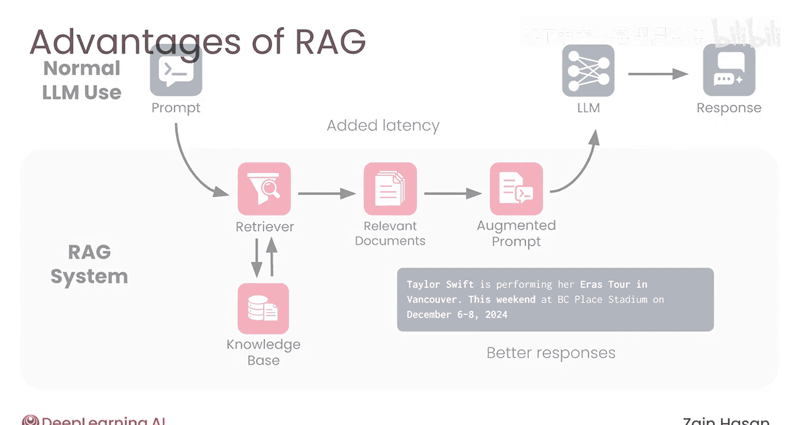

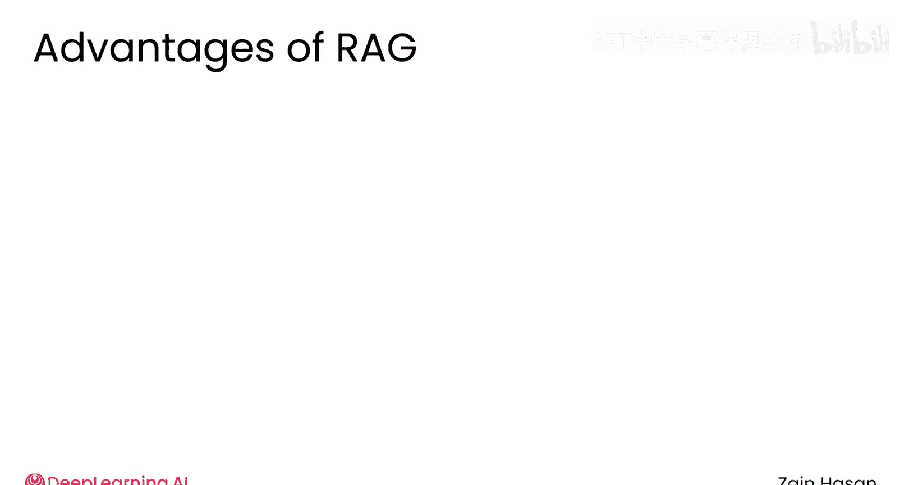

First， and most importantly。It makes information available to the LLM that might otherwise not be。

Whether it's company policies， a piece of personal information， or this morning's headlines。

 RaG is often the only way to make some kinds of information available to an LLM。

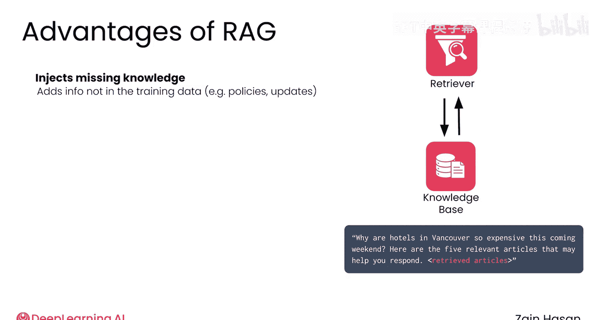

Related to this first point， RaG reduces the likelihood of hallucinations or misleading responses。

These are often caused by LLMs generating responses about topics which were excluded from their training data。

 or perhaps just mentioned rarely， adding relevant information directly in the prompt grounds the language model's responses and makes them less likely to create generic or misleading text。

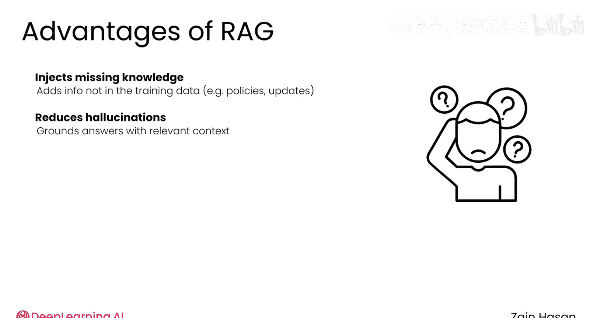

Rag makes it much easier to keep LLMs up to date with rapidly changing information。

 retraining a language model is usually a costly and time consuming feat。

So LM struggled to keep up with very new information。In a RA system， however。

 you can simply update the information in the knowledge base。

 just like you'd update entries in any other database， as soon as those changes are indexed。

 your LLM will be able to respond based on the new information。

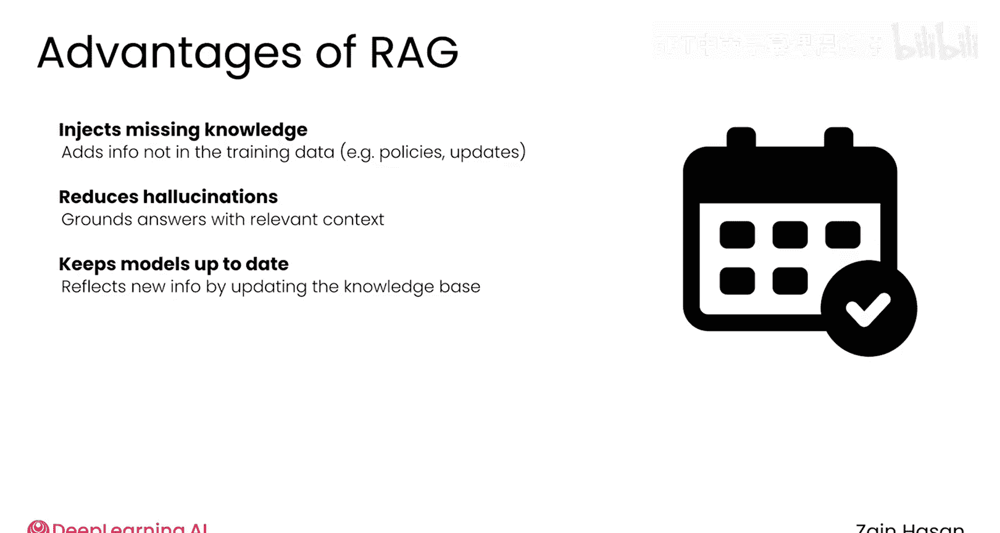

RAG improves in LLM's ability to cite sources， a RA system can add citation information to the augmented prompt。

 and the LLM can then include that information in its ultimate response。

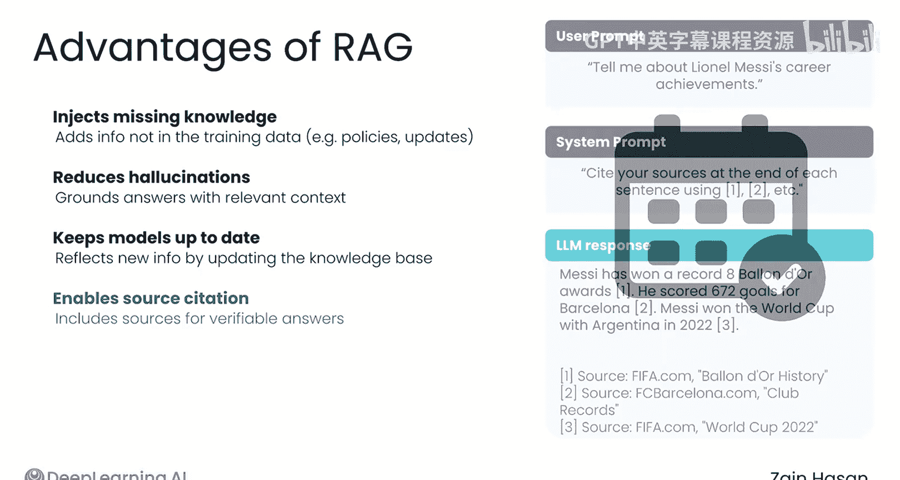

This doesn't just ground the response， but enables human readers to dig deeper and validate the generated text。

 Finally， Rag allows an eent to focus on this text generation。

 The retriever filters down a vast world of information。

 finds what's most important and relevant and presents it succinctly。😊。

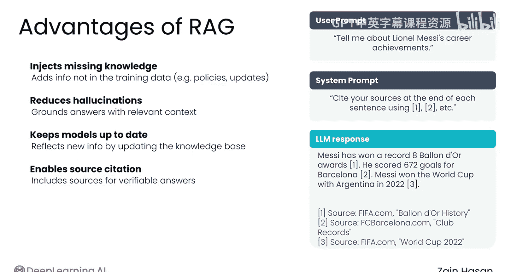

The LLM still needs to write a good response， but it's not being relied upon to do fact finding or filtering steps。

 In other words， each component is assigned to work on the area of its greatest strength。

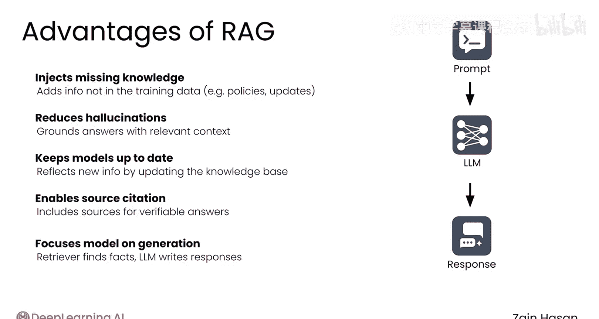

By the end of this course you'll dive deep on building ragG systems from the ground up。

 but here's a very simple code demo of how RAG works with most of the details abstracted away。

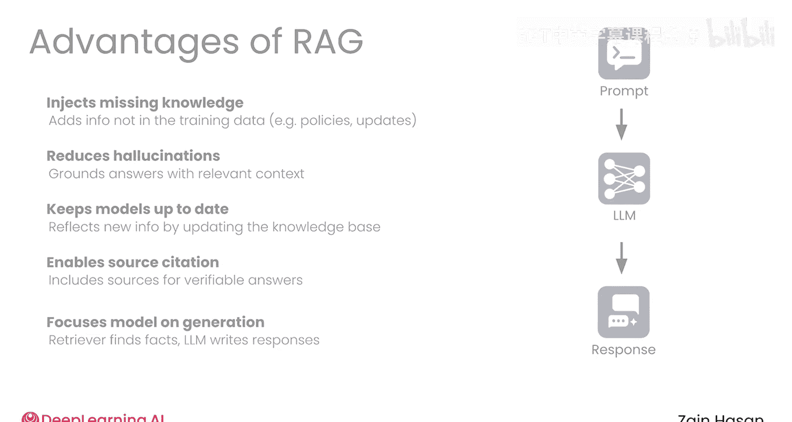

I have a retrieve function and a generate function。

 The retrieve function is a wrapper around a retriever。

 It accepts a text query and returns relevant documents from the knowledge base。

The generate function is just a wrapper around a large language model。

 It accepts a text prompt and returns the L L M's response。

 Allll write a prompt and save it in the variable prompt。

 The prompt is why are hotel prices in Vancouver super expensive this weekend。Now。

 let's submit our prompt directly to our LLM and see what answer it returns。Okay。

 now let's see what additional information our retriever has about this prompt like this。😡。

And now let's build an augmented prompt that contains both the original user question and the retrieved information。

 So here， the augmented prompt reads respond to the following prompt。

 we add in our prompt using the following information retrieved to help you answer。

 and then we add in our retrieved documents。

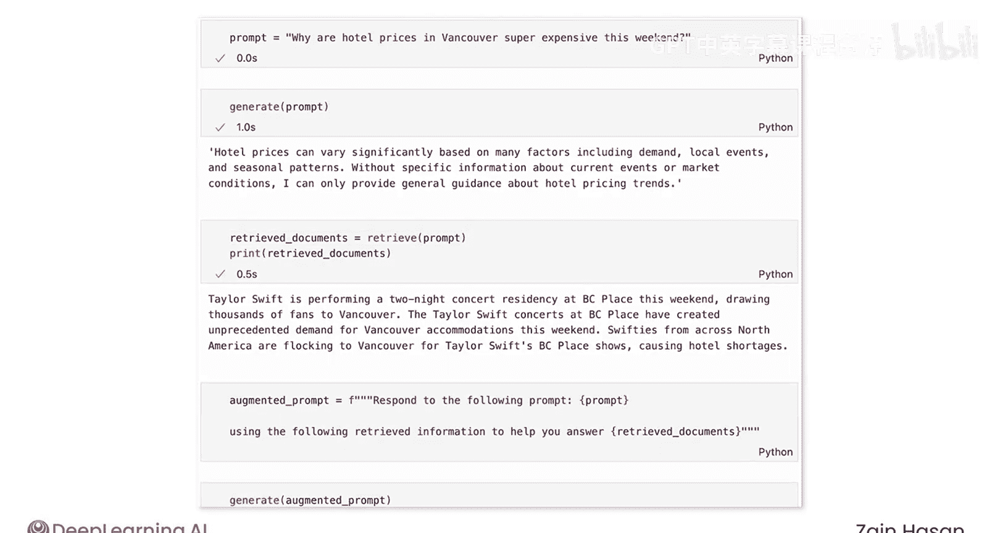

Now， let's submit this augmented prompt to our LL M。 Now。

 the LL M is able to provide an accurate response to the question。

 integrating the information that was retrieved from the knowledge base。

 That's really all there is to Ra， adding additional context to your prompt to help an LL M respond more accurately。

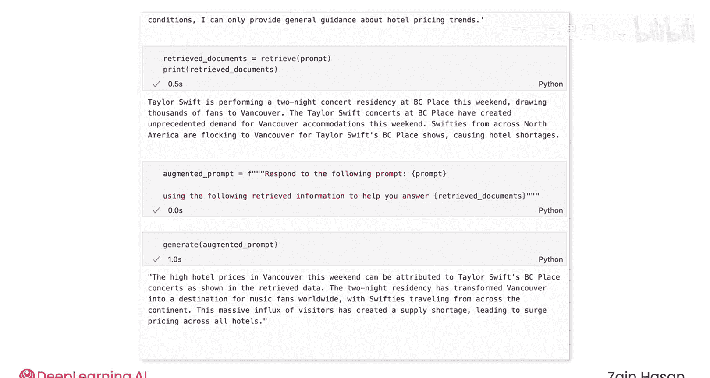

This was admittedly a very high level overview of a rag architecture。

 So join me in the next video and we'll start looking at each component in more detail。

