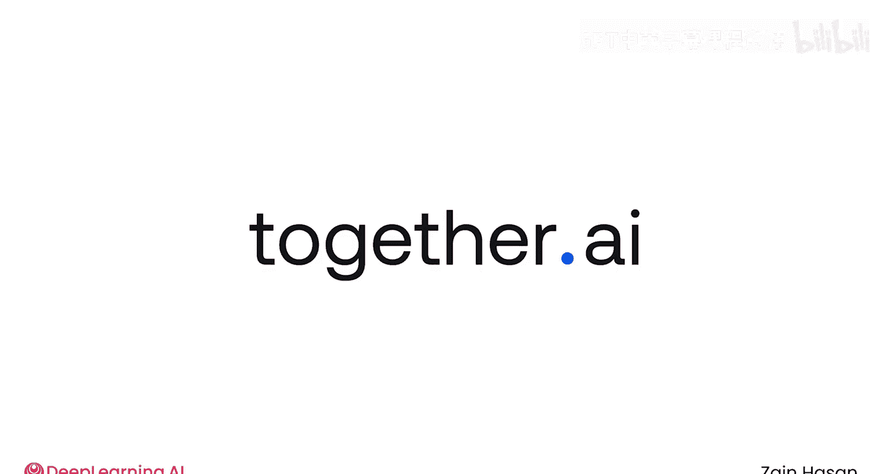

# 吴恩达《检索增强生成｜Retrieval Augmented Generation (RAG)》中英字幕（Claude-3.7-s） - P6：5_大语言模型导论.zh_en - GPT中英字幕课程资源 - BV1qsgLzmEg6

Now that you've seen the high level architecture of a rag system。

 let's take a closer look at each component， starting with the large language model itself。

Understanding the way they operate， their strengths and their limitations will help explain the way other components in a rag system are designed to improve an LLm's performance。

LMs are sometimes jokingly called fancy autocomplete。But that's actually a fair description。

All LLMs do is predict the next word that should appear in a piece of text。For example。

 if I show you the incomplete phrase， what a beautiful day the sun is dot dot dot。

 You and I could probably guess what word should complete that sentence。And so could an L L M。

 I'd say the words shining makes the most sense， but the sun is rising or the sun is out could also work。

 The original phrase is called the prompt。 And each of these final completed phrases is called a completion。

 One possible completion for this prompt is the sun is exploding。

But you'd probably say that's incorrect。 The problem isn't that the phrase is grammatically flawed。

 It's valid English， but just that this phrase is improbable。 The sun usually doesn't explode。

 Certainly not on a beautiful day， like this one。You have an intuitive sense for how words are used。

And in a way， so do language models under the hood， they use a neural network。

 an enormous and complex mathematical model of language。

 This model stores information about which words are commonly used with each other。

In which order they typically appear and on a higher level。

 captures what these words mean in context。This mathematical representation of language is what the model ultimately uses to generate new text。

 When an L M generates a completion， all it's doing is adding new words to the end of the prompt。

 One word at a time。 For example， if it were generating a completion to that last prompt。

 it would likely add the word shining and then might add the words in the sky one at a time before signaling the completion is done and returning it to the user。

Technically， an LLM doesn't generate words， but rather tokens。

Which is a more generic term for pieces of words。 Some words like London and Door。

Might have their own token， but common， compound words like programmatically and unhappy are usually split into multiple tokens。

Punctuation like the period comma and the question mark could also get their own tokens。

 Most LLms have a total vocabulary。Of anywhere from 10 to more than 100000 tokens。

Having the flexibility to build up compound words out of smaller word pieces allows the model to build any possible word without needing to actually assign a token to each one。

 Here's the process the L M goes through before adding each new token to the completion。First。

 it processes the current state of the completion， generating a deep understanding of the relationships between each word and the overall meaning of the text。

 Then the LLM goes through every token in its vocabulary。

 usually tens to hundreds of thousands of them and calculates the probability that it should appear next。

In the example you've seen so far， Shi would likely have the highest probability and rising would have a smaller probability。

 but even improbable words like exploding or snoring would still have a tiny chance of appearing next。

 In other words， the L M generates a probability distribution across every token。

It then randomly chooses the next token from that probability distribution。In this example。

80 times out of 100， ill'll choose shining。But it's still possible it could choose rising， or yes。

 even exploding。When the L M goes to add another token to the completion。

 it repeats this entire process。 This time， most of the words in the completion are from the original prompt。

 but one of them is the words shining， which it just generated。

This means that token choices the LLM makes earlier in the completion will impact selections it makes later。

This is desirable behavior because it means new tokens will make sense in the context of the tokens the LM has already chosen。

That said。It also means that once an LLM randomly chooses one direction to take a completion。

 it will follow that path where it leads。For example， after choosing shining。

 the LM might choose in the and sky， since those words all make sense in the context of the words chosen before them。

 If that initial generated token had been warming， however。The LLM might then choose our faces。

 as that makes more sense， given the direction the LLM took the completion。

This behavior is called auto regressive， meaning self influencing。

Thanks to their randomness and auto regressive nature。

 running the same prompt multiple times through the same LLM will usually lead to different completions。

An LLM is able to understand the meaning of a prompt and make reasonable predictions of words because it has been trained on large collections of text。

The mathematical model that powers in LLM has billions of individual parameters or numerical weights。

 before training， this model would just produce gibberish。 During training。

 the L M has shown incomplete pieces of text from the training data and tries to predict which word comes next。

Based on the accuracy of these predictions， it will update its internal parameters in this way the model learns to produce both the factual information and the linguistic styles in the training data。

Many large language models today are trained on trillions of tokens of text。

 largely taken from the open internet。The resulting models are able to generate texts in a wide variety of styles and on wide variety of topics。

 because examples of those styles and information of those topics was in its training data。

 understandinging how LMs work and how they're trained also explains many of their behaviors。

Let's start with hallucinations。All LLMs can do is generate probable sequences of words based on the patterns they learned in their training data。

If you ask an LLM about your company's private， internal data or today's news。

The model almost certainly wasn't trained on that information and so isn't in a good position to respond。

 In these instances， an LLM will sometimes give responses that sound right， but aren't actually true。

Even though these behaviors are called hallucinations。

It's important to remember the LM isn't having a psychological episode。

 or even really malfunctioning。LMs are designed to generate probable text， not truthful text。 Tru。

 as far as an LLM is concerned， is just that a sequence of words is probabilistically likely based on its training data。

 with high quality training data， our intuitive understanding of truth and an LLM's mathematical understanding of probable word sequences can be kept in alignment。

The challenge， then， is to ensure the LM has access to as much relevant information as possible。

 Rag solves this problem by taking advantage of how well Lms are able to understand context。

If your RAC system adds relevant information to the prompt。

 the LLM is able to understand and incorporate that information into its responses。

 even though that information wasn't part of its training data。

 Typically you'd say this information grounds the LLM's responses。

While you might just want to add as much relevant information to the prompt as you can find in practice。

 there's reasons you can't。 First， longer prompts just take more computation to run。

 This is because before generating each new token， the model performs a computationally complex scan of every token already in the completion。

 including the original prompt。Second， eventually you'll hit the limit of an LLM's context window。

 the longest sequence it can process at once。Some older models have context windows of only a few thousand tokens。

 while newer ones can process millions。This means that as a retriever adds more information to the augmented prompt。

 at first， you'll just make your prompts more costly and eventually you'll entirely use up the model's context window。

There are a wide array of ELM providers， but in this course you'll be using together AI。

 which hosts many popular open source models。Using open source models makes it easier to look under the hood of large language models and explore many of the concepts you'll learn throughout this course。

There's a lot more to learn about LLms。But the main takeaway at this point is that an LLMs design allows it to incorporate information in the prompt into its response。

 even if that information wasn't included in the training data。

So let's turn our attention to the retriever and see how it worked to provide that information。

