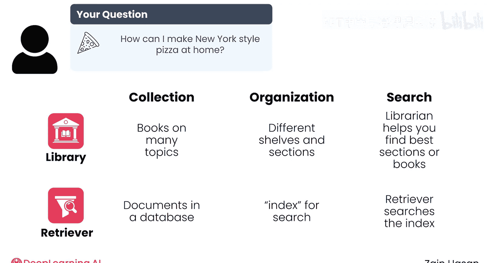
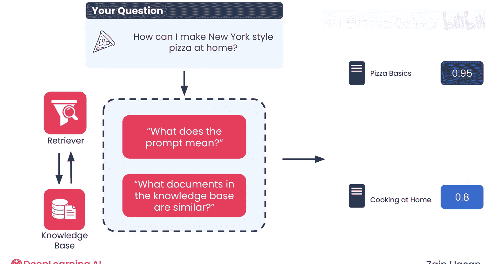
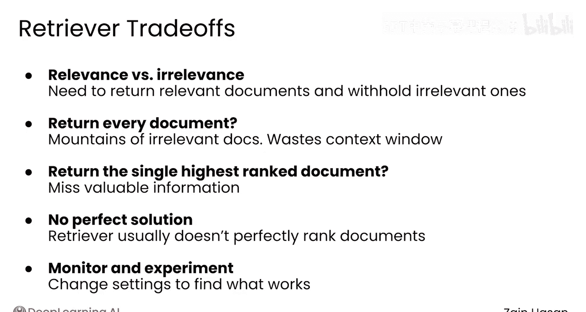
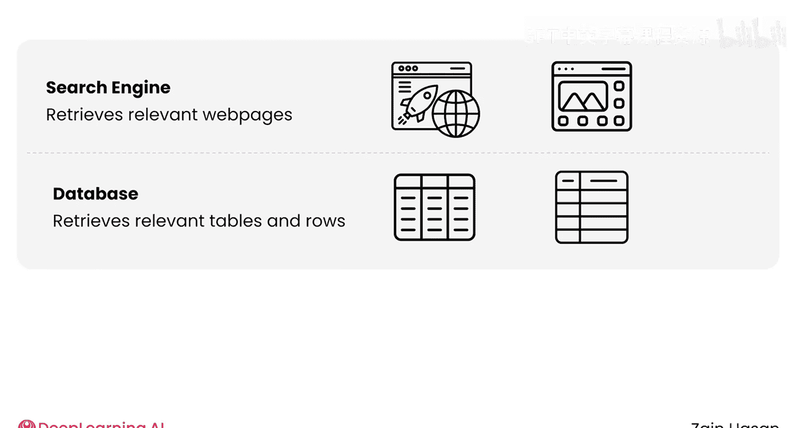
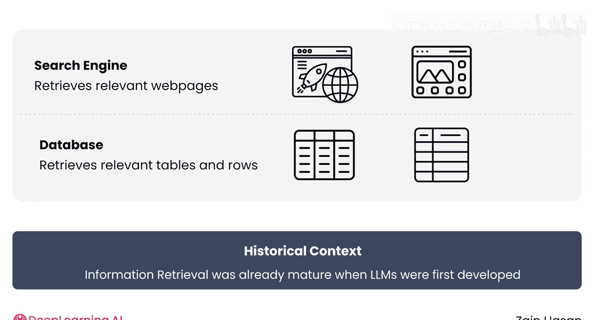
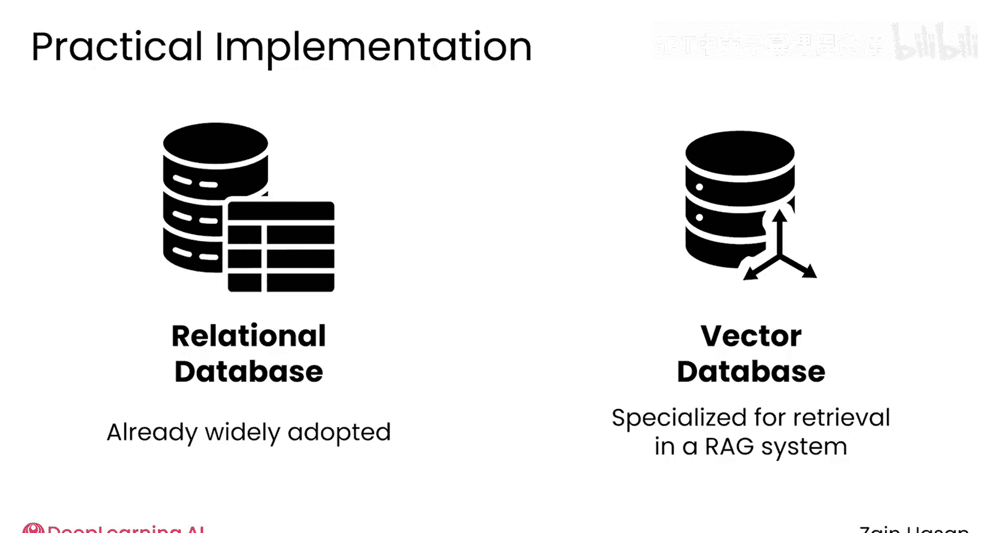

# 吴恩达《检索增强生成｜Retrieval Augmented Generation (RAG)》中英字幕（Claude-3.7-s） - P7：6_信息检索技术导论.zh_en - GPT中英字幕课程资源 - BV1qsgLzmEg6

At this point， the purpose of the retriever is probably pretty clear。

 It needs to provide useful information to the LLM that was potentially not available when the model was trained。

Now let's take a look at how this component actually works。Let's start with an analogy。

 Imagine you're visiting a library to answer the question。

 how can I make New York style pizza at home？I know。

 I know you probably just look this up online and honestly， so would I？

But stick with the metaphor because I think the visuals are helpful。

The library has a large collection of books on many topics to help you browse the collection。

 The books are organized in sections and shelves based on characteristics of their topics， genre。

 authors and so forth。If you share your question with the librarian。

 they can help you find the sections of the library or even the exact books that are most relevant to your question。

Rettrieverrs have many similar components。Where a library has a collection of books。

 a retriever has a knowledge base of documents。A retriever will similarly create an index of the documents in the knowledge base。

 which keeps the documents organized and makes them easy to search。

 The next step is to actually retrieve relevant information in the library。

 You can just ask the librarian directly。 The librarian is able to understand the meaning of your question。

 and knows to go look and section of the library on cooking or Italian cuisine or possibly New York。

 The ability to interpret the meaning of your question allows them to identify the right shelves of the library to search through and eventually find relevant books。

 inside a rag system。 The retriever does something similar It first needs to process the prompt to understand its underlying meaning。

It then uses that understanding to search the index of documents。

The retriever then returns the documents from the knowledge base that determines are the most relevant to the prompt。

 When it's completing its search， the retriever ranks documents in the knowledge base by how relevant they are to the prompt。

Each document receives a numerical score that quantifies its relevance。 Usually。

 this means some measure of the similarity between the text of the prompt and the text of the document。

The documents with the highest scores are the ones that are returned。

There are a variety of approaches to calculating these similarity scores that you'll learn more about later in the course。

A well designed retriever should of course， return relevant documents。

 but it also needs to withhold irrelevant documents。

If you asked for information about making New York style pizza at home and the retriever responded with all the documents in the knowledge base。

 technically， you'd have every relevant document， but it' be lost in a mountain of irrelevant information。

As you saw earlier， this would also lead to costly prompt or even entirely use up the LLM's context window。

 on the other hand。If you only retrieve the highest rank documents in the knowledge base。

You might miss valuable， relevant information in the documents ranked second， third， or fourth。

In a perfect world， the retriever perfectly ranks the documents and chooses the exact right number of them to return。

In practice， however， you know， the rer will sometimes rank some relevant documents too low and rank some other irrelevant documents too high。

 making it difficult to confidently decide how many of them to return。

To optimize a retriever's performance， you'll need to monitor it over time and experiment with different settings。

 something you will see extensively in this course。

It's worth noting that many familiar pieces of software perform very similar tasks to a retriever。

A web search engine retrieves web pages that are relevant to a web search。

And a relational database retrieves rows and tables that match a SQL query。

The broader field of information retrieval was already mature when large language models first were developed。

And ideas from this field underlie the way retrievers and rag systems are designed。

In theory， there's lots of ways to implement the retriever in a rack system。

 since most companies already have their data in traditional relational databases。

It'd be nice to keep the data there and figure out a way to retrieve from that database to power a rack system while they're not strictly necessary at scale。

 most retrieveverrs will be built on top of a vector database。

 a specialized type of database that is optimized for rapidly finding the documents in your knowledge base that most closely match a prompt。

In this course， you'll learn about both general principles of information retrieval that power a wide variety of search technologies and vector databases that are typically used as a retriever inside a production scale ragG system。

There's lots more to learn about retrievers， but for now that covers the most important points。

 Join me in the next video and let's wrap up this module。

