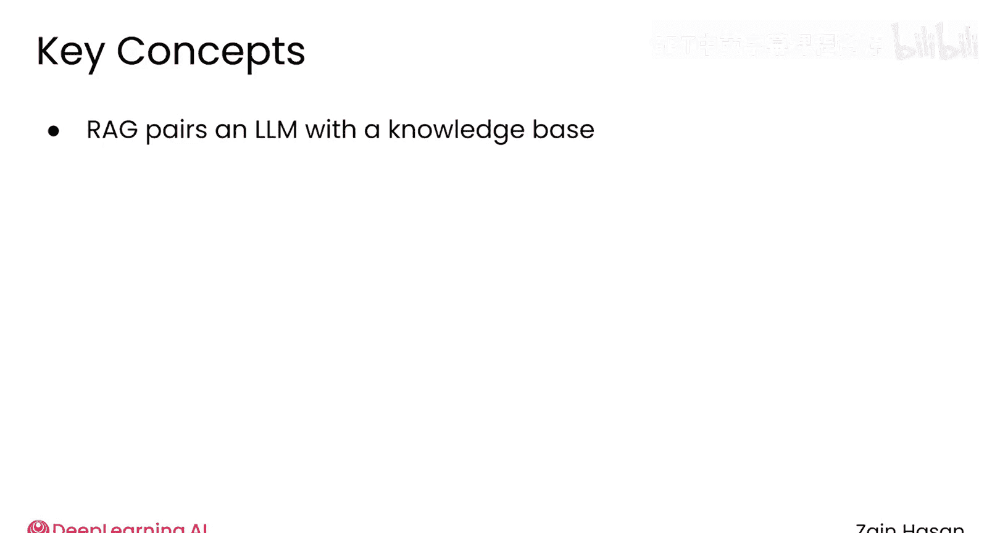
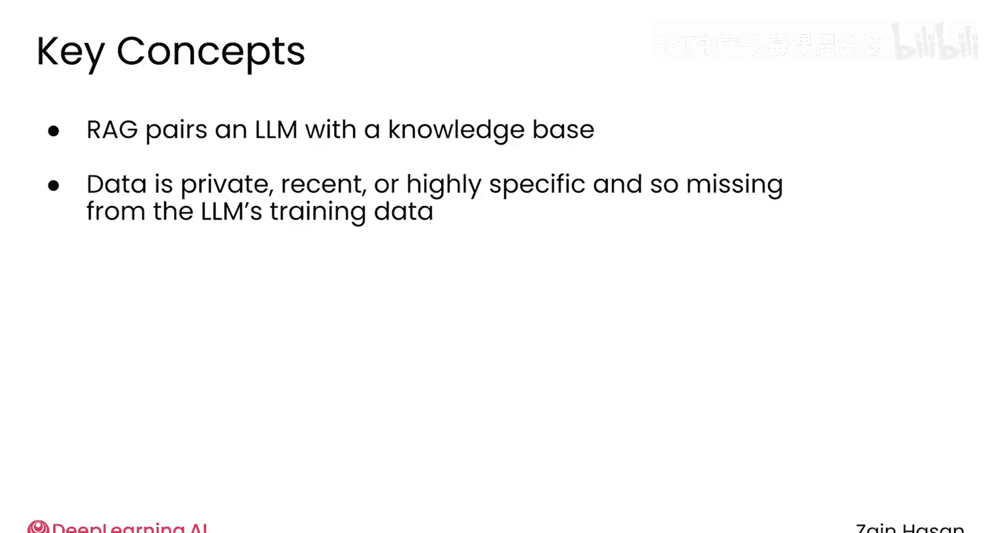
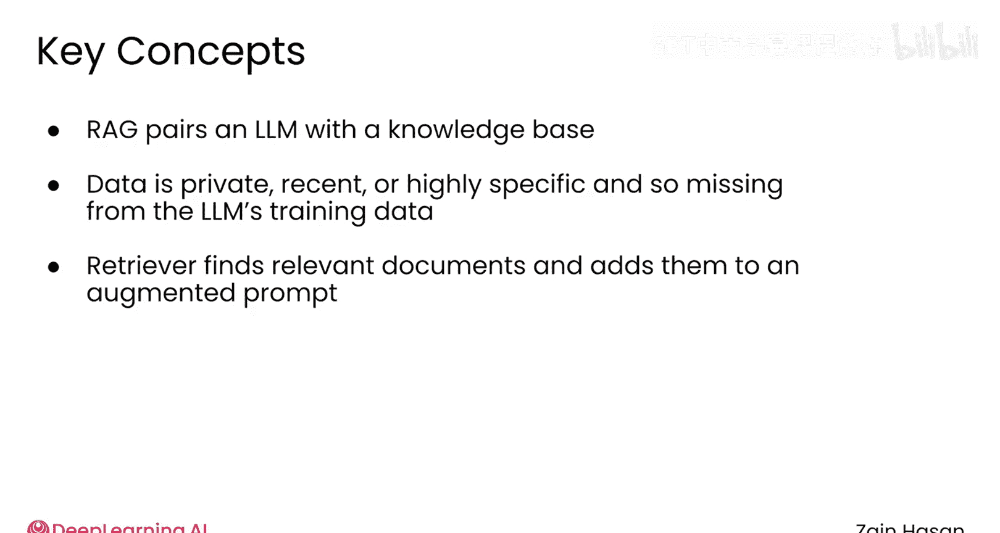
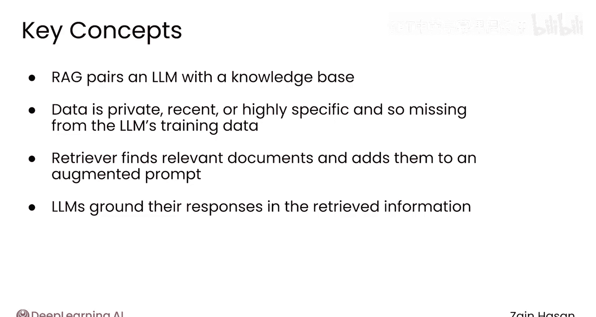

# 吴恩达《检索增强生成｜Retrieval Augmented Generation (RAG)》中英字幕（Claude-3.7-s） - P8：7_模块1 总结.zh_en - GPT中英字幕课程资源 - BV1qsgLzmEg6

Retrieval augmented generation is hopefully already starting to feel more approachable。

 Its goal is to make L L Ms more useful and more accurate by giving them access to information that they might not have had when being trained。

 in order to do this， the L M is paired with a collection of data called the knowledge base。

 This data might be private， recent or just highly specific。

 and so not included in an off the shelf LL M's training data。

When users submit prompts， they're first routed to the retriever。

The retriever searches the knowledge base for relevant documents and adds text from those documents to the user prompts。

LMs are able to incorporate this information from the prompt into the responses they generate。

 The retrieved information grounds the final response， making it more accurate and relevant。😊。

Of course， that's a very high level description。 So throughout the remainder of this course。

 you're going to deep dive on each part of a rack system。

 You'll learn how each component actually works。 A variety of techniques for optimizing their performance。

And important considerations when tuning them to your project and your data。

Come join me in the next module and let's start that journey。

