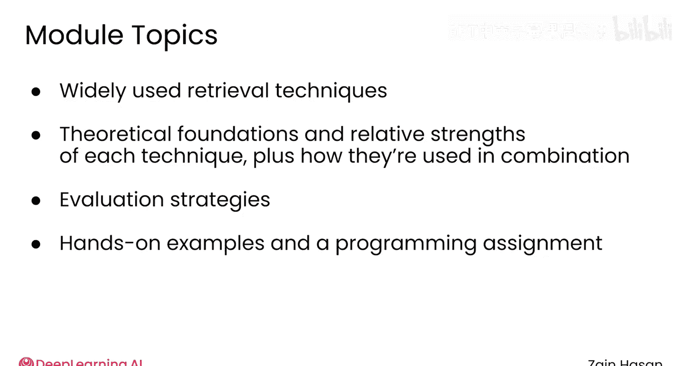

# 吴恩达《检索增强生成｜Retrieval Augmented Generation (RAG)》中英字幕（Claude-3.7-s） - P9：8_模块2 简介.zh_en - GPT中英字幕课程资源 - BV1qsgLzmEg6

A retriever's job is pretty easy to state。 All it needs to do is find documents in the knowledge base that can help an LLM respond to a prompt。

If you think about it， though， that's a pretty difficult job。

Users aren't submitting well structured SQL queries to your rack system。

 They're chatting with your LLM the way they talk to another person。 Meanwhile。

 the documents in your knowledge base might be anything from personal emails to internal company memos or articles from a medical journal。

They might be rich in information， but it's usually structured for humans to read。

 not for a computer to search through it。Somehow， a retriever has to handle all of this messily structured information and rapidly return the most relevant pieces。

 all infractions of a second。In this module， you'll learn about the primary techniques a retriever uses to accomplish this feat。

 You'll build a theoretical understanding of how each technique works。

 explorere their relative strengths and weaknesses and see how a retriever uses them in combination to provide the best possible results。

You'll also be introduced to some strategies for evaluating a retriever's performance。And as always。

 you will find some hands on coding exercises and a programming assignment where you can directly apply what you've learned。

I think you'll enjoy this deep dive on information retrieval。

 so join me in the next video and let's get started。

