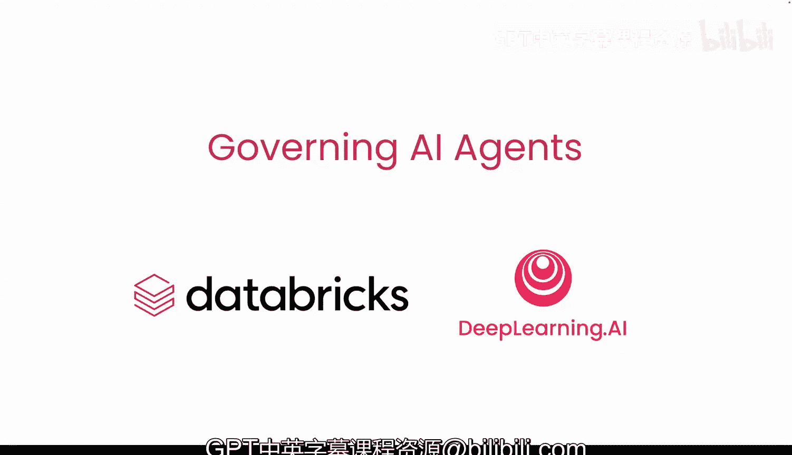
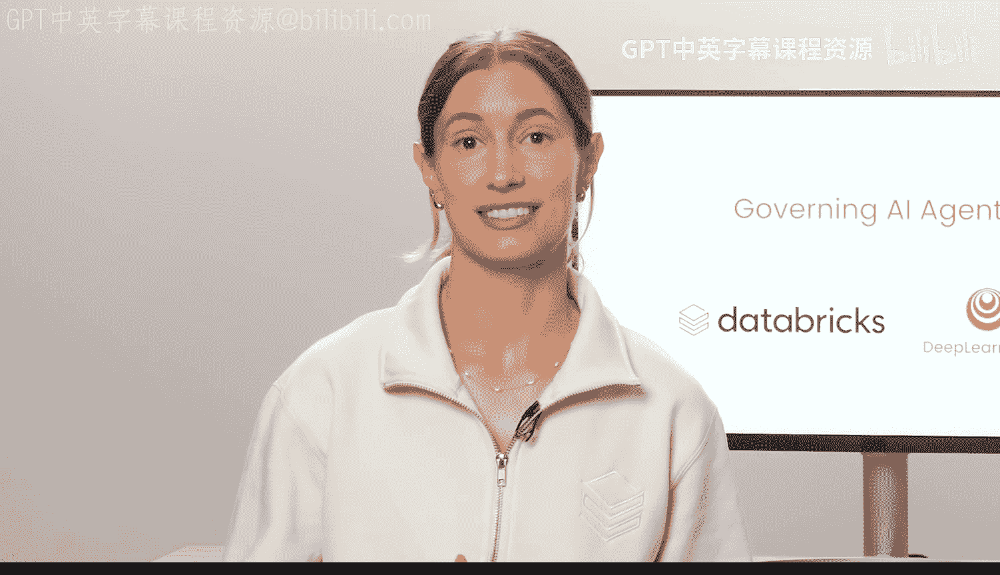
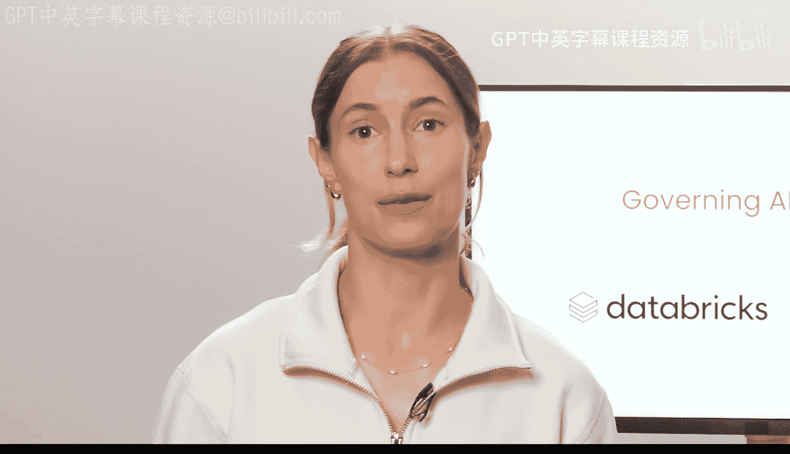
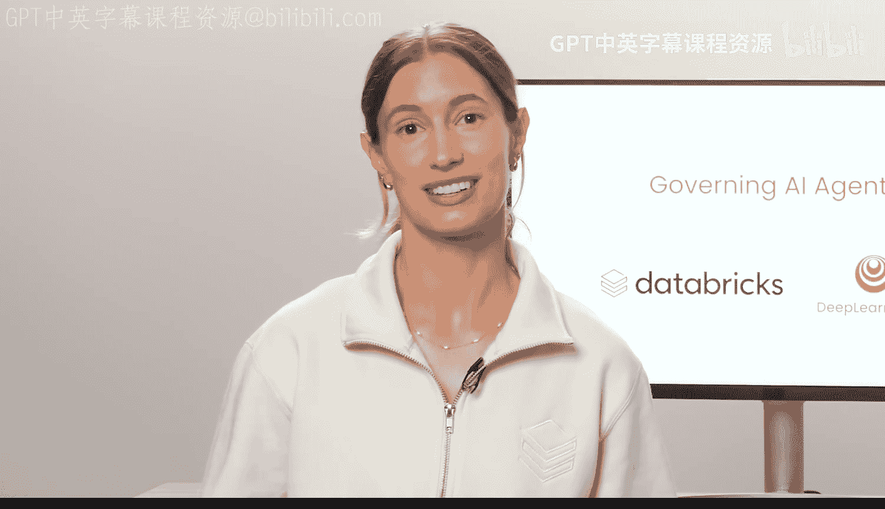
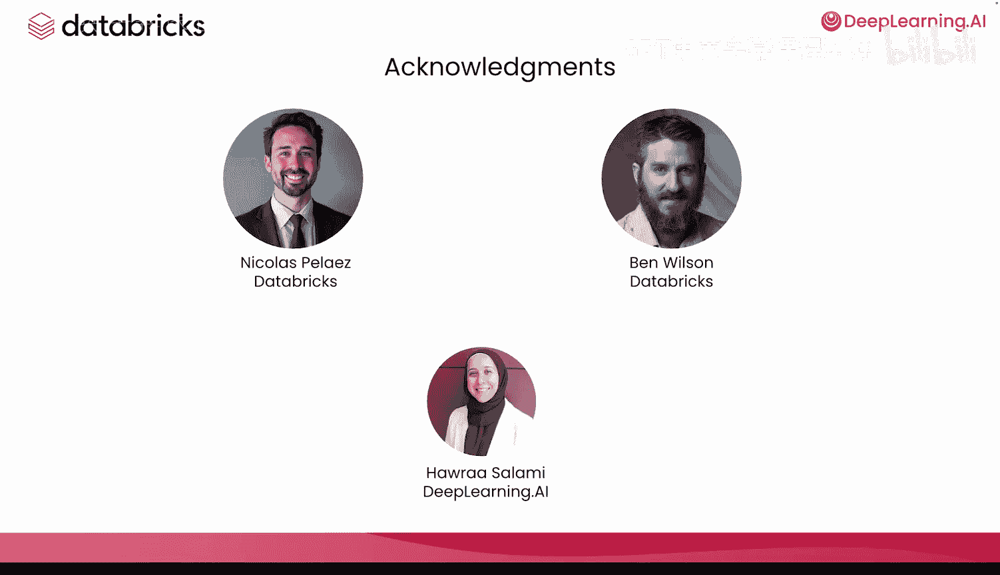

# 吴恩达《治理AI智能体｜Governing AI Agents》中英字幕 - P1：1.intro.zh_en - GPT中英字幕课程资源 - BV1GXyhBWE6h

Welcome to Gving AI Ages built in partnership with Data Bricks。

In this course， you'll learn how to integrate data governance into your agent' work though to ensure the agent can handle data safely。

 securely and accurately。Data governance consists of a set of policies and practices that you can implement to ensure your agent has access only to the data that the needs。

 that personal information is protected from unauthorized access and that you and your team can monitor the agent's performance。

'm delighted the instructor for this course is Andver Robs。

 who is staff technical marketing manager at Databricks。

 Thanks Andrew I'm excited to work with you on this course。

 say you want to build an agent specializing in customer analysis you can define for the agent a set of tools that allow it to ingest data like customer demographics or transactions or website engagements and survey responses。

 if you give this agent brought permissions to all this data era the agent leaking private customer information such as credit card info or their address or their personal purchase behavior data that shouldn't be visible to maybe all complete employees if however。

 you build this agent with data governance in mind then you can ensure that your agent properly handles this data For example。

 you can specify into deployment environment what tables or columns your agent can access and encrypt customer id and mask credit card information you can also implement data quality check。

😊，Points for the agent's input and output and add evals to measure output quality and enable observability to lock the agent's processing steps。

All of these practices help you to continuously monitor the agent's behavior and debug any FA scenarios In this course。

 you will learn how to apply these governance practices to an agent that you'll build and deploy on Databs Now in order to make sure your agent follows least privilege access you'll give the agent specific intentional access with views these views which are SQL queries that act like tables will contain only the data needed for the agent's task Now for the agent to access these views you will need to learn how to specify the agent's permissions you will then build tools so the agent can access the data and register those tools as functions in unity catalog unity catalog is an open source data catalog that ensures only authorized agent or users can access those tools After that you will implement the agent logic using the openAI SDK evaluate it and enable tracing using MLflow and finally you will。

Deploy your agent to follow along with the course labs。

 you can create your account with Databricks free edition and try the labs at no cost Many people have worked to create this course。

 I'd like to thank from Databricks Nicholas Ps and Ben Wilson from Deeple AI Harra Salami also contributed to this course in the next lesson Amber will walk you through the four pillars of data governance for AI agents。

 which summarizes the main aspects of how to govern your AI agents The four pillars are lifecycl management risk management。

 security and observability So let's go on to the next video to get started。

