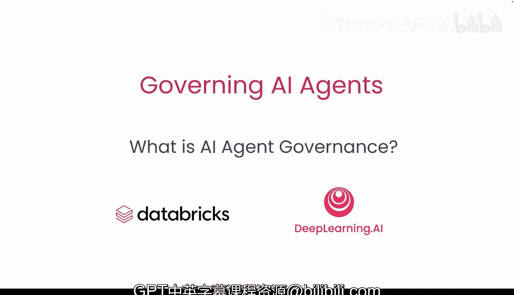
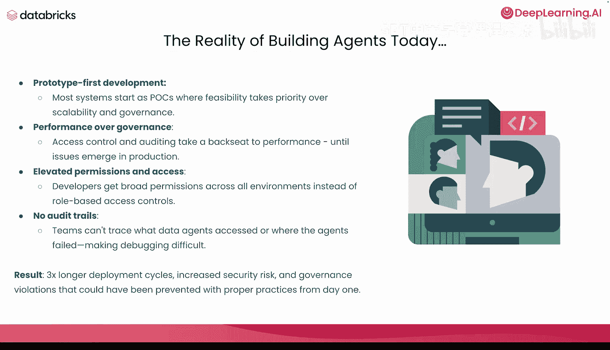
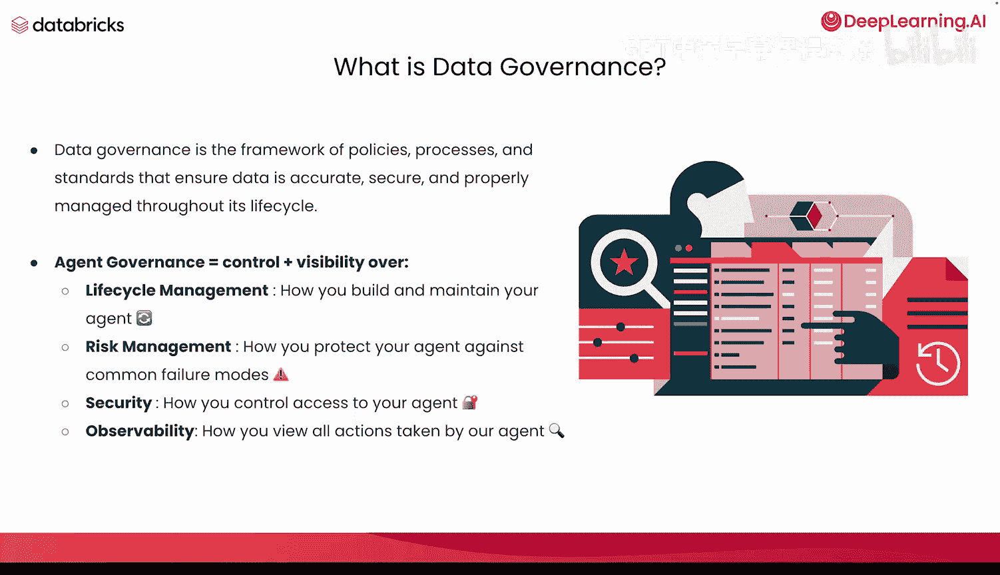
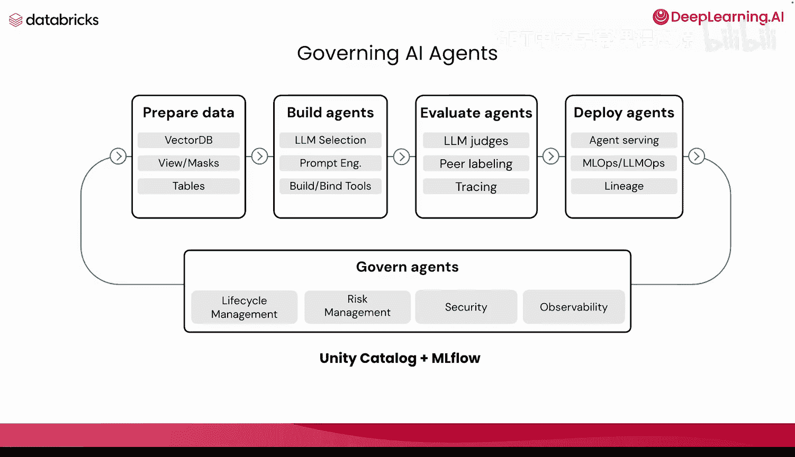
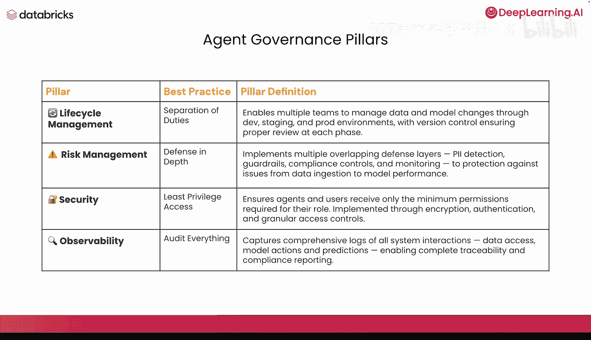
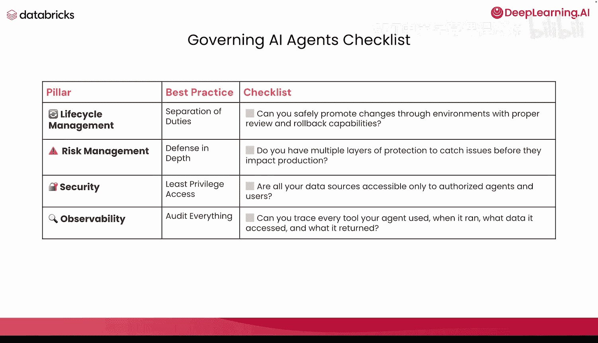

# 吴恩达《治理AI智能体｜Governing AI Agents》中英字幕 - P2：2.what-is-ai-agent-governance.zh_en - GPT中英字幕课程资源 - BV1GXyhBWE6h

In this lesson， you'll learn about the four pillars of agent governance and how to apply them to your agent workflow。

 let's get started。

So what's the reality of building agents today Well。

 they tend to start with prototype first developments。

 So most systems start as POCs or as demos where feasibility takes priority over scalability and governance and starting as a demo isn't necessarily a bad thing until performance starts taking priority over governance So how accurate the model is the metrics that are happening with it are taking priority over access control over auditing so we don't want those to take a backseat to performance。

 especially when issues start emerging in production。

 we know the only way to really troubleshoot those issues is with governance So having elevated permissions in access is a very bad thing when you're wanting to put something into production。

 typically when developers start building， they get broad permissions across all environments instead of role-based access controls Next is the reality of building agents today is there's not a lot of audit trails So teams can't trace exactly what the agents did what they had access to。

Where the agents failed making debugging really difficult so what happens is you have three time longer deployment cycles。

 you might have a really nice POC that took two or three weeks to build and then you give it to the team to put in production and it takes about eight months because they have to go back and redo every aspect of security and governance and you don't want that added security risk so it's best to practice governance from day one。

Now what is data governance Well data governance is the framework of policies。

 processes and standards that ensure data is accurate， it's safe。

 it's secure and it's properly managed through its lifecycle so agent governance is really the ability to have control plus visibility over your lifecycle management。

 so how you build and maintain your agents， risk management so how you protect your agent against common failure modes security so how you control access to your agent and observability。

 the ability to view all the actions that have been taken by your agent so where does data governance take place in your ability to build agent systems well basically whenever you're building an agent。

 you start with data prep so this could be creating your tables， creating views and masks。

 creating a vector database and then you're building the agent so you're binding tools together you're adding prompts。

 you're selecting your LLM and then you're evaluating agents either through LLM judges through peer labeling or having。

that golden data set that you can evaluate your agents against looking at tracing capabilities。

 having agent deployment is your next step so making sure your agent served you're tracking lineage and from that beginning to end is the governance layer so overall that you need lifecycle management risk management security and observability so we're going to apply these layers of governance with the help of unity catalog and Mflow as I mentioned before governance encompasses everything you build from data creation to model monitoring so I wanted to create a way for developers to conceptualize and categorize these areas so that's when I've made these four pillars for you these agent governance pillars are lifecycle management risk management。

 security and observability and they have best practices so for lifecycle management the best practice is separation of duties This enables multiple teams to manage data and model changes through dev staging and pro environments with version control。

To ensure proper review at each phase risk management。

 which the best practice is defense in depth so implementing multiple overlapping defense layers。

 this is your PII detection， guardrails， compliance control and monitoring in order to protect against issues anywhere from data ingestion to model performance security the best practice here is least privilege access this ensures agents and users receive only the minimum permissions required for their role implemented through encryption authenticification and granular access controls and then finally observability。

 the ability to audit everything so this captures comprehensive logs of all system interactions so data access。

 model actions and predictions enabling complete traceability and compliance reporting。

Now I want to walk you through some of the common techniques and tools that implement that best practice of each pillar so for lifecycle management and separation of duties。

 you're going to be using version control， CICD pipelines。

 environmental management so this is when you have your depth。

 staging and prod environments and isolation， deploy orchestrations。

 change management so the ability to have rollback capabilities， looking at risk management。

 your defense and depth， this is your data quality monitoring， your PII detection。

 these are your guardrails， any compliance capabilities and model validation， security。

 your lease privilege access， so this is your SSO login， these are your API keys。

 your multifactor authenticification service principles， secret management access controls。

 your data protection and your network security， and then your observability。

 so this is your ability to audit everything。In GenAI。

 we often talk about OTL or the open telemetry standard for logging traces from models。

 but this goes beyond that this is logging audit logs， application logs， inferenceprint logging。

 access logs， monitoring capabilities， lineage tracking， and alerting。

So those are the four main areas and next time you want to build agent capabilities and you're wondering is this ready for deployment。

 is this ready for production use case I've created a checklist that you can go through just to keep these best practices in mind for example。

 can you safely promote changes through environments with proper review and rollback capabilities do you have multiple layers of protection to catch issues before they impact production are all your data sources accessible only to authorized agents and authorized users can you trace every tool your agent used when it ran and what data access and what it returned so these are the key capabilities for your lifecycle management risk management security and observability you'll get to see these pillars in action throughout this short course。

