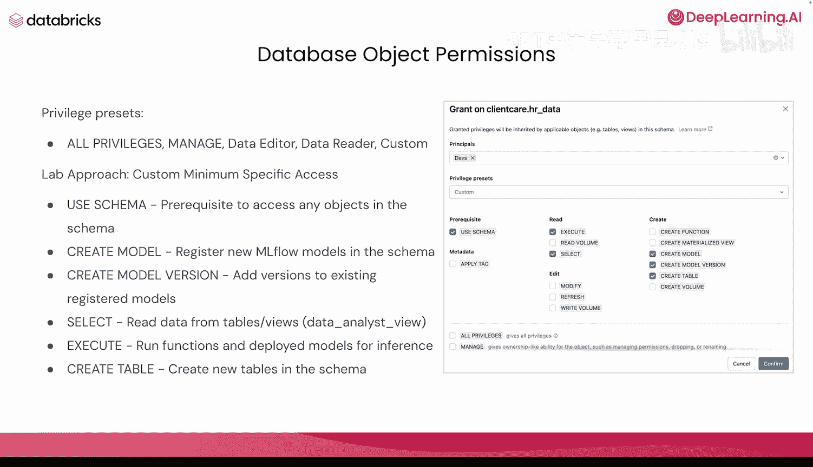
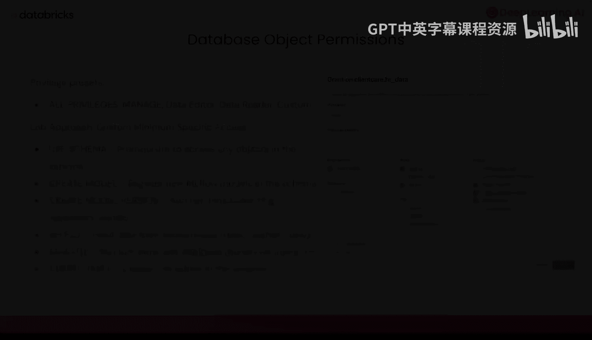

# 吴恩达《治理AI智能体｜Governing AI Agents》中英字幕 - P3：3.establishing-governance-in-catalogs.zh_en - GPT中英字幕课程资源 - BV1GXyhBWE6h

In the previous lesson you learned about the four pillars of agent governance。

 you can make the pillars actionable using Unity catalog in this lesson you'll learn what Unity catalog is and explore its components Allright let's dive in So as we saw from the first lecture we have our governing agents lifecycle where we prepare data build agents evaluate agents deploy them and then have this layer of governance Now we'll see how we apply these layers of governance on databs with the help of unity catalog Unity catalog is essentially your governance foundation Un catalog is aized data catalog that provides access control。

 auditing， lineage tracking， data quality monitoring and more across databricks workspaces and since you'll be in a Databricks workspace It's best to know that a Databs workspace is an environment where teams write code run notebooks and access data so it's a great way to work collaboratively with teammates Unity catalog provides this unified governance。

😊，Across all those workspaces。And when using Unity catalog。

 it's best to understand the structure and the metastore。

 so the metastore is the top level container for data in Unity catalog and then metastore is register metadata about data and AI assets and the permissions that govern access to them each metastore exposes a threelevel namespace so you have your catalog your schema and then your table views。

 volumes and functions by which your data can be organized now let's get into what each one of those means so we have database objects。

 so databasebricks primarily uses two primary seable objects to store and access your data so you have your structured tabular data which is in our tables and then you have your unstructured non-tabular data in volumes so you can also create vector databases from both tables so vector columns and volumes if you have a vector index。

Using Dataricks vector search， so these vector databases will still inherit all the unity catalog security and audit capabilities for all AI retrieval applications just to recap you have your tables for your structured your volumes for your nonstructured and with either one you can create vector databases looking at dataricks objects from a catalog schema and tables perspective so that top level of the container is going to be the catalog that contains all schemas so you can have multiple schemas then you have your schema or often referred to as a database and that contains all your data objects so the data objects can be contains in a single schema so these are your tables collections of data organized by rows and columns views a saved query against one or more tables。

 volumes again all your unstructured data in a cloud object storage， your volumes which can be PDF。

They can be images， they can be videos， any unstructured data functions。

 so save logic that returns values functions are also your tools or your skills。

 anything you can also attach to your agent to be able to query data and then models so these are AI models packaged with MLflow and these are also your agents so you can register your agent as an AI model that's packaged with MLflow you'll see how to do that in lab2。

In lab one of this course you'll create and use Unity catalog objects to create your tables。

 so we're going to be a company called client care and we're going to have a database of all our HR data so the schema is going to be called HR data so remember we have a catalog client care schema HR data and then we'll have tables of all that data will create a view as an analyst view so an analyst view will anonymize a lot of that key personal identifiable information so Social security numbers it will anonymize names it will anonymize and just give the information that would be needed for a data analyst we're going to build functions so we'll build masking functions and we'll build functions that can query the data we're going to use that as a tool to bind to our agent so that our agent can query the data using that specific view we built models so this is where we again we register the model we're building as an MLflow model。

And that's going to be the fool agent， so we consider an agent as a model or any customized finet LLMs Next you'll see how Unity catalog provides centralized governance for all these data objects across your Databricks environment。

And just before diving into lab1， when you have privilege presets so we can grant all permissions。

 we can create manage permissions you can have edit specific information。

 read permissions or custom permissions we're going to have custom permissions for our developer group that we're going to create and so this lab wants to use custom minimum specific access so we're gonna to give these developers access to use the schema。

 create a model， create model versions， use select so they can read data from tables and views。

 execute so that they can run functions and deploy models for inference and then create tables so they can create new tables in the schema So again。

 if you wanted to provide broad access to all your developers it's as simple as clicking all privileges if you just want to manage access you can manage access there custom presets I can choose editor reader and it will change out the permissions but。

Custom is going to let you have that hands on approach and of course you can always revoke as easily as you grant access。

