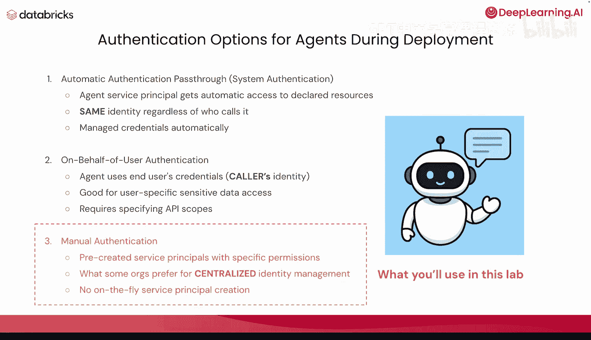
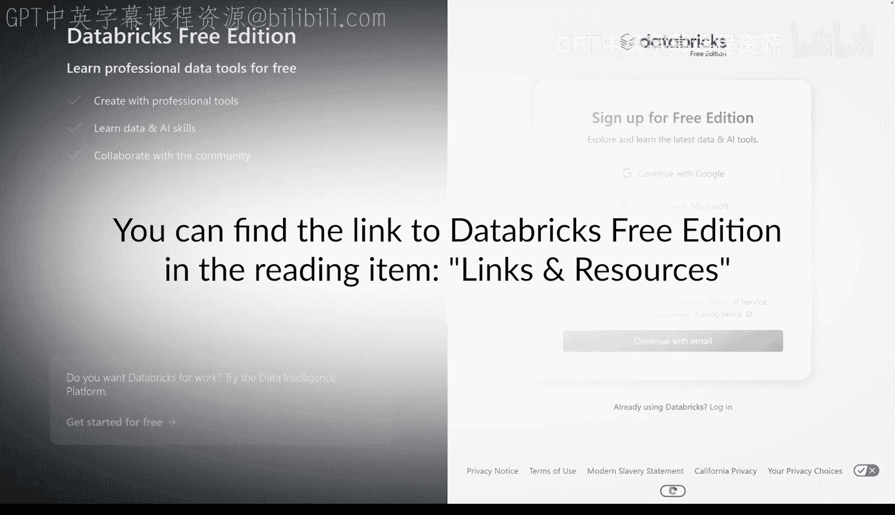
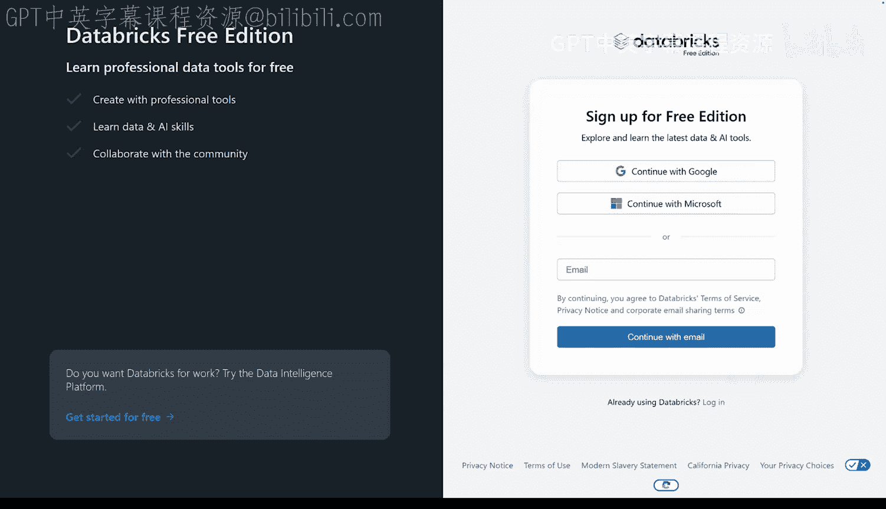

# 吴恩达《治理AI智能体｜Governing AI Agents》中英字幕 - P4：4.adding-identity-to-an-agent.zh_en - GPT中英字幕课程资源 - BV1GXyhBWE6h

When you deploy your agent， you need to make sure it has the right permissions to access only the data it needs in this lesson。

 you'll learn what databricks identity you need to assign to your agent so that it has the appropriate permissions。

 Allright， let's get to it。 There are three main types of identities for databricks。

 There are your users。 This is your user identities recognized by databricks and they're represented by your email address。

 service principles are to be used with jobs， automated tools and systems such as scripts。

 apps and CicCd platforms， and then you have your groups So groups simplify identity management。

 making it easier to assign access to workspaces， data and other seable objects。

 So your groups can have sets of users they can have service principles all assigned to them and that way you can just give access to a group。

 if you're giving access to data to models anything you want to be able to grant permissions on。

 you can give it access to this entire group。Of users and service principles， for example。

 if you make a group of developers and they need broad access。

 you can grant it easily instead of doing it one by one there are also administrative roles that can manage Databricks identities so this is your account admin the highest level they can add users add service principles and groups to accounts and assign admin roles Workspace admins add users and service principles to accounts and they can grant access to workspaces so your group managers those groups we just talked about can manage the permissions within that group and assign group manager roles and then you have your service principal managers so they manage the roles on those service principles。

And those are identities for users， but what about identity management for agents。

 It's a challenge because an agent needs their own identity。

 an agent needs to run automated tasks and it needs access to data in order to do so and using a human admin credential will create security and audit risk so they need consistent identity regardless of who triggers the agent a solution to this is by creating a service principle so that when you run an agent you run it with the credentials of a service principle so you'd first create this dedicated service principle for each agent。

 you'd grant minimum required unity catalog permissions for that service principle or if that service principle is in a group。

 make sure the permissions matchup， and then you deploy the agent with specific identity context。

The authentication options for agents steering deployments are one automatic authentication pass through or system authentication。

 so the agent service principle gets automatic access to declared resources So this means it's the same identity regardless of who calls it it has managed credentials automatically and this is most common if you're building an agent as a POC or as a demo2 on behalf of user authentication so agents use the end user' credentials so has the caller's identity it's good for user specific sensitive data access and this requires specific API scopes if you need to validate your identity and you can only be a real human user in order to do that you would be able to validate that with the caller's identity So that's on behalf of user authentication and the third is manual authentication so this is where you have a pre-created service principle with specific permissions。

What some orgs refer to as centralized identity management。

 this is very common for companies that put a lot of systems into production because there's no on the flyly service principle creation。

 and for this lab since it's what we see very commonly for models in production and now for what we're seeing agents going into production use is manual authentication so we are going to pre-create the service principle with specific permissions and this will create a centralized identity management so that we can deploy the agent with their credentials of the service principle and you'll see that in the following labs with manual authentication。

 we are going to first in lab1， create the service principle。

 we're also going to create a group of developers and add the service principle to that group。

 we are going to make sure that group has very specific permission so that when we develop the agent in lab2 and deploy the agent in lab3。

 we are going to end up deploying the agent with their credentials of the service principle。

Before we dive into this lab， if you'd like to follow along。

 you can create a Dataricks free Ed account and follow along with me on the lab steps When you create a Dataricks free Ed account。

 you will have both admin privileges so account admin as well as Workspace admin but just so you know the Ac admin Council is locked so you won't have account admin privileges and this is just because it is a free edition now let's get started。

